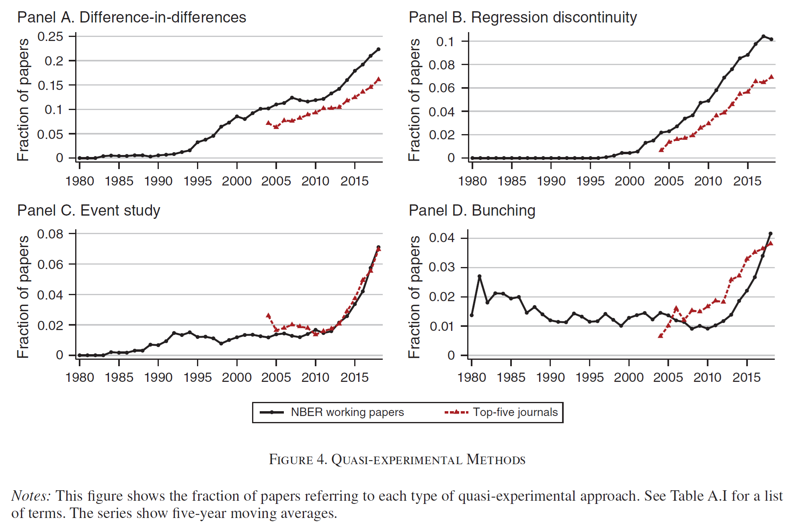
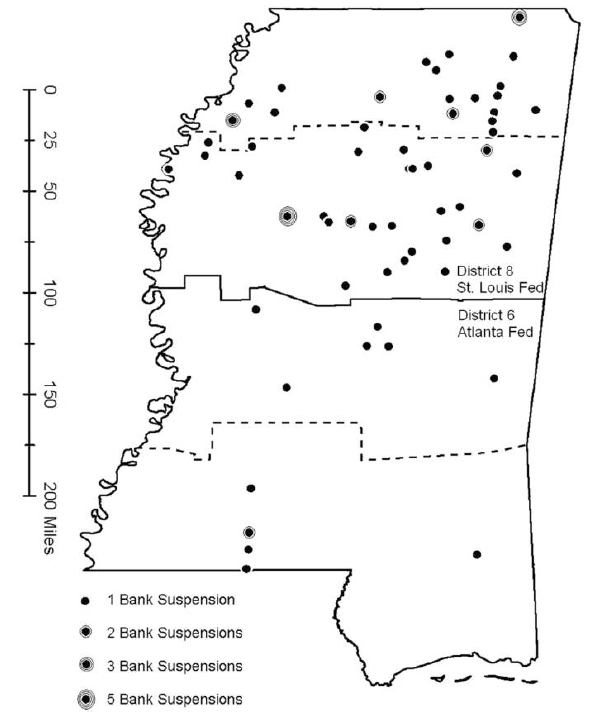
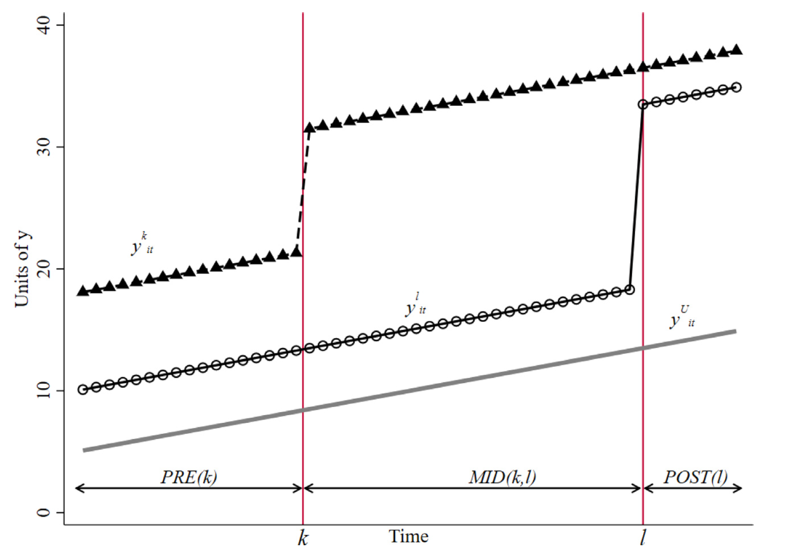
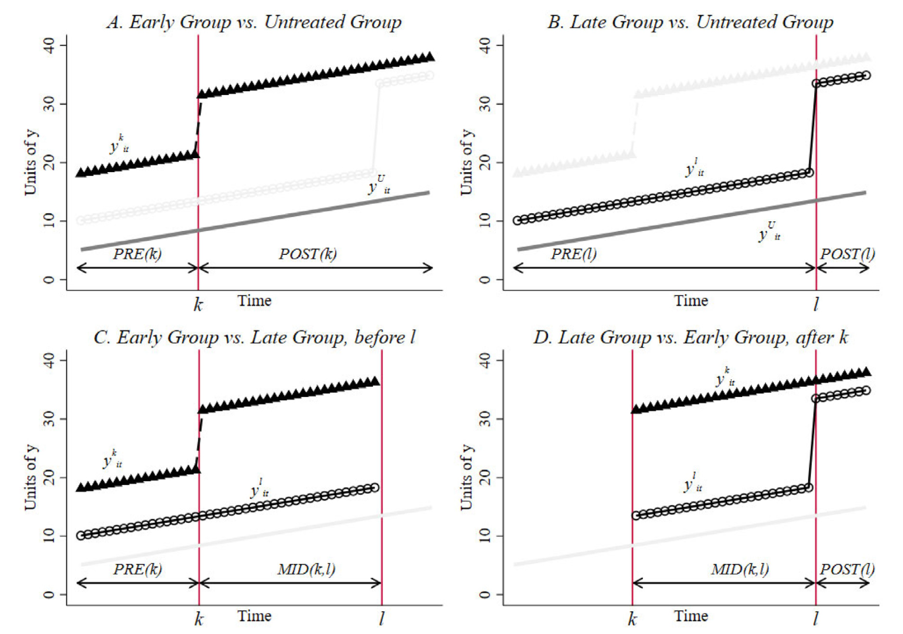

---
format:
  revealjs:
    theme: ["./theme-ic.scss"]
    width: 1600
    height: 900
    slide-number: c/t
    center: false
    scrollable: false
    title-slide: false
    logo: logo-CIDE.jpg
    footer: "Inferencia Causal · Diferencia en diferencias"
    include-in-header:
      - _ic-header.html
      - fontawesome.html
---


```{r setup, include=FALSE}
knitr::opts_chunk$set(echo = FALSE, fig.path = "figures/")

library(tidyverse)
library(modelsummary)
library(kableExtra)
library(lfe)


xfun::pkg_load2(c('base64enc', 'htmltools', 'mime'))

# Leyenda dentro del panel para que el gráfico use todo el ancho de la columna
theme_update(legend.position = "inside",
             legend.position.inside = c(0.98, 0.98),
             legend.justification = c(1, 1))
```


# Diferencia en diferencias {.portada background-color="#163D34" data-state="nochrome"}

::: {.pa-eyebrow}
Inferencia Causal
:::

[Irvin Rojas]{.pa-name} <span class="pa-icons"><a href="https://github.com/rojasirvin" target="_blank" aria-label="GitHub"><i class="bi bi-github"></i></a> <a href="https://scholar.google.com/citations?hl=es&user=FUwdSTMAAAAJ&view_op=list_works&sortby=pubdate" target="_blank" aria-label="Google Scholar"><i class="bi bi-mortarboard-fill"></i></a> <a href="mailto:irvin.rojas@cide.edu" aria-label="Correo"><i class="bi bi-envelope-fill"></i></a></span>

::: {.pa-inst}
Centro de Investigación y Docencia Económicas<br>Maestría en Economía
:::

```{css}
/* Láminas con código a la izquierda y gráfico a la derecha: código más grande
   que el del tema, con interlineado más compacto para que quepa */
.reveal .codigo-figura div.sourceCode pre code.sourceCode { font-size: 1.2em !important; line-height: 1.35; max-height: none !important; }
.reveal .codigo-figura div.sourceCode pre { max-height: none !important; }
```


# Diferencia en diferencias {.divider background-color="#9B2247" data-state="nochrome"}

## Motivación

- Diferencia en diferencias especifica las condiciones bajo las cuales es posible identificar el efecto del tratamiento al comparar unidades tratadas y no tratadas, cuando se dispone de información antes y después de la intervención

- Esta estrategia es ampliamente utilizada para analizar el efecto de leyes y políticas que afectan a un grupo de individuos al mismo tiempo

- Además, constituye el fundamento para otro de los métodos en donde la investigación actual es muy activa, el control sintético

- El supuesto fundamental es el de **tendencias paralelas**, que significa que podemos aprender sobre la trayectoria que hubieran seguido las unidades tratadas a partir de la trayectoria que siguieron las unidades no tratadas

- DID se popularizó en la década de los 2000 y ha tenido un fuerte *segundo aire* en los 2020 para el análisis de tratamientos con adopción escalonada

## Métodos cuasiexperimentales en economía

{fig-align="center" width="62%"}

::: {.aside}
Fuente: Currie, Kleven & Zwiers (2020).
:::

## Ejemplo: corridas bancarias


:::: {.columns}

::: {.column width="50%"}
- Angrist & Pischke (2014) describen lo sucedido con el sector bancario en Mississippi durante la Gran Depresión

- En EUA, la FED tiene 12 bancos regionales y cada uno tiene autonomía para tomar ciertas decisiones de política monetaria

- En particular, Mississippi tiene una parte del estado bajo el mando del distrito 6 (Atlanta) y la otra parte en el distrito 8 (San Luis)
:::

::: {.column width="50%"}
```{r}
#| echo: false
#| out.width: "80%"
#| fig-align: center

```
:::

::::

::: {.aside}
Fuente: Richardson & Troost (2009).
:::


## Ejemplo: corridas bancarias

- Como respuesta a las corridas bancarias que caracterizaron la crisis de 1929, los bancos comerciales en Mississippi se vieron expuestos a dos políticas distintas

$$
D=
\begin{cases}
1\quad\quad \text{proveer liquidez adicional (distrito 6)} \\
0\quad\quad \text{dar igual o menos liquidez (distrito 8)} \\
\end{cases}
$$


- Si estamos interesados en la cantidad de bancos que sobrevivieron y decir algo sobre qué política es más efectiva, ¿qué podemos hacer?

- Una primera respuesta sería contar la diferencia después de la crisis:

```{r}
#| label: tabla-bancos-1931

d8 <- c("\\(D=0\\)", "132 bancos")
d6 <- c("\\(D=1\\)", "121 bancos")
dif <- c("", "-11 bancos")

tabla_bancos <- data.frame(cbind(d8, d6, dif))

tabla_bancos |>
  kbl(col.names = c("Distrito 8", "Distrito 6", "Diferencia"),
      align = "ccc",
      escape = FALSE) |>
  kable_paper(c("hover", "condensed", "responsive"),
              full_width = FALSE)
```


- Pareciera que la política de proveer liquidez, *easy money*, **causó** que quebraran más bancos

- Sin embargo, esta comparación claramente ignora las condiciones iniciales


## Representación gráfica {.codigo-figura}

- Gráficamente observamos

```{r}
#| echo: true
#| output-location: column
#| fig-width: 5
#| fig-height: 4.6
#| out-width: "100%"

banks <- read_csv("banks_mm.csv",
                  locale = locale(encoding = "latin1"))

banks <- banks |>
  filter(month(date) == 7L, mday(date) == 1L) |>
  mutate(year = year(date)) |>
  select(year, bib6, bib8) |>
  pivot_longer(c(bib6, bib8), names_to = "distrito",
               values_to = "banks") |>
  arrange(distrito, year) |>
  mutate(treatment = ifelse(distrito == "bib6", 1, 0),
         post = ifelse(year >= 1931, 1, 0))

banks |>
  mutate(banks = ifelse(year == 1930 | year == 1931,
                        banks, NA)) |>
  filter(year <= 1932) |>
  ggplot(aes(year, banks, color = distrito)) +
  geom_line(linewidth = 2) +
  scale_y_continuous(limits = c(100, 180)) +
  labs(x = "Año", y = "Bancos abiertos",
       color = "Distrito")
```

## Representación gráfica

- Del distrito 8 (no tratado) podemos obtener la pendiente:

$$m_{8}=\frac{Y_{8,post}-Y_{8,pre}}{X_{8,post}-X_{8,pre}}=\frac{132-165}{1931-1930}=-33$$

donde $X_{d,pre}$ y $X_{d,post}$ son los años

- Y entonces, podemos encontrar cuál hubiera sido el número de bancos en el distrito 6 (tratado) si hubiera seguido la pendiente del distrito 8:

$$m_{6}=\frac{\tilde{Y}_{6,post}-Y_{6,pre}}{X_{6,post}-X_{6,pre}}=\frac{\tilde{Y}_{6,post}-135}{1931-1930}=-33$$

- Por tanto, $\tilde{Y}_{6,post}=102$ es el número de bancos que el distrito 6 hubiera tenido si hubiera seguido una tendencia paralela a la del distrito 8


## Representación gráfica {.codigo-figura}

- Podemos construir el contrafactual para el distrito 6 observando la pendiente del distrito 8

```{r}
#| echo: true
#| output-location: column
#| fig-width: 5
#| fig-height: 4.6
#| out-width: "100%"

banks_cf <- banks |>
  mutate(banks = ifelse(year == 1930 | year == 1931,
                        banks, NA)) |>
  filter(year <= 1932) |>
  mutate(tipo = "observado")

d6_cf <- banks_cf |>
  filter(distrito == "bib6") |>
  mutate(banks = ifelse(year == 1931, 102, banks),
         tipo = "contrafactual")

banks_cf <- rbind(banks_cf, d6_cf)

banks_cf |>
  ggplot(aes(year, banks,
             color = distrito, linetype = tipo)) +
  geom_line(linewidth = 2) +
  scale_linetype_manual(values = c("dashed", "solid")) +
  scale_y_continuous(limits = c(100, 180)) +
  labs(x = "Año", y = "Bancos abiertos",
       color = "Distrito", linetype = "Tipo")
```


## Un estimador de DID

- Podemos dar así una primera definición de lo que es la diferencia en diferencias del número de bancos que sobrevivieron a la Gran Depresión en Mississippi

$$
\begin{aligned}
\hat{\delta}_{DID}&=(Y_{6,post}-Y_{6,pre})-(Y_{8,post}-Y_{8,pre}) \\
&=(Y_{6,1931}-Y_{6,1930})-(Y_{8,1931}-Y_{8,1930}) \\
&=(121-135)-(132-165) \\
&=-14+33 = 19
\end{aligned}
$$

- El estimador de DID toma en cuenta las diferencias iniciales. El distrito 8 ya tenía más bancos abiertos que el 6 antes de la crisis

- DID construye un contrafactual para las unidades tratadas usando la pendiente de las no tratadas


## DID en el diseño $2\times 2$

**Definiciones**

- $t\in\{1,2\}$ periodos
- $D_i=
\begin{cases}
1\quad\quad \text{si $i$ es tratado} \\
0\quad\quad \text{si $i$ no es tratado} \\
\end{cases}
$
- El tratamiento ocurre entre los periodos 1 y 2
- $Y_{it}$ es la variable de resultados observada
- Datos en panel con $i=1,\ldots,N$ unidades (puede adaptarse a secciones cruzadas repetidas)
- $Y_{it}(0)$ y $Y_{it}(1)$ son los resultados potenciales bajo cada valor del tratamiento
- Estimamos el ATT (*average treatment effect on the treated*):
$$ATT=E(Y_2(1)-Y_2(0)|D=1)$$

- $Y_2(0)$ no es observado para el grupo con $D=1$
- Callaway & Sant’Anna (2021) y Roth, Sant’Anna, Bilinski & Poe (2023) usan ATT mientras que CA usa ATET

## Supuestos

**Supuesto 1**: tendencias paralelas

- El cambio promedio en la variable de resultados entre los grupos tratados y no tratados habría sido el mismo en ausencia del tratamiento

$$E(Y_2(0) - Y_1(0) | D = 1) = E(Y_2(0) - Y_1(0) | D = 0)$$

**Supuesto 2**: no anticipación

- Las unidades que aún no son tratadas no anticipan que lo van a ser, por lo que el tratamiento no afecta el resultado potencial pre intervención

$$Y_{i1}(0) = Y_{i1}(1) \quad \forall \quad \text{$i$ con $D_i = 1$}$$

**Supuesto 3**: SUTVA


## DID resuelve el problema contrafactual

- Reacomodando los términos del supuesto de tendencias paralelas para expresar $E(Y_2(0)| D = 1)$ (lo que no vemos):

$$E(Y_2(0)|D=1)=E(Y_1(0)|D=1)+E(Y_2(0)-Y_1(0)|D=0)$$

- Por no anticipación, $E(Y_1(0)|D=1)=E(Y_1(1)|D=1)$, entonces:

$$
\begin{aligned}
E(Y_2(0)|D=1)&=E(Y_1(1)|D=1)+E(Y_2(0)-Y_1(0)|D=0) \\
&=E(Y_1|D=1)+E(Y_2-Y_1|D=0)
\end{aligned}
$$

- Sustituyendo en la definición del ATT:

$$ATT=\underbrace{E(Y_2-Y_1|D=1)}_{\text{cambio para } D=1}-\underbrace{E(Y_2-Y_1|D=0)}_{\text{cambio para } D=0}$$

## DID resuelve el problema contrafactual

- La expresión para el $ATT$ puede ser reescrita como:

$$ATT=\underbrace{(E(Y_2|D=1)-E(Y_2|D=0))}_{\text{diferencia entre grupos en $t=2$}}-\underbrace{(E(Y_1|D=1)-E(Y_1|D=0))}_{\text{diferencia
entre grupos en $t=1$}}$$


## Estimador de DID con diferencias de medias

- Las ecuaciones anteriores expresan el $ATT$ como una diferencia en diferencias de esperanzas poblacionales

- Una forma natural de estimarlo es reemplazar las esperanzas por sus análogos muestrales. Siguiendo la primera expresión para el $ATT$, podemos estimar:

$$\widehat{ATT}=(\bar{Y}_{t=2,D=1}-\bar{Y}_{t=1,D=1})-(\bar{Y}_{t=2,D=0}-\bar{Y}_{t=1,D=0})$$

donde $\bar{Y}_{t=t',D=d}$ es la media muestral de $Y$ para el grupo $d$ en el periodo $t'$

## Estimador de DID con regresión

- La forma más común de implementar la estimación por DID es usando una regresión

- Definimos $POST_t=\mathbf{1}(t=2)$

$$Y_{it}=\alpha+\beta D_i+\gamma POST_t+\delta_{DID}(D_i\times POST_t)+\varepsilon_{it}$$

- Las medias condicionales de cada grupo y periodo son:

```{r}
#| label: tabla-medias-regresion

tabla_medias <- tibble(
  grupo = c("\\(D=0\\)", "\\(D=1\\)", "Diferencia"),
  t1 = c("\\(\\alpha\\)", "\\(\\alpha+\\beta\\)", "\\(\\beta\\)"),
  t2 = c("\\(\\alpha+\\gamma\\)",
         "\\(\\alpha+\\beta+\\gamma+\\delta_{DID}\\)",
         "\\(\\beta+\\delta_{DID}\\)"),
  dif = c("\\(\\gamma\\)", "\\(\\gamma+\\delta_{DID}\\)",
          "\\(\\delta_{DID}\\)"))

tabla_medias |>
  kbl(col.names = c("", "\\(t=1\\)", "\\(t=2\\)", "Diferencia"),
      align = "cccc",
      escape = FALSE) |>
  kable_paper(c("hover", "condensed", "responsive"),
              full_width = FALSE)
```

## Estimador de DID con regresión

- Lo que la regresión identifica
  - $\alpha=E(Y_1|D=0)$
  - $\beta=E(Y_1|D=1)-E(Y_1|D=0)$
  - $\gamma=E(Y_2|D=0)-E(Y_1|D=0)$
  - $\delta_{DID}=(E(Y_2|D=1)-E(Y_1|D=1))-(E(Y_2|D=0)-E(Y_1|D=0))$

- Si se cumplen los **supuestos 1, 2 y 3**, $\delta_{DID}=ATT$

- La ventaja de usar regresión es que obtenemos errores estándar y podemos añadir covariables (con cuidado)

## DID con regresión gráficamente {.codigo-figura}

```{r}
#| echo: true
#| output-location: column
#| fig-width: 5
#| fig-height: 4.6
#| out-width: "100%"

medias <- tibble(
  t = rep(1:2, 3), Y = c(2, 3, 4, 7, 4, 5),
  Grupo = rep(c("D=0", "D=1", "D=1 sin tratamiento"),
              each = 2))
medias |>
  ggplot(aes(t, Y, color = Grupo, linetype = Grupo)) +
  geom_line(linewidth = 1.5) +
  annotate("segment", x = 1, xend = 2.05,
           y = 2, yend = 2, linetype = "dotted") +
  annotate("segment", x = c(0.95, 2.05, 2.05),
           xend = c(0.95, 2.05, 2.05),
           y = c(2, 2, 5), yend = c(4, 3, 7),
           arrow = arrow(ends = "both",
                         length = unit(0.1, "in"))) +
  annotate("text", x = c(1, 0.89, 2.13, 2.18),
           y = c(1.7, 3, 2.5, 6), parse = TRUE, size = 6,
           label = c("alpha", "beta", "gamma",
                     "delta[DID]")) +
  scale_color_manual(values = c("grey40", "darkred",
                                "darkred")) +
  scale_linetype_manual(values = c(1, 1, 2)) +
  scale_x_continuous(breaks = 1:2,
                     limits = c(0.85, 2.3)) +
  labs(x = "Periodo", y = "E(Y)") +
  theme(legend.position = "bottom")
```


## Múltiples unidades y periodos pre y post tratamiento

- Como en el ejemplo de las corridas bancarias, donde tenemos datos sobre el número de bancos en cada distrito en cada año (1929-1934), podemos tener varias observaciones pre y post intervención

- También podemos tener múltiples unidades en los grupos tratado y no tratado

- Podemos generalizar la regresión sustituyendo las dummies por efectos fijos:

$$Y_{it}=\alpha_i+\lambda_t+\delta_{DID}(D_i\times POST_t)+\varepsilon_{it}$$

- $\alpha_i$: **efectos fijos individuales** (sustituyen a $\alpha+\beta D_i$), diferencias entre unidades que no cambian en el tiempo

- $\lambda_t$: **efectos fijos de periodo** (sustituyen a $\gamma POST_t$), choques comunes a todas las unidades

- $D_i\times POST_t$: **término de interacción**, con $POST_t=\mathbf{1}(t\geq t_0)$ y $t_0$ el primer periodo tratado

- $\delta_{DID}$ es el efecto de tratamiento

- Si hay varios puntos pre intervención, el supuesto de tendencias paralelas para ese subperiodo puede evaluarse empíricamente


## Ejemplo: corridas bancarias con regresión


:::: {.columns}

::: {.column width="50%"}
- Usemos los datos del archivo [banks_mm.csv](banks_mm.csv) que se utilizan en MM

- Es una forma muy básica de datos en panel: cada fila representa un distrito en un periodo de tiempo

- Podemos identificar si cada fila pertenece a un distrito tratado o no o a un periodo posterior al tratamiento o no
:::

::: {.column width="50%"}
```{r}
#| label: tabla-panel-bancos

banks |>
  kbl(align = "ccccc") |>
  kable_paper(c("hover", "condensed", "responsive"),
              full_width = FALSE,
              font_size = 22)
```
:::

::::


## Ejemplo: corridas bancarias con regresión

- Estimamos $Y_{it}=\alpha+\beta D_i+\gamma POST_t+\delta_{DID}(D_i\times POST_t)+\varepsilon_{it}$, con $POST_t=\mathbf{1}(t\geq 1931)$

```{r}
#| echo: true
#| output-location: column

did_bank <- lm(banks ~ treatment*post,
               data = banks)

modelsummary(list("Bancos abiertos" = did_bank),
             coef_map = c("treatment",
                          "post",
                          "treatment:post",
                          "(Intercept)"),
             gof_map = c("nobs"),
             stars = c('*' = .1,
                       '**' = .05,
                       '***' = 0.01))
```


## Ejemplo: corridas bancarias con regresión

- Noten que si solo usamos dos años, obtenemos exactamente lo que obtendríamos haciendo las diferencias *a mano*

$$\hat{\delta}_{DID}=(Y_{6,1931}-Y_{6,1930})-(Y_{8,1931}-Y_{8,1930})=19$$

```{r}
#| echo: true
#| output-location: column

did_bank2 <- lm(banks ~ treatment*post,
                data = filter(banks,
                              year == 1930 | year == 1931))

# Cuatro observaciones y cuatro coeficientes:
# no hay errores estándar
modelsummary(list("Bancos abiertos" = did_bank2),
             coef_map = c("treatment",
                          "post",
                          "treatment:post",
                          "(Intercept)"),
             statistic = NULL,
             gof_map = c("nobs"))
```


## Relajación de los supuestos


:::: {.columns}

::: {.column width="50%"}

- En estos ejemplos hipotéticos asumimos un tratamiento que ocurre en 1975

- Este gráfico muestra un caso de tendencias paralelas

- El estimador de DID captura correctamente el salto por encima de la tendencia en la unidad tratada 
:::

::: {.column width="50%"}
```{r}
#| fig-width: 6
#| fig-height: 4.8
#| out-width: "100%"

# Trayectorias hipotéticas: la no tratada es la misma en los tres ejemplos
tendencias <- tibble(year = 1970:1985) |>
  mutate(no_tratada = 81 + (year - 1970),
         tratada_1 = 91 + (year - 1970) + 7 * (year >= 1975),
         tratada_2 = 92 + 2 * (year - 1970),
         tratada_3 = 92 + 2 * (year - 1970) + 7 * (year >= 1975))

grafica_tendencias <- function(tratada) {
  tendencias |>
    select(year, "No tratada" = no_tratada, "Tratada" = {{ tratada }}) |>
    pivot_longer(-year, names_to = "unidad", values_to = "tasa") |>
    ggplot(aes(year, tasa, color = unidad)) +
    geom_line(linewidth = 1.5) +
    geom_vline(xintercept = 1975, linetype = "dashed") +
    geom_text(data = \(d) filter(d, year == 1980),
              aes(label = unidad), nudge_y = -4, size = 6) +
    scale_color_manual(values = c("grey50", "black")) +
    labs(x = "Año", y = "Tasa de mortalidad (por 100,000)") +
    theme(legend.position = "none")
}

grafica_tendencias(tratada_1)
```

:::

::::


## Relajación de los supuestos


:::: {.columns}

::: {.column width="50%"}
```{r}
# DID con los mismos datos de la gráfica: dos unidades observadas de 1970 a 1985
datos_tendencias <- function(tratada) {
  tendencias |>
    select(year, "0" = no_tratada, "1" = {{ tratada }}) |>
    pivot_longer(-year, names_to = "D", values_to = "tasa") |>
    mutate(D = as.numeric(D),
           post = as.numeric(year >= 1975),
           t = year - 1970)
}

did_tendencias <- function(tratada) {
  datos <- datos_tendencias({{ tratada }})

  modelsummary(list("Tasa de mortalidad" = lm(tasa ~ D*post, data = datos)),
               coef_map = c("D:post" = "δ (D × POST)"),
               statistic = NULL,
               gof_map = c("nobs"))
}

did_tendencias(tratada_1)
```
:::

::: {.column width="50%"}
```{r}
#| fig-width: 6
#| fig-height: 4.8
#| out-width: "100%"

grafica_tendencias(tratada_1)
```

:::

::::


## Relajación de los supuestos


:::: {.columns}

::: {.column width="50%"}
- En este segundo ejemplo, el supuesto de tendencias paralelas pre intervención se viola

- La línea de la unidad tratada es más inclinada en todos los periodos y estimar esta relación por DID de nuevo atribuiría a la política la diferencia de tendencias que ya existía antes de la intervención


:::

::: {.column width="50%"}
```{r}
#| fig-width: 6
#| fig-height: 4.8
#| out-width: "100%"

grafica_tendencias(tratada_2)
```


:::

::::


## Relajación de los supuestos


:::: {.columns}

::: {.column width="50%"}
```{r}
did_tendencias(tratada_2)
```
:::

::: {.column width="50%"}
```{r}
#| fig-width: 6
#| fig-height: 4.8
#| out-width: "100%"

grafica_tendencias(tratada_2)
```

:::

::::


## Relajación de los supuestos

:::: {.columns}

::: {.column width="50%"}
- En este tercer ejemplo hay tendencias que no son paralelas pre tratamiento

- La pendiente para la unidad tratada es mayor que la de la no tratada en todos los periodos

- Aquí DID detectaría un efecto, pero sobreestimado, pues al salto en la unidad tratada le sumaría la brecha que de todos modos se iba abriendo por tener una tendencia más inclinada que la de la no tratada

- Una forma de separar ambas cosas es incluir tendencias específicas por unidad:

$$
\begin{aligned}
Y_{it}=&\alpha+\beta D_i+\gamma POST_t + \theta t \\
&+ \rho (D_i\times t) + \delta_{DID}(D_i\times POST_t)+\varepsilon_{it}
\end{aligned}
$$
:::

::: {.column width="50%"}
```{r}
#| fig-width: 6
#| fig-height: 4.8
#| out-width: "100%"

grafica_tendencias(tratada_3)
```


:::

::::


## Relajación de los supuestos


:::: {.columns}

::: {.column width="50%"}
```{r}
datos <- datos_tendencias(tratada_3)

modelsummary(list("DID simple" = lm(tasa ~ D*post, data = datos),
                  "Con tendencias" = lm(tasa ~ D*post + t + D:t, data = datos)),
             coef_map = c("D:post" = "δ (D × POST)",
                          "D:t" = "ρ (D × t)",
                          "t" = "θ (t)"),
             statistic = NULL,
             gof_map = c("nobs"))
```
:::

::: {.column width="50%"}
```{r}
#| fig-width: 6
#| fig-height: 4.8
#| out-width: "100%"

grafica_tendencias(tratada_3)
```

:::

::::


## Inferencia

- Estamos nuevamente ante un diseño con posible presencia de errores agrupados

- La dimensión relevante ahora es $i$ pues es muy probable que haya características no observadas de las unidades que presentan *correlación serial*

- Con suficientes unidades, podemos usar los resultados de la matriz de varianza agrupada, donde el nivel de agrupación es ahora $i$

- En general, cuando trabajamos con datos en panel, lo relevante es que $N$ sea lo suficientemente grande para usar teoría asintótica (y no solo $NT$)

- Bertrand, Duflo & Mullainathan (2004) analizan 92 artículos de DID y encuentran que la mayoría no reconoce el problema de correlación serial, por lo que subestiman los errores estándar estimados

- En la actualidad, en el trabajo empírico se pone énfasis en la correcta estimación de la matriz de varianzas usando resultados asintóticos o bootstrap por bloques en el caso de tener pocos grupos o *clusters*


## Ejemplo clásico: cambios al salario mínimo

- Card & Krueger (1994) estudian el efecto del incremento del salario mínimo (de 4.25 a 5.05 dólares por hora en abril de 1992)

- El cambio ocurrió en Nueva Jersey y se emplea a la vecina Pensilvania como no tratada

- Encuestaron a los mismos restaurantes de comida rápida en ambos estados antes y después del cambio al salario mínimo y compararon el empleo equivalente de tiempo completo (FTE)

:::: {.columns}

::: {.column width="50%"}
```{r}
#| label: tabla-card-krueger

tabla_ck <- tibble(
  variable = c("FTE antes", "", "FTE después", "", "Cambio en FTE", ""),
  pa = c("23.33", "(1.35)", "21.17", "(0.94)", "-2.16", "(1.25)"),
  nj = c("20.44", "(0.51)", "21.03", "(0.52)", "0.59", "(0.54)"),
  dif = c("-2.89", "(1.44)", "-0.14", "(1.07)", "2.76", "(1.36)"))

tabla_ck |>
  kbl(col.names = c("", "PA", "NJ", "NJ - PA"),
      align = "lccc") |>
  kable_paper(c("hover", "condensed", "responsive"),
              full_width = FALSE, font_size = 22) |>
  footnote(general = "Errores estándar entre paréntesis. Fuente: adaptado de la tabla 3 de Card & Krueger (1994).",
           general_title = "Nota: ",
           footnote_as_chunk = TRUE)
```
:::

::: {.column width="50%"}
```{r}
#| label: figura-card-krueger
#| fig-width: 6
#| fig-height: 4
#| out-width: "100%"

ck <- tibble(
  mes = rep(1:2, 3),
  fte = c(23.33, 21.17, 20.44, 21.03, 20.44, 18.28),
  Grupo = rep(c("Pensilvania", "Nueva Jersey",
                "Nueva Jersey sin tratamiento"), each = 2))

ck |>
  ggplot(aes(mes, fte, color = Grupo, linetype = Grupo)) +
  geom_vline(xintercept = 1.5, color = "grey60") +
  geom_line(linewidth = 1.5) +
  geom_point(size = 3) +
  annotate("segment", x = 1, xend = 2.05,
           y = 23.33, yend = 23.33, linetype = "dotted") +
  annotate("segment", x = c(0.95, 2.05, 2.05),
           xend = c(0.95, 2.05, 2.05),
           y = c(20.44, 21.17, 18.28), yend = c(23.33, 23.33, 21.03),
           arrow = arrow(ends = "both",
                         length = unit(0.1, "in"))) +
  annotate("text", x = c(1, 0.89, 2.12, 2.12),
           y = c(23.75, 21.9, 22.25, 19.65), parse = TRUE, size = 6,
           label = c("alpha", "beta", "gamma", "delta[DID]")) +
  annotate("text", x = 1.52, y = 17.6, label = "Aumento del salario mínimo",
           color = "grey40", size = 3.5, hjust = 0) +
  scale_color_manual(values = c("darkred", "darkred", "grey40")) +
  scale_linetype_manual(values = c(1, 2, 1)) +
  scale_x_continuous(breaks = 1:2,
                     labels = c("Febrero 1992", "Noviembre 1992"),
                     limits = c(0.85, 2.2)) +
  labs(x = NULL, y = "FTE promedio", color = NULL, linetype = NULL) +
  theme(legend.position = "bottom",
        text = element_text(size = 14))
```
:::

::::


# Adopción escalonada {.divider background-color="#9B2247" data-state="nochrome"}

## Adopción escalonada en la *antigüedad*

- DID es uno de esos campos tan activos en la investigación que cosas que pensábamos superadas o completamente estudiadas se han modificado en los últimos años

- En esta sección mostramos el tratamiento que MHE y MM dan a los problemas de adopción escalonada

- La adopción escalonada ocurre cuando existen varios periodos de tratamiento y algunas unidades van siendo tratadas de forma desfasada

- En México, las leyes de despenalización del aborto o las que reconocen las uniones entre personas del mismo sexo son buenos ejemplos de tratamientos con adopción escalonada

- Hasta los trabajos de Goodman-Bacon (2021), Borusyak, Jaravel & Spiess (2024) y de Chaisemartin & D’Haultfœuille (2020), los problemas con adopción escalonada se abordaban econométricamente de la misma forma que hemos descrito hasta ahora, conocida como efectos fijos bidireccionales o *two-way fixed effects*

- Esta sección presenta el tipo de tratamiento que hoy ya consideramos inapropiado

- Más adelante se presentan alternativas para los problemas de adopción escalonada


## Ejemplo: edad legal para beber en EUA

- Diferencias en la edad legal para beber en Estados Unidos

- ¿Las restricciones a la edad mínima para comprar alcohol tienen un impacto en la mortalidad?

- Alabama redujo la edad legal a 19 en 1975, mientras que, por ejemplo, Arkansas mantuvo la edad en 21

- Podemos definir $LEGAL_{st}$ como la proporción de individuos de entre 18 y 20 años autorizados para beber en el estado $s$ y en el año $t$

$$Y_{st}=\alpha+\delta_{DID}LEGAL_{st}+\sum_k\beta_k STATE_{ks}+\sum_j \gamma_j YEAR_{jt}+\varepsilon_{st}$$


## Estructura de datos en panel

- Los datos que acabamos de describir tienen una estructura de panel

- La variable de panel es el estado $s$ y la variable de tiempo es el año $t$

- En nuestros datos, cada estado se encuentra presente en varios años, y para cada estado y año sabemos la mortalidad y la fracción de personas de 18 a 20 años que pueden beber

- **Efectos fijos** $STATE_{ks}$: diferencias entre estados que no cambian con el tiempo

- **Efectos año** $YEAR_{jt}$: factores que afectan a todas las unidades por igual en un momento del tiempo


## Interpretación

:::: {.columns}

::: {.column width="50%"}
- La interpretación de los resultados es directa

- El acceso a alcohol causa un incremento de casi 11 muertes adicionales por cada 100,000 habitantes y este efecto es estadísticamente significativo

- No hay efectos donde no esperaríamos tenerlos
:::

::: {.column width="50%"}
```{r}
#| label: tabla-mlda

causa <- c("Todas", "", "Accidentes en vehículos", "", "Suicidio", "", "Causas internas", "")
efecto <- c("10.80", "(4.59)", "7.59", "(2.50)", "0.59", "(0.59)", "1.33", "(1.59)")

tabla_mlda <- data.frame(cbind(causa, efecto))

tabla_mlda |>
  kbl(col.names = c("Muertes por 100,000 habs.:",
                    "\\(\\hat{\\delta}_{DID}\\)"),
      align = "lc",
      escape = FALSE) |>
  kable_paper(c("hover", "condensed", "responsive"),
              full_width = FALSE)
```
:::

::::


# Descomposición de Goodman-Bacon {.divider background-color="#9B2247" data-state="nochrome"}

## ¿Qué hace el estimador de TWFE?

- Consideremos el siguiente problema de adopción escalonada

  - Observamos $T$ periodos
  - $k$ denota a las unidades tratadas temprano
  - $l$ denota a las unidades tratadas tarde
  - $\bar{D}_k$ es la fracción de los periodos en que las unidades $k$ están tratadas
  - Similarmente, $\bar{D}_l$
  - $n_k$ es la proporción de la muestra que corresponde a las unidades tratadas temprano
  - $n_l$ es la proporción de la muestra que corresponde a las unidades tratadas tarde
  - $n_U$ es la proporción de la muestra que corresponde a las unidades nunca tratadas
  - Para cualesquiera dos grupos $a$ y $b$, $n_{ab}=\frac{n_a}{n_a+n_b}$ es la proporción de $a$ en la submuestra formada por ambos

## ¿Qué hace el estimador de TWFE?

```{r}
#| echo: false
#| fig-align: center

```

::: {.aside}
Fuente: Goodman-Bacon (2021).
:::


## ¿Qué hace el estimador de TWFE?

**Cuatro posibles comparaciones $2\times 2$**

- Las comparaciones con las unidades nunca tratadas:

$$\hat{\delta}_{jU}=\left(\bar{Y}_j^{POST(j)}-\bar{Y}_j^{PRE(j)}\right)-\left(\bar{Y}_U^{POST(j)}-\bar{Y}_U^{PRE(j)}\right),\;j\in\{k,l\}$$

- La comparación entre $k$ y $l$ cuando las unidades $k$ son tratadas, usando los periodos antes de que las unidades $l$ sean tratadas

$$\hat{\delta}^{k}_{kl}=\left(\bar{Y}_k^{MID(k,l)}-\bar{Y}_k^{PRE(k)}\right)-\left(\bar{Y}_l^{MID(k,l)}-\bar{Y}_l^{PRE(k)}\right)$$

- La comparación entre $l$ y $k$ cuando las unidades $l$ son tratadas, usando los periodos después de que las unidades $k$ fueron tratadas

$$\hat{\delta}^{l}_{kl}=\left(\bar{Y}_l^{POST(l)}-\bar{Y}_l^{MID(k,l)}\right)-\left(\bar{Y}_k^{POST(l)}-\bar{Y}_k^{MID(k,l)}\right)$$

## ¿Qué hace el estimador de TWFE?

```{r}
#| echo: false
#| fig-align: center

```

::: {.aside}
Fuente: Goodman-Bacon (2021).
:::


## ¿Qué hace el estimador de TWFE?

- Denotamos $D_{it}=1$ cuando la unidad $i$ es tratada en el periodo $t$

- Por el teorema de Frisch-Waugh-Lovell sabemos que podemos *purgar* de efectos fijos a $D_{it}$

- Es decir, podemos estimar por MCO, donde $P_{\tau t}$ son dummies temporales y $S_{ji}$ son dummies individuales:

$$D_{it}=\sum_{\tau}\gamma_\tau P_{\tau t}+\sum_{j}\pi_j  S_{ji}+\varepsilon_{it}$$

- Luego obtenemos $\tilde{D}_{it}=D_{it}-\hat{D}_{it}$

- Y entonces el estimador de TWFE puede escribirse como el coeficiente de una regresión bivariada, donde $\hat{C}(\cdot,\cdot)$ es la covarianza muestral y $\hat{V}^D$ es la varianza de la variable de tratamiento *purgada* de efectos fijos:

$$\hat{\delta}_{DID}=\frac{\hat{C}(Y_{it}, \tilde{D}_{it})}{\hat{V}^D}$$


## ¿Qué hace el estimador de TWFE?

- Goodman-Bacon (2021) muestra que el estimador de TWFE puede descomponerse como:

$$\hat{\delta}_{DID}=s_{kU}\hat{\delta}_{kU}+s_{lU}\hat{\delta}_{lU}+s_{kl}^k\hat{\delta}_{kl}^k+s_{kl}^l\hat{\delta}_{kl}^l$$

con los pesos dados por:

$$
\begin{aligned}
s_{kU}&=\frac{(n_k+n_U)^2\hat{V}_{kU}^D}{\hat{V}^D} \\
s_{lU}&=\frac{(n_l+n_U)^2\hat{V}_{lU}^D}{\hat{V}^D} \\
s_{kl}^k&=\frac{[(n_k+n_l)(1-\bar{D}_l)]^2\hat{V}_{kl}^{D,k}}{\hat{V}^D} \\
s_{kl}^l&=\frac{[(n_k+n_l)\bar{D}_k]^2\hat{V}_{kl}^{D,l}}{\hat{V}^D}
\end{aligned}
$$


## ¿Qué son los pesos?

- Desarrollando varianzas del tratamiento:

$$
\begin{aligned}
s_{kU}&=\frac{(n_k+n_U)^2\hat{V}_{kU}^D}{\hat{V}^D}=\frac{(n_k+n_U)^2n_{kU}(1-n_{kU})\bar{D}_k(1-\bar{D}_k)}{\hat{V}^D} \\
s_{lU}&=\frac{(n_l+n_U)^2\hat{V}_{lU}^D}{\hat{V}^D}=\frac{(n_l+n_U)^2n_{lU}(1-n_{lU})\bar{D}_l(1-\bar{D}_l)}{\hat{V}^D} \\
s_{kl}^k&=\frac{[(n_k+n_l)(1-\bar{D}_l)]^2\hat{V}_{kl}^{D,k}}{\hat{V}^D}=\frac{[(n_k+n_l)(1-\bar{D}_l)]^2n_{kl}(1-n_{kl}) \frac{\bar{D}_k-\bar{D}_l}{1-\bar{D}_l}\frac{1-\bar{D}_k}{1-\bar{D}_l}}{\hat{V}^D} \\
s_{kl}^l&=\frac{[(n_k+n_l)\bar{D}_k]^2\hat{V}_{kl}^{D,l}}{\hat{V}^D}=\frac{[(n_k+n_l)\bar{D}_k]^2n_{kl}(1-n_{kl})\frac{\bar{D}_l}{\bar{D}_k}\frac{\bar{D}_k-\bar{D}_l}{\bar{D}_k}}{\hat{V}^D}
\end{aligned}
$$

## ¿Qué son los pesos?

- Pongamos atención a uno de los pesos, $s_{kU}$, para ver la intuición

- Vimos que:

$$s_{kU}=\frac{(n_k+n_U)^2\hat{V}_{kU}^D}{\hat{V}^D}=\frac{(n_k+n_U)^2n_{kU}(1-n_{kU})\bar{D}_k(1-\bar{D}_k)}{\hat{V}^D}$$

- Primero, noten que el peso depende de $(n_k+n_U)^2$, es decir, el cuadrado de la proporción de la muestra que se usa para estimar cada comparación $2\times 2$


## ¿Qué son los pesos?

- Ahora veamos la varianza que entra en este peso:

$$\hat{V}_{kU}^D=n_{kU}(1-n_{kU})\bar{D}_k(1-\bar{D}_k)$$

- Una primera cosa que entra en juego es $n_{kU}=\frac{n_k}{n_k+n_U}$, el peso relativo de las unidades tratadas temprano en la submuestra

- Recordemos que $\bar{D}_k$ indica la fracción del tiempo del panel que las unidades $k$ permanecen tratadas

- Dado que $D_{it}$ es binaria, $\bar{D}_k(1-\bar{D}_k)$ es la varianza de $D_{it}$ para las unidades $k$

- $\bar{D}_k(1-\bar{D}_k)$ alcanza un máximo de 0.25, es decir, la contribución se maximiza cuando el tratamiento ocurre lo más cercano a la mitad del panel ($\bar{D}_k=0.5$)

- En resumen, los pesos están dados por

$$\text{peso} = \frac{(\text{participación de la submuestra})^2(\text{varianza del tratamiento purgada de efectos fijos en la submuestra})}{\text{varianza del tratamiento purgada de efectos fijos en la muestra completa}}$$

## ¿Qué nos dice la descomposición del estimador?

- Todos los grupos funcionan como *controles* (algunas veces)

- Los pesos en cada comparación $2 \times 2$ dependen del tamaño de la muestra usada para estimarlos y del tiempo que las unidades permanecen tratadas

- El efecto estimado se modificaría solo por agregar más años al final del panel

- Los términos que dominen pueden incluso cambiar el signo del efecto estimado

- Goodman-Bacon (2021) muestra que, en general, usar TWFE solo recupera un efecto de tratamiento bajo supuestos muy fuertes, el más crucial, bajo efectos de tratamiento que no varían en el tiempo (no hay efectos dinámicos)


## ¿Qué parámetro estima TWFE?

- Hasta ahora hemos usado la descomposición de Goodman-Bacon para mostrar lo que hace el estimador de TWFE

- Ahora mostraremos bajo qué condiciones el estimador de TWFE estima el ATT

- Para ello escribimos cada comparación $2\times 2$ en términos de resultados potenciales

  - $t_i$ es el periodo en que la unidad $i$ empieza a ser tratada
  - $Y_{it}(k)$ es el resultado de $i$ en $t$ si es tratada a partir de $k$
  - $Y_{it}(0)$ es el resultado de $i$ en $t$ si no es tratada

## Efectos y tendencias por grupo

- El ATT promedio del grupo tratado en $k$ en una ventana de tiempo $W$ con $T_W$ periodos:

$$ATT_k(W)\equiv\frac{1}{T_W}\sum_{t\in W}E\left[Y_{it}(k)-Y_{it}(0)\,|\,t_i=k\right]$$

- En la práctica, $W$ serán las ventanas posteriores al tratamiento que aparecen en las comparaciones $2\times 2$ ($POST(k)$, $MID(k,l)$, $POST(l)$)

- El cambio en el resultado promedio *sin tratamiento* del grupo $k$ entre dos ventanas $W_0$ y $W_1$:

$$\Delta Y_k^0(W_1,W_0)\equiv\frac{1}{T_{W_1}}\sum_{t\in W_1}E\left[Y_{it}(0)\,|\,t_i=k\right]-\frac{1}{T_{W_0}}\sum_{t\in W_0}E\left[Y_{it}(0)\,|\,t_i=k\right]$$

## Cada comparación $2\times 2$ tiene un sesgo

- Sumando y restando los resultados sin tratamiento del grupo tratado en cada comparación $2\times 2$, el límite en probabilidad de cada una de ellas es un ATT más un sesgo por tendencias distintas:

$$
\begin{aligned}
\delta_{kU}&=ATT_k(POST(k))+\left[\Delta Y_k^0(POST(k),PRE(k))-\Delta Y_U^0(POST(k),PRE(k))\right]\\
\delta_{kl}^k&=ATT_k(MID(k,l))+\left[\Delta Y_k^0(MID(k,l),PRE(k))-\Delta Y_l^0(MID(k,l),PRE(k))\right]\\
\delta_{kl}^l&=ATT_l(POST(l))+\left[\Delta Y_l^0(POST(l),MID(k,l))-\Delta Y_k^0(POST(l),MID(k,l))\right]\\
&\quad-\left[ATT_k(POST(l))-ATT_k(MID(k,l))\right]
\end{aligned}
$$

- En las dos primeras, las tendencias paralelas solo involucran resultados sin tratamiento

- En la tercera, el control $k$ *ya está tratado*. Además de tendencias paralelas, tenemos el efecto en $k$ entre $MID(k,l)$ y $POST(l)$

## ¿Qué parámetro estima TWFE?

- Sustituyendo las tres expresiones en la descomposición, con $T$ fijo y $N$ creciendo:

$$\underset{N\to\infty}{\text{plim}}\;\hat{\delta}_{DID}=VWATT+VWCT-\Delta ATT$$

- La derivación es bastante tediosa, con algunos pasos presentados en el trabajo de Goodman-Bacon (2021)

## ¿Qué parámetro estima TWFE?

**Efecto de tratamiento promedio ponderado por varianza** (*variance-weighted ATT*): es un promedio de ATTs por grupo y ventana con pesos positivos

**Tendencias comunes ponderadas por varianza** (*variance-weighted common trends*): es un promedio de las diferencias en tendencias contrafactuales usando los mismos pesos de la descomposición

**Cambio en los efectos de tratamiento**: es el *cambio* en los efectos de tratamiento para grupos que sirven como control ya tratados

$$\Delta ATT\equiv\sum_{k\neq U}\sum_{l>k}\sigma_{kl}^l\left[ATT_k(POST(l))-ATT_k(MID(k,l))\right]$$

  - En los tres componentes los pesos $\sigma$ son los límites en probabilidad de los pesos $s$ de la descomposición


## ¿Bajo qué condiciones TWFE estima un efecto causal?

- Si se cumplen tendencias paralelas entre todos los grupos, $VWCT=0$

- Si además los efectos no cambian en el tiempo, $\Delta ATT=0$ y TWFE estima $VWATT$ (un promedio ponderado de ATTs con pesos que dependen del tamaño de cada grupo y de cuándo fue tratado)

- TWFE estima el ATT solo si el efecto es constante, $ATT_k(W)=ATT$, en cuyo caso $\Delta ATT=0$ y $VWATT=ATT$

- Si los efectos cambian en el tiempo, $\Delta ATT\neq 0$ y TWFE está sesgado respecto a $VWATT$ aunque se cumplan tendencias paralelas (usar a los ya tratados como controles resta los cambios en sus efectos)


## Otros estudios sobre TWFE en DID

- Goodman-Bacon (2021) no es el único trabajo que estudia las desventajas de usar TWFE con adopción escalonada

- de Chaisemartin & D’Haultfœuille (2020) parten de los parámetros a estimar y sus resultados son más generales en cuanto a tipos de tratamiento

- Borusyak, Jaravel & Spiess (2024) se enfocan en problemas con efectos dinámicos

- Las conclusiones de los tres apuntan en la misma dirección, es mejor considerar otro tipo de estimadores para problemas escalonados y con tipos de tratamiento más complejos

# Estimador de Callaway & Sant’Anna {.divider background-color="#9B2247" data-state="nochrome"}

## Estimador de Callaway & Sant’Anna

- El estimador de Callaway & Sant’Anna (2021) es una forma muy sencilla de explotar la información del desfase del tratamiento

- Además permite una presentación muy intuitiva de los efectos de tratamiento

- Esencialmente consiste en definir una serie de cohortes de unidades y estimar los impactos para cada cohorte

- Luego podemos agregar los impactos por cohorte o presentar la dinámica de los impactos de forma gráfica

## Definiciones


- $G_i=\min\{t:D_{it}=1\}$ es el primer periodo en que $i$ es tratado
- $G_i=\infty$ indica que $i$ nunca es tratado
- $\mathcal{G}$ es el conjunto de periodos en que alguna unidad empieza a ser tratada
- $t=1,\ldots,T$ son los periodos
- $D_{it}=1\;\forall\;t\geq G_i$ indica tratamiento absorbente

- Definamos el efecto del tratamiento al periodo $t$ para la cohorte que empezó a ser tratada en $g$:

$$ATT(g,t)=E(Y_{t}(g)-Y_{t}(\infty)|G=g)$$

- Por ejemplo, $ATT(2014,2016)$ es el efecto del tratamiento en 2016 para aquellos tratados empezando en 2014


## Supuestos

**Supuesto 1. Tendencias paralelas en el contexto escalonado**

$$E(Y_{t}(\infty)-Y_{t'}(\infty)|G=g)=E(Y_{t}(\infty)-Y_{t'}(\infty)|G=g')\quad\forall\;t\neq t',\; g\neq g'$$

- Este supuesto indica que en el estado contrafactual de nunca haber sido tratados, dos grupos tratados en dos momentos diferentes $g$ y $g'$ habrían tenido una trayectoria igual entre los periodos $t$ y $t'$

**Supuesto 1a. Tendencias paralelas en el contexto escalonado (débil)**

- Modifica el supuesto anterior pero $\forall \;t,t'\geq g_{min}-1$ donde $g_{min}=\min_i G_i$ es el primer periodo en donde alguna unidad es tratada (Callaway & Sant’Anna solo usan este supuesto más débil)

**Supuesto 2. No anticipación en el contexto escalonado**

$$Y_{it}(g)=Y_{it}(\infty)\quad \forall\;i \;\text{y}\;\forall\;t<g$$

## Estimador de Callaway & Sant’Anna

- Callaway & Sant’Anna (2021) proponen identificar:

$$ATT(g,t)=E(Y_{t}-Y_{g-1}|G=g)-E(Y_{t}-Y_{g-1}|G\in\mathcal{G}_{comp}) \quad \forall\; t\geq g$$

- Queremos comparar el valor de la variable de impacto entre el periodo $g-1$ y el $t$ para el grupo que fue tratado en $g$ con algún grupo de comparación denominado $\mathcal{G}_{comp}$ de tamaño $N_{\mathcal{G}_{comp}}$

- Sustituyendo por el análogo muestral, donde $N_g$ es el número de unidades en la cohorte $g$:

$$\widehat{ATT}(g,t)=\frac{1}{N_g}\sum_{i:\;G_i=g}(Y_{it}-Y_{i,g-1})-\frac{1}{N_{\mathcal{G}_{comp}}}\sum_{i:\;G_i\in \mathcal{G}_{comp}}(Y_{it}-Y_{i,g-1})$$

- ¿Qué es $\mathcal{G}_{comp}$?

  - $\mathcal{G}_{comp}=\{\infty \}$: aquellas unidades nunca tratadas
  - $\mathcal{G}_{comp}=\{g':g'>t \}$: aquellas unidades aún no tratadas al periodo $t$

## Reportar resultados

- Si tenemos pocos periodos y cohortes puede ser práctico reportar todos los $\widehat{ATT}(g,t)$

- También podemos construir medidas agregadas:

$$\theta = \sum_{g\in\mathcal{G}}\sum_{t=g}^{T}w(g,t)ATT(g,t)$$

**Efecto de tratamiento por duración de exposición**: $\theta(e)$, el efecto promedio $e$ periodos después del tratamiento, donde $e=t-g$ es el tiempo que transcurre desde que se realizó el tratamiento

**Efecto de tratamiento por grupo o cohorte**: $\theta(\tilde{g})$, nos permite conocer si el efecto del tratamiento es distinto para cohortes que fueron tratadas temprano o tarde

**Efecto de tratamiento acumulado**: $\theta(\tilde{t})$, es el efecto promedio por participar en el tratamiento hasta una fecha $\tilde{t}$

## Ventajas del estimador

- Toma en cuenta la heterogeneidad de los efectos de tratamiento

- Los pesos son especificados por el investigador y no mecánicamente como en TWFE

- Hace explícito el grupo de comparación (nunca tratados o aún no tratados)

## Otros estimadores

- El estimador de Callaway & Sant’Anna no es la única forma de explotar los datos de adopción escalonada

- **Sun & Abraham (2021)**: usan un enfoque de regresión de un estudio de evento con interacciones entre cohorte y tiempo relativo al tratamiento, usando como control a los nunca tratados (o a la última cohorte en ser tratada) y luego promedian los efectos por cohorte

- **de Chaisemartin & D’Haultfœuille (2026)**: comparan, periodo a periodo, a las unidades que cambian de estado de tratamiento con unidades que tenían el mismo tratamiento inicial y que aún no cambian. Permite tratamientos que se encienden y apagan o que no son binarios

- **Borusyak, Jaravel & Spiess (2024)**: estiman los efectos fijos de unidad y de tiempo solo con observaciones no tratadas, imputan $Y_{it}(0)$ para las tratadas y promedian las diferencias $Y_{it}-\hat{Y}_{it}(0)$

- **Dube, Girardi, Jordà & Taylor (2025)**: para cada horizonte $h$ realizan una regresión de $Y_{i,t+h}-Y_{i,t-1}$ sobre el inicio del tratamiento, restringiendo la muestra a unidades recién tratadas y a controles limpios (aún no tratados). Se conoce como *proyecciones locales* y es más usado en macroeconometría


# Estudios de evento {.divider background-color="#9B2247" data-state="nochrome"}

## Estudios de evento

- Los estudios de evento son una forma de brindar evidencia en favor de las tendencias paralelas

- La idea es mostrar que existe evidencia de tendencias paralelas en los **periodos pre tratamiento** y asumir que, por tanto, habría tendencias paralelas en los periodos posteriores

- Sin embargo, las tendencias paralelas en los periodos pre tratamiento no son necesarias para la identificación del ATT

- Un estudio de evento estima un coeficiente para cada periodo relativo al inicio del tratamiento

## Estudios de evento

**Definiciones**

- $t^*$: periodo en que inicia el tratamiento

- $e=t-t^*$: tiempo relativo al inicio del tratamiento, con $e=-K,\ldots,-1,0,\ldots,L$

- Se plantea la siguiente regresión: 
$$Y_{it}=\alpha_i+\lambda_t+\sum_{e=-K}^{-2}\mu_e\left(D_i\times \mathbf{1}\{t-t^*=e\}\right)+\sum_{e=0}^{L}\delta_e\left(D_i\times \mathbf{1}\{t-t^*=e\}\right)+\varepsilon_{it}$$

- $\alpha_i$ y $\lambda_t$ son efectos fijos de unidad y de tiempo

- Lo que hace este modelo es interactuar el indicador de tratamiento con indicadores de cada periodo relativo, salvo un periodo base

- Se omite $e=-1$, el periodo previo al tratamiento y todos los coeficientes se miden respecto a él

- El periodo base debe ser uno en el que nadie ha sido tratado

## Interpretación de los coeficientes

- Cada coeficiente es un DID $2\times 2$ entre el periodo $t^*+e$ y el periodo base $t^*-1$

**Adelantos** ($\mu_e$, con $e\leq -2$)

- Antes del tratamiento solo observamos resultados potenciales sin tratamiento, por lo que con no anticipación:

$$\mu_e=\left(E(Y_{t^*+e}(0)|D=1)-E(Y_{t^*-1}(0)|D=1)\right)-\left(E(Y_{t^*+e}(0)|D=0)-E(Y_{t^*-1}(0)|D=0)\right)$$

- $\mu_e$ solo mide la diferencia en tendencias entre tratados y no tratados antes de la intervención

**Rezagos** ($\delta_e$, con $e\geq 0$)

- $\delta_e$ es el efecto del tratamiento sobre los tratados $e$ periodos después del inicio del tratamiento, siempre que se cumplan tendencias paralelas entre $t^*-1$ y $t^*+e$ y no anticipación

- Los rezagos permiten ver la dinámica del efecto (si aparece de inmediato, si crece o si se desvanece)

## Lo que nos dicen los estudios de evento

- El supuesto de tendencias paralelas no puede probarse pues incluye $E(Y_t(0)|D=1)$ después del tratamiento, un contrafactual que no observamos

- Pero los adelantos $\mu_e$ no involucran contrafactuales, pues son comparaciones de resultados observados antes del tratamiento

- Si $\mu_e\approx 0$ para $e\leq -2$, tratados y no tratados seguían trayectorias paralelas antes de la intervención

- Esto hace más creíble que la trayectoria de los no tratados aproxime el contrafactual de los tratados después de la intervención

- Si los $\mu_e$ son distintos de cero o muestran una tendencia, hay razones para dudar del diseño

- El mostrar tendencias paralelas pre tratamiento aporta evidencia sugerente, pero no una prueba, de la plausibilidad del supuesto de tendencias *contrafactuales* paralelas después del tratamiento

## Simulación de un estudio de evento

:::: {.columns}

::: {.column width="45%"}
- Simulamos un panel de 100 unidades observadas durante 10 periodos, siendo tratadas las primeras 50 ($D_i=1$)

- El tratamiento inicia en $t^*=6$, así que $e$ va de $-5$ a $4$

- El resultado es $Y_{it}=a_i+0.3t+\tau_{it}+u_{it}$, con un efecto de unidad $a_i\sim N(0,1)$, una tendencia común $0.3t$ y $u_{it}\sim N(0,1)$

- El efecto $\tau_{it}$ es cero antes del tratamiento y $1+0.5e$ para $e\geq 0$ (las tendencias paralelas se cumplen por construcción)
:::

::: {.column width="55%"}
```{=html}
<style>
.reveal .codigo-grande pre{ font-size:.75em !important; }
.reveal .codigo-grande pre code{ max-height:none !important; }
</style>
```

::: {.codigo-grande}
```{r}
#| label: simulacion-estudio-evento
#| echo: true

set.seed(1992)

panel <- expand_grid(id = 1:100, t = 1:10) |>
  mutate(D = as.numeric(id <= 50),
         e = t - 6,
         efecto = if_else(D == 1 & e >= 0,
                          1 + 0.5 * e, 0),
         a_i = rnorm(1),
         .by = id) |>
  mutate(Y = a_i + 0.3 * t + efecto + rnorm(n()),
         e = relevel(factor(e), ref = "-1"))
```
:::
:::

::::


## Estimación del estudio de evento

- Estimamos con `felm()` con efectos fijos de unidad y de tiempo y errores estándar agrupados por unidad

- `D * e` interactúa $D_i$ con cada periodo relativo, con $e=-1$ como base

- Los efectos fijos absorben los términos de $D_i$ y $e$

- Podemos reportar los coeficientes estimados para cada adelanto y rezago


## Estimación del estudio de evento

::: {.codigo-grande}
```{r}
#| label: estimacion-estudio-evento
#| echo: true
#| warning: false
#| output-location: column

evento <- felm(Y ~ D * e | id + t | 0 | id,
               data = panel)

modelsummary(list("Y" = evento),
             coef_map = c("D:e-5" = "e = -5",
                          "D:e-4" = "e = -4",
                          "D:e-3" = "e = -3",
                          "D:e-2" = "e = -2",
                          "D:e0" = "e = 0",
                          "D:e1" = "e = 1",
                          "D:e2" = "e = 2",
                          "D:e3" = "e = 3",
                          "D:e4" = "e = 4"),
             shape = term ~ model + statistic,
             statistic = "std.error",
             gof_map = c("nobs"))
```
:::


## Gráfica de estudio de evento

:::: {.columns}

::: {.column width="40%"}
- Se grafican los $\widehat{\mu}_e$ y $\widehat{\delta}_e$ con sus intervalos de confianza

- En el periodo base ($e=-1$) el coeficiente es cero por construcción

- En esta simulación, los adelantos son cercanos a cero y el efecto crece con el tiempo de exposición

- Con adopción escalonada, el estudio de evento por TWFE hereda el problema de pesos de Goodman-Bacon, por lo que se prefiere graficar $\theta(e)$ de Callaway & Sant’Anna
:::

::: {.column width="60%"}
```{r}
#| label: figura-estudio-evento
#| fig-width: 7
#| fig-height: 5
#| out-width: "100%"

coefs <- tibble(termino = names(coef(evento)),
                coef = coef(evento),
                ee = evento$cse) |>
  filter(str_starts(termino, "D:e")) |>
  mutate(e = as.numeric(str_remove(termino, "D:e"))) |>
  bind_rows(tibble(e = -1, coef = 0, ee = 0)) |>
  mutate(periodo = if_else(e < 0, "Adelantos", "Rezagos"))

coefs |>
  ggplot(aes(e, coef, color = periodo)) +
  geom_hline(yintercept = 0, color = "grey60") +
  geom_vline(xintercept = -0.5, linetype = "dashed") +
  geom_errorbar(aes(ymin = coef - 1.96 * ee, ymax = coef + 1.96 * ee),
                width = 0.15, linewidth = 1) +
  geom_point(size = 3) +
  scale_color_manual(values = c("grey40", "darkred")) +
  scale_x_continuous(breaks = -5:4) +
  labs(x = "Periodos relativos al tratamiento (e)",
       y = "Coeficiente estimado", color = NULL) +
  theme(legend.position = "inside",
        legend.position.inside = c(0.02, 0.98),
        legend.justification = c(0, 1),
        text = element_text(size = 16))
```
:::

::::


## Diferencia en diferencias {background-color="#9B2247" data-state="nochrome" .final}

::: {.f-eyebrow}
Inferencia Causal
:::

::: {.f-inst}
[Irvin Rojas](https://rojasirvin.github.io/)
:::

::: {.f-inst}
CIDE · Maestría en Economía
:::

<span class="f-icons"><a href="https://github.com/rojasirvin" target="_blank" aria-label="GitHub"><i class="bi bi-github"></i></a> <a href="https://scholar.google.com/citations?hl=es&user=FUwdSTMAAAAJ&view_op=list_works&sortby=pubdate" target="_blank" aria-label="Google Scholar"><i class="bi bi-mortarboard-fill"></i></a> <a href="mailto:irvin.rojas@cide.edu" aria-label="Correo"><i class="bi bi-envelope-fill"></i></a></span>

::: {.f-rule}
:::

::: {.f-copy}
© 2026 Irvin Rojas. Distribuido bajo licencia Creative Commons **CC BY-NC-SA 4.0**. Los materiales de terceros citados conservan sus propios derechos.
:::

