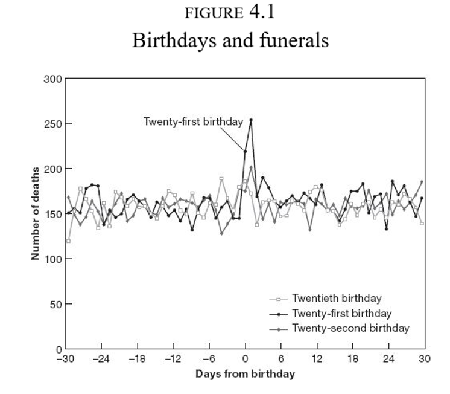
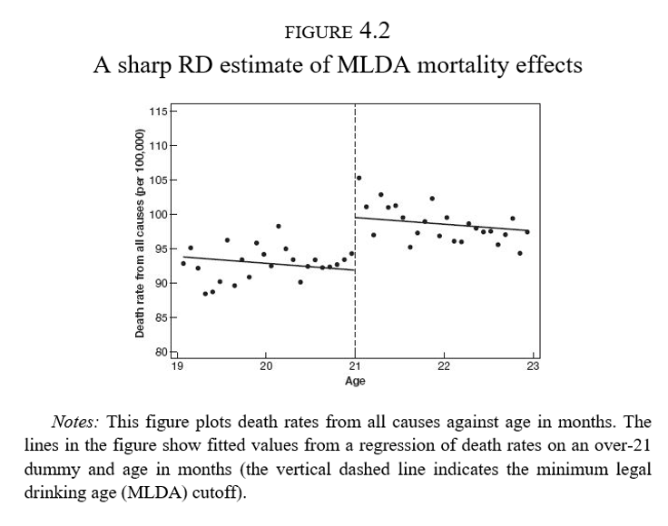
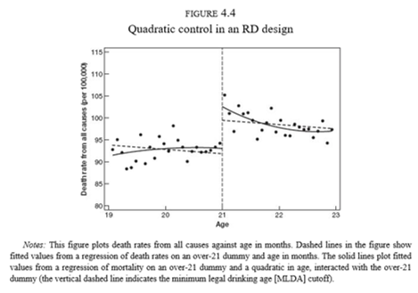
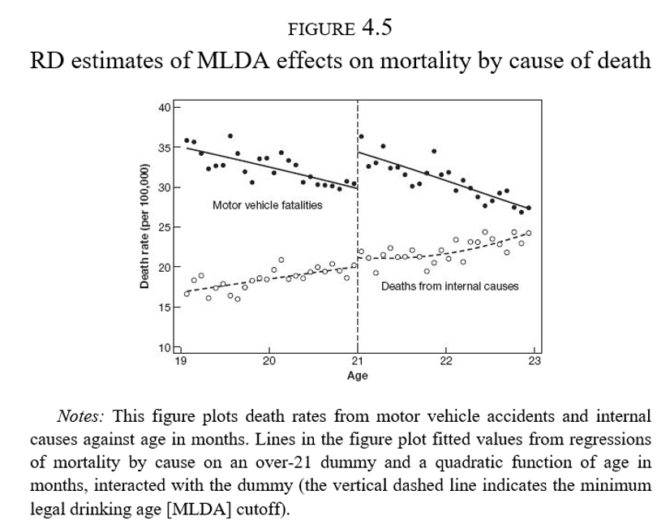
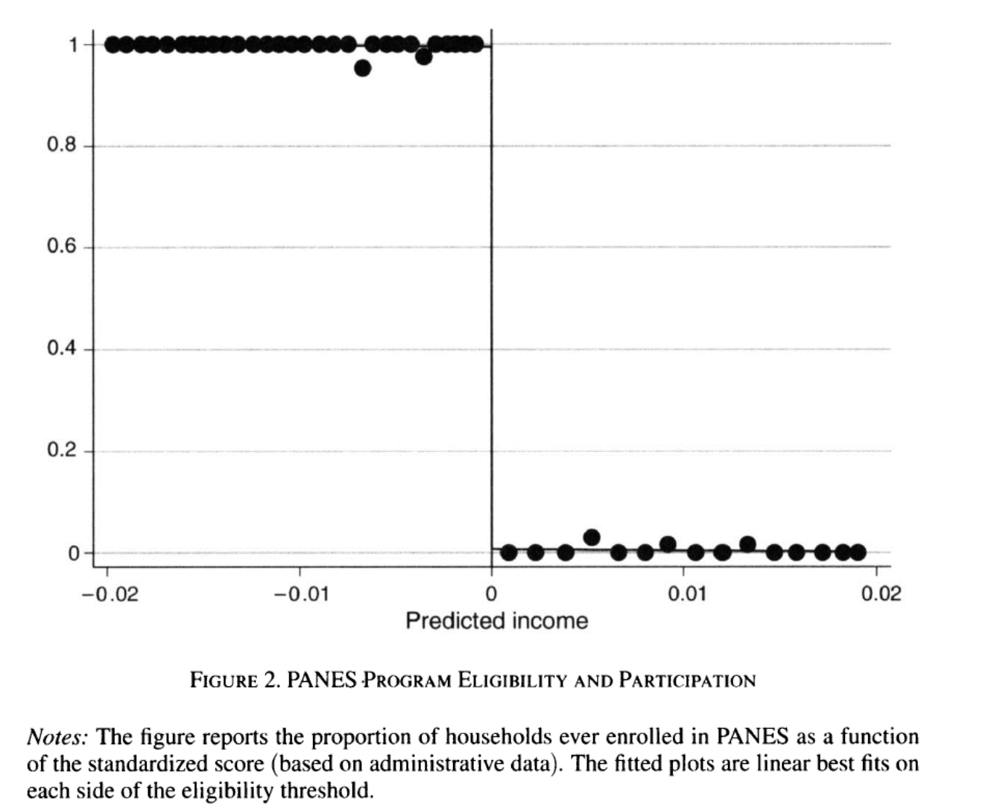
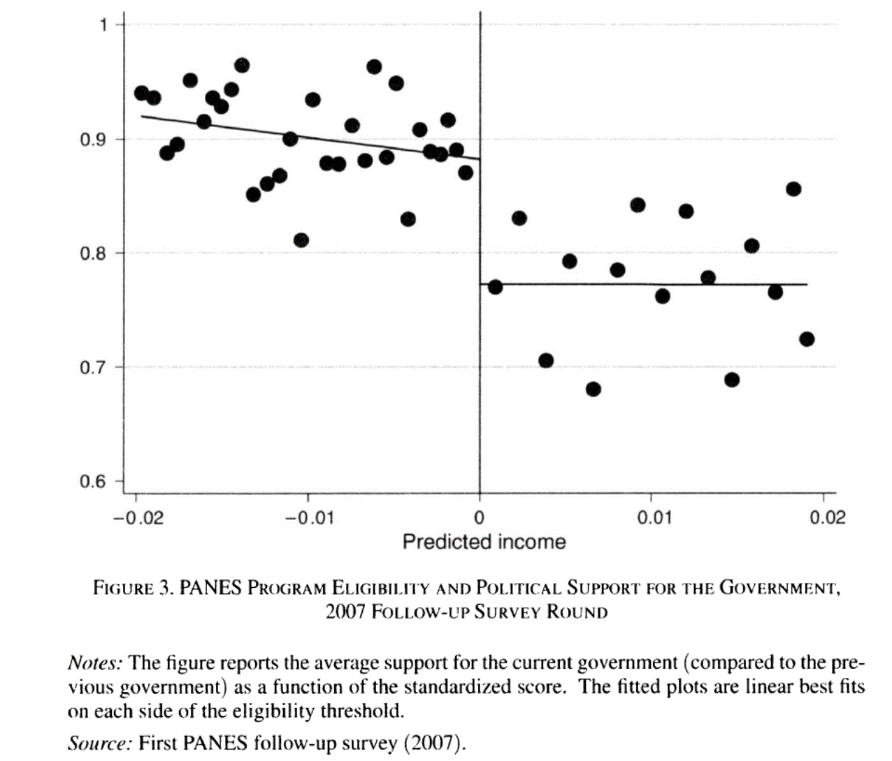
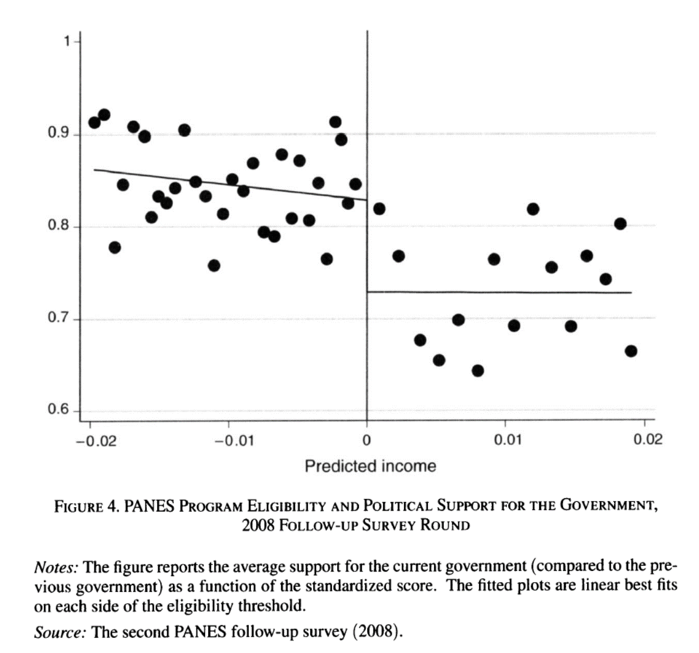

---
format:
  revealjs:
    theme: ["./theme-ic.scss"]
    width: 1600
    height: 900
    slide-number: c/t
    center: false
    scrollable: false
    title-slide: false
    logo: logo-CIDE.jpg
    footer: "Inferencia Causal · Diseños con discontinuidades"
    include-in-header:
      - _ic-header.html
      - fontawesome.html
---


```{r setup, include=FALSE}
knitr::opts_chunk$set(echo = FALSE, fig.path = "figures/")

library(tidyverse)
library(kableExtra)
```


# Diseños con discontinuidades {.portada background-color="#163D34" data-state="nochrome"}

::: {.pa-eyebrow}
Inferencia Causal
:::

[Irvin Rojas]{.pa-name} <span class="pa-icons"><a href="https://github.com/rojasirvin" target="_blank" aria-label="GitHub"><i class="bi bi-github"></i></a> <a href="https://scholar.google.com/citations?hl=es&user=FUwdSTMAAAAJ&view_op=list_works&sortby=pubdate" target="_blank" aria-label="Google Scholar"><i class="bi bi-mortarboard-fill"></i></a> <a href="mailto:irvin.rojas@cide.edu" aria-label="Correo"><i class="bi bi-envelope-fill"></i></a></span>

::: {.pa-inst}
Centro de Investigación y Docencia Económicas<br>Maestría en Economía
:::
```{css, echo = FALSE}
/* Láminas con código a la izquierda y gráfico a la derecha: código más grande
   que el del tema, con interlineado más compacto para que quepa */
.reveal .codigo-figura div.sourceCode pre code.sourceCode { font-size: 1.2em !important; line-height: 1.35; max-height: none !important; }
.reveal .codigo-figura div.sourceCode pre { max-height: none !important; }
```


# Diseños con discontinuidades {.divider background-color="#9B2247" data-state="nochrome"}

	 
## Motivación: edad legal para tomar en EU


:::: {.columns}

::: {.column width="50%"}
- En Estados Unidos la edad legal para tomar es de 21 años
  
- Claramente no podemos realizar un experimento para estudiar esta relación causal

- En DID vimos una aproximación al explotar la variación geográfica y temporal del cambio en las leyes de acceso al alcohol

- Otra manera de aproximar el problema es explotar la discontinuidad en el acceso legal al alcohol justo a los 21 años

:::

::: {.column width="50%"}
```{r}
#| echo: false
#| out-width: "100%"

```
:::

::::

::: {.aside}
Fuente: Angrist & Pischke (2014), con datos de Carpenter & Dobkin (2009).
:::

 

## Motivación: edad legal para tomar en EU


:::: {.columns}

::: {.column width="50%"}

- Algo pasa en el cumpleaños 21

- ¿Podemos pensar que es el efecto fiesta?
 
- Hay una tendencia a la baja a ambos lados de la discontinuidad

- Sin embargo, hay un claro salto en la tasa de mortalidad a los 21 años
:::

::: {.column width="50%"}
```{r}
#| echo: false
#| out-width: "100%"

```
:::

::::

::: {.aside}
Fuente: Angrist & Pischke (2014), con datos de Carpenter & Dobkin (2009).
:::


# Discontinuidades nítidas {.divider background-color="#9B2247" data-state="nochrome"}

## Discontinuidades nítidas
 
- $D_a$ indica el estatus de tratamiento

$$
D_a =
\begin{cases}
1  & \text{si } a \geq 21 \\
0  & \text{si } a < 21
\end{cases}
$$

- $a$ es conocida como *running variable*, *score*, variable de selección, variable de asignación, etc.

- Llamamos *corte* o *umbral* al valor $a_0=21$

- El tratamiento es una función determinística de $a$

  - Si conocemos $a$ entonces conocemos $D_a$

- El tratamiento es discontinuo en $a_0$

  - No importa qué tanto nos acerquemos al corte, el estatus de tratamiento no cambia hasta cruzar $a_0$
 

## Discontinuidades nítidas y regresión
 
- Muchas cosas cambian con la edad

- Riesgo de enfermedades, muerte por otras causas

- Usamos regresión para aislar los efectos de la regla

$$
\bar{M}_a=\alpha+\rho D_a + \gamma a + \varepsilon_a
$$

- $\bar{M}_a$ es la tasa de mortalidad (por cada 100 mil habitantes) a la edad $a$, medida en meses

- $\rho$ captura el salto en la mortalidad a los 21 años

- $\hat{\rho}=7.66$ son muertes adicionales por cada 100 mil habitantes a los 21 años
	
 
## Diferencias respecto a otros diseños
 
- En los diseños experimentales generamos grupos estadísticamente similares en una serie de características $X$ y que difieren solo en el estatus de tratamiento

- En los métodos de regresión y de *matching*, controlamos por un vector $X$ y requerimos que haya soporte común, es decir, que haya individuos tratados y no tratados para cada valor de $X$

- En DID, para cada periodo de análisis post tratamiento, comparamos a los individuos tratados con algún grupo de comparación no tratado

- En los diseños con discontinuidades *no* hay valores de $a$ para los que observemos individuos en ambos estados del tratamiento

- De forma similar a los diseños experimentales con cumplimiento imperfecto, la interpretación de los efectos en los diseños con discontinuidades es la de un efecto local, en la vecindad de $a_0$
 
## No linealidad vs discontinuidad

:::: {.columns}

::: {.column width="50%"}
- En los paneles A y B hay un salto en $E(y|a)$ en el corte, con una relación lineal y no lineal, respectivamente

- En el panel C, $E(y|a)$ es continua pero muy pronunciada cerca de $a_0$, por lo que ajustar una recta a cada lado (líneas discontinuas) nos llevaría a inferir un salto donde no existe

- Al usar un diseño con discontinuidad debemos asegurarnos de que estamos identificando una discontinuidad y no una no linealidad

  - Modelar la no linealidad (enfoque *original*)

  - Concentrarnos solo en una ventana cercana a $a_0$ con métodos no paramétricos (enfoque más *moderno*)
:::

::: {.column width="50%"}
```{r}
#| label: no-linealidad-vs-discontinuidad
#| fig-width: 6.8
#| fig-height: 6.2
#| out-height: "670px"
#| fig-align: center
set.seed(2026)
n <- 100
a_sim <- sort(runif(n))
d_sim <- as.numeric(a_sim >= 0.5)

paneles <- c("(A) Discontinuidad lineal",
             "(B) Discontinuidad no lineal",
             "(C) No linealidad sin discontinuidad")

sim_nl <- tibble(
  a = rep(a_sim, 3),
  d = rep(d_sim, 3),
  panel = rep(paneles, each = n),
  ey = c(0.2 + 0.6 * a_sim + 0.25 * d_sim,
         0.6 - 0.5 * sin(2 * pi * a_sim) + 0.25 * d_sim,
         0.35 + 0.3 * a_sim + 0.5 * plogis((a_sim - 0.5) / 0.04))) |>
  mutate(y = ey + rnorm(3 * n, mean = 0, sd = 0.07),
         tramo = if_else(panel == paneles[3], 0, d))

sim_nl |>
  ggplot(aes(a, y)) +
  geom_point(size = 1, alpha = 0.6) +
  geom_line(aes(y = ey, group = tramo), linewidth = 1) +
  geom_smooth(data = filter(sim_nl, panel == paneles[3]),
              aes(group = d), method = "lm", formula = y ~ x,
              se = FALSE, linetype = "dashed", color = "#9B2247") +
  geom_vline(xintercept = 0.5, linetype = "dashed") +
  facet_wrap(~panel, ncol = 1) +
  labs(x = "Variable de asignación (a)", y = "Resultado (y)") +
  theme_minimal(base_size = 15)
```
:::

::::

::: {.aside}
Fuente: elaboración propia con datos simulados, con base en la figura 6.1.1 de Angrist & Pischke (2009).
:::


## No linealidades
 
- Podemos usar polinomios de $a$

- Idealmente, las conclusiones no deberían cambiar de acuerdo con el grado del polinomio usado

- La recomendación práctica es intentar varias especificaciones y no solo la que se ajuste más a nuestras expectativas de los resultados

- La gráfica de mortalidad por edad parece tener una leve curvatura a la derecha de $a_0$

- Podemos ajustar directamente un polinomio de la edad:

$$
\bar{M}_a=\alpha+\rho D_a + \gamma_1 a + \gamma_2 a^2 + \varepsilon_a
$$


## No linealidades

- O podemos especificar una pendiente diferente para $a$ antes y después de $a_0$:


$$
\bar{M}_a=\alpha+\rho D_a + \gamma(a-a_0) + \kappa[(a-a_0)D_a] + \varepsilon_a
$$

- Notemos que en este caso el efecto del tratamiento es:

$$
\rho+\kappa(a-a_0)
$$


- Es decir, un efecto que depende de la distancia con $a_0$

- Sin embargo, ¿qué tan válido es evaluar el efecto en, digamos, $a=30$? ¿O en $a=10$?

## No linealidades

- Podemos emplear una combinación de no linealidades y cambios en pendiente:

$$
\begin{aligned}
\bar{M}_a&=\alpha+\rho D_a + \gamma_1(a-a_0) +\gamma_2(a-a_0)^2+\kappa_1[(a-a_0)D_a]+ \kappa_2[(a-a_0)^2D_a] + \varepsilon_a
\end{aligned}
$$

- En esta especificación los términos lineal y cuadrático cambian en $a_0$

- Notemos que en este caso el efecto del tratamiento es:

$$
\rho+\kappa_1(a-a_0)+\kappa_2(a-a_0)^2
$$


- En los dos casos anteriores, regularmente se interpreta solo a $\rho$ como el efecto del tratamiento
 
  
## No linealidades


:::: {.columns}

::: {.column width="50%"}
- Con el polinomio cuadrático interactuado, $\hat{\rho}=9.55$

- Modelo más elaborado con mejor ajuste

- Es evidente gráficamente que hay un salto a los 21 años y una caída suave después

- ¿Qué tan robustos son los resultados?
:::

::: {.column width="50%"}
```{r}
#| echo: FALSE
#| fig-align: center
#| out-width: "100%"

```
:::

::::

::: {.aside}
Fuente: Angrist & Pischke (2014), con datos de Carpenter & Dobkin (2009).
:::


## Efectos estimados

```{r}
#| label: tabla-mlda

tabla_mlda <- tibble(
  variable = c("Todas las muertes",
               "Accidentes de vehículos de motor",
               "Suicidio",
               "Homicidio",
               "Otras causas externas",
               "Todas las causas internas",
               "Causas relacionadas con el alcohol",
               "Controles", "Tamaño de muestra"),
  m1 = c("7.66 (1.51)", "4.53 (0.72)", "1.79 (0.50)", "0.10 (0.45)",
         "0.84 (0.42)", "0.39 (0.54)", "0.44 (0.21)",
         "edad", "48"),
  m2 = c("9.55 (1.83)", "4.66 (1.09)", "1.81 (0.78)", "0.20 (0.50)",
         "1.80 (0.56)", "1.07 (0.80)", "0.80 (0.32)",
         "edad, edad², interactuadas", "48"),
  m3 = c("9.75 (2.06)", "4.76 (1.08)", "1.72 (0.73)", "0.16 (0.59)",
         "1.41 (0.59)", "1.69 (0.74)", "0.74 (0.33)",
         "edad", "24"),
  m4 = c("9.61 (2.29)", "5.89 (1.33)", "1.30 (1.14)", "-0.45 (0.93)",
         "1.63 (0.75)", "1.25 (1.01)", "1.03 (0.41)",
         "edad, edad², interactuadas", "24"))

tabla_mlda |>
  kbl(col.names = c("Variable dependiente", "(1)", "(2)", "(3)", "(4)"),
      align = "lcccc") |>
  kable_paper(c("hover", "condensed", "responsive"),
              full_width = FALSE, font_size = 26) |>
  add_header_above(c(" " = 1, "Edades 19-22" = 2, "Edades 20-21" = 2)) |>
  footnote(general = "Coeficientes de un indicador de edad mayor o igual a 21 años en regresiones de la tasa de mortalidad por mes de edad, según causa. Los controles de edad se interactúan con el indicador de mayor de 21 en las columnas (2) y (4). Errores estándar entre paréntesis. Fuente: adaptado de la tabla 4.1 de Angrist & Pischke (2014), con datos de Carpenter & Dobkin (2009).",
           general_title = "Nota: ",
           footnote_as_chunk = TRUE)
```


## Efectos estimados

```{r}
#| echo: FALSE
#| fig-align: center
#| out-width: "57%"

```

::: {.aside}
Fuente: Angrist & Pischke (2014), con datos de Carpenter & Dobkin (2009).
:::

# Ejemplo: transferencias gubernamentales y apoyo político {.divider background-color="#9B2247" data-state="nochrome"}


## Transferencias gubernamentales y apoyo político

- Manacorda, Miguel & Vigorito (2011), "Government Transfers and Political Support", *American Economic Journal: Applied Economics*

- ¿Los programas gubernamentales generan lealtades?

- Programa Nacional de Emergencia Social (PANES), focalizado con base en un índice de ingreso

- Existe una discontinuidad en el acceso al programa
 
## Contexto
 
- ¿Qué pasó en Uruguay?
 
- Crisis económica a inicios de los 2000
 
- En abril de 2005 el Frente Amplio toma el poder
 
- Expansión del gasto público contra la pobreza (0.41% del PIB)
 
- PANES
	 
  - Ingreso ciudadano: alrededor de US$70 mensuales
   
  - Otros componentes: alimenticio, empleo, salud, etc.
   
  - Alcanzó al 10% de los hogares y 14% de la población
		 

## Regla de asignación
 
- ¿Cómo se decidió quién recibiría el PANES?

- Focalizado a los más pobres

- Modelo probit de ingreso predicho

- El ingreso observado puede ser un indicador muy ruidoso

- Se asignó el programa solo a aquellos por debajo de un umbral de ingreso predicho


## Datos


:::: {.columns}

::: {.column width="50%"}
- Se recolectó información de los hogares alrededor de la discontinuidad (tratados y no tratados)
 
- Se realizaron dos rondas de seguimiento en 2006-07 y en 2008
 
- Variable de interés: apoyo político al gobierno en turno

- La figura muestra que la elegibilidad determina casi por completo la participación, es decir, el diseño es prácticamente nítido
:::

::: {.column width="50%"}
```{r}
#| echo: FALSE
#| fig-align: center
#| out-width: "100%"

```
:::

::::

::: {.aside}
Fuente: Manacorda, Miguel & Vigorito (2011).
:::

## ¿Cómo medir el apoyo político?
 
- Construcción de un índice del 0 al 1
 
- Justo debajo del umbral, los hogares elegibles tenían un apoyo político cercano a 0.90
 
- Justo arriba del umbral, los no elegibles mostraban un apoyo de 0.77
 
- Esto implica un incremento de 13 puntos porcentuales
 
## Evidencia gráfica en 2007

```{r}
#| echo: FALSE
#| fig-align: center
#| out-width: "53%"

```

::: {.aside}
Fuente: Manacorda, Miguel & Vigorito (2011).
:::

## Resultados de regresión

- $S_i$ es el score (ingreso predicho) del hogar $i$ y $E$ es el umbral de elegibilidad de PANES

- $N_i=S_i-E$ es el score normalizado; los hogares con $N_i<0$ son elegibles

$$
y_i=\beta_0+\beta_1 \mathcal{I}(N_i<0) + f_1(N_i) + \mathcal{I}(N_i<0)f_2(N_i)+u_i
$$

- $f_1$ y $f_2$ son polinomios del score normalizado

- $\beta_1$ captura el impacto del programa


## Efectos estimados

```{r}
#| label: tabla-panes

tabla_panes <- tibble(
  variable = c("Recibió PANES alguna vez, 2005-2007", "",
               "Apoyo al gobierno, 2007 (durante el programa)", "",
               "Apoyo al gobierno, 2008 (después del programa)", "",
               "Controles del score", "Otros controles"),
  media = c("0.004", "", "0.77", "", "0.73", "", "", ""),
  m1 = c("0.993***", "(0.002)", "0.129***", "(0.013)", "0.118***", "(0.030)", "Ninguno", "No"),
  m2 = c("0.987***", "(0.005)", "0.110***", "(0.026)", "0.100***", "(0.043)", "Lineal", "No"),
  m3 = c("0.995***", "(0.005)", "0.130***", "(0.040)", "0.093**", "(0.016)", "Cuadrático", "No"),
  m4 = c("0.993***", "(0.003)", "0.126***", "(0.014)", "0.119***", "(0.031)", "Ninguno", "Sí"),
  m5 = c("0.988***", "(0.005)", "0.103***", "(0.027)", "0.096***", "(0.045)", "Lineal", "Sí"),
  m6 = c("0.998***", "(0.005)", "0.125***", "(0.043)", "0.081*", "(0.045)", "Cuadrático", "Sí"),
  obs = c("2,232", "", "2,089", "", "1,948", "", "", ""))

tabla_panes |>
  kbl(col.names = c("Variable dependiente", "Media no elegibles",
                    "(1)", "(2)", "(3)", "(4)", "(5)", "(6)",
                    "Observaciones"),
      align = "lcccccccc") |>
  kable_paper(c("hover", "condensed", "responsive"),
              full_width = FALSE, font_size = 23) |>
  column_spec(1, width_min = "14em") |>
  add_header_above(c(" " = 2, "Coeficiente (error estándar)" = 6, " " = 1)) |>
  footnote(general = "Efecto de la elegibilidad a PANES (score por debajo del umbral) sobre la recepción del programa y el apoyo político. Las columnas (1) a (3) incluyen un polinomio de grado 0, 1 y 2 del score normalizado, interactuado con el indicador de elegibilidad; las columnas (4) a (6) agregan características previas al tratamiento. Errores estándar agrupados por score entre paréntesis. *** p<0.01, ** p<0.05, * p<0.1. Fuente: adaptado de la tabla 1 de Manacorda, Miguel & Vigorito (2011).",
           general_title = "Nota: ",
           footnote_as_chunk = TRUE)
```


## Evidencia gráfica en 2008

```{r}
#| echo: FALSE
#| fig-align: center
#| out-width: "48%"

```

::: {.aside}
Fuente: Manacorda, Miguel & Vigorito (2011).
:::


## Robustez

- Si el diseño es válido, la elegibilidad no debería predecir las características de los hogares antes del programa (2005) ni la no respuesta en las encuestas de seguimiento

```{r}
#| label: tabla-panes-balance

tabla_balance <- tibble(
  variable = c("Log del ingreso per cápita",
               "Años de educación promedio del hogar (16 años o más)",
               "Tamaño del hogar",
               "Edad promedio del hogar",
               "Quien responde es mujer",
               "Años de educación de quien responde",
               "Edad de quien responde",
               "No respuesta sobre apoyo político (2007)",
               "No respuesta sobre apoyo político (2008)",
               "Votó en las elecciones de 2004"),
  media = c("6.34", "4.05", "3.03", "31.68", "0.70",
            "6.43", "43.63", "0.41", "0.46", "0.92"),
  coef = c("-0.062", "0.135", "-0.350", "-1.195", "-0.025",
           "0.228", "-0.929", "0.037", "0.049", "0.013"),
  ee = c("(0.059)", "(0.198)", "(0.242)", "(2.159)", "(0.057)",
         "(0.307)", "(1.512)", "(0.044)", "(0.048)", "(0.023)"),
  obs = c("2,150", "2,162", "2,232", "2,232", "2,231",
          "2,206", "2,231", "2,372", "2,372", "2,200"))

tabla_balance |>
  kbl(col.names = c("Variable dependiente", "Media no elegibles",
                    "Coeficiente", "Error estándar", "Observaciones"),
      align = "lcccc") |>
  kable_paper(c("hover", "condensed", "responsive"),
              full_width = FALSE, font_size = 25) |>
  footnote(general = "Regresiones de características previas al programa en el indicador de elegibilidad, con la especificación de la columna (2) de la tabla anterior. Fuente: adaptado de la tabla 2 de Manacorda, Miguel & Vigorito (2011).",
           general_title = "Nota: ",
           footnote_as_chunk = TRUE)
```


# Estimación con discontinuidades nítidas {.divider background-color="#9B2247" data-state="nochrome"}

## Discontinuidades nítidas

- Generalizamos la notación del ejemplo del alcohol: $x_i$ es la variable de asignación, $c_0$ es el corte y $y_i$ es el resultado

- Motivamos el uso de una regresión con el siguiente modelo


$$
D_i =
\begin{cases}
1  & \text{si } x_i \geq c_0 \\
0  & \text{si } x_i < c_0
\end{cases}
$$

- Si asumimos efectos de tratamiento constantes

$$
\begin{aligned}
y_i^0&=\alpha + \beta x_i + \varepsilon_i \\
y_i^1&= y_i^0 + \delta
\end{aligned}
$$

## Discontinuidades nítidas

- Con nuestro modelo de resultados potenciales

$$
\begin{align*}
y_i &= y_i^0 + (y_i^1 - y_i^0)D_i \\
 &= \alpha + \beta x_i + \varepsilon_i + (\alpha + \beta x_i + \varepsilon_i + \delta - \alpha - \beta x_i - \varepsilon_i)D_i \\
 &= \alpha + \beta x_i + \delta D_i + \varepsilon_i
\end{align*}
$$

- Como solo usamos la información en la vecindad del corte de elegibilidad, definimos el efecto del tratamiento en el corte como

$$
\delta^{RD,N} = E(y_i^1 - y_i^0 | x_i=c_0)
$$

- Bajo el supuesto de continuidad, que formalizamos más adelante, este efecto se identifica con los límites laterales de lo que sí observamos

$$
\delta^{RD,N} = \lim_{x\downarrow c_0} E(y_i|x_i = x) - \lim_{x\uparrow c_0} E(y_i|x_i = x)
$$

## Discontinuidades nítidas

:::: {.columns}

::: {.column width="50%"}
- El efecto estimado es un *efecto local*, en el sentido de que nuestras conclusiones son válidas solo en la vecindad alrededor de $c_0$

- A diferencia de otros diseños, aquí no hay traslape

- Recurrimos a la *extrapolación*

- Las líneas discontinuas son los resultados potenciales que no observamos, pero extrapolamos usando los puntos que sí observamos
:::

::: {.column width="50%"}
```{r}
#| label: extrapolacion-nitida
#| fig-width: 6.8
#| fig-height: 6.2
#| out-height: "670px"
#| fig-align: center
set.seed(1711)

datos_nitida <- tibble(x = runif(1000, -1, 1)) |>
  mutate(y = 3 + 2 * x + 5 * (x >= 0) + rnorm(1000, mean = 0, sd = 0.2))

datos_nitida |>
  ggplot(aes(x, y)) +
  geom_point(size = 1, alpha = 0.6) +
  # Resultados potenciales observados
  annotate("segment", x = -1, xend = 0, y = 1, yend = 3, linewidth = 1) +
  annotate("segment", x = 0, xend = 1, y = 8, yend = 10, linewidth = 1) +
  # Resultados potenciales no observados (extrapolación)
  annotate("segment", x = -1, xend = 0, y = 6, yend = 8, linewidth = 1,
           linetype = "dashed", color = "#9B2247") +
  annotate("segment", x = 0, xend = 1, y = 3, yend = 5, linewidth = 1,
           linetype = "dashed", color = "#9B2247") +
  geom_vline(xintercept = 0, linetype = "dashed") +
  annotate("text", x = 0.5, y = 6.6, size = 4.5, color = "#9B2247",
           label = "Tratadas si no\nhubieran sido tratadas") +
  annotate("curve", x = 0.5, y = 5.9, xend = 0.6, yend = 4.4,
           curvature = -0.4, color = "#9B2247",
           arrow = arrow(length = unit(0.25, "cm"))) +
  annotate("text", x = -0.5, y = 4.4, size = 4.5, color = "#9B2247",
           label = "No tratadas si hubieran\nsido tratadas") +
  annotate("curve", x = -0.5, y = 5.1, xend = -0.4, yend = 7.0,
           curvature = -0.4, color = "#9B2247",
           arrow = arrow(length = unit(0.25, "cm"))) +
  labs(x = expression("Variable de asignación centrada" ~ (x[i] - c[0])),
       y = expression("Resultado" ~ (y[i]))) +
  theme_minimal(base_size = 15)
```
:::

::::

::: {.aside}
Fuente: elaboración propia con datos simulados.
:::

## Supuestos de identificación

**Supuesto 1. Continuidad**: $E(y_i^0|x_i)$ y $E(y_i^1|x_i)$ son funciones suaves y continuas de $x_i$ en el corte $c_0$

- Los resultados potenciales *no saltan* en el corte

- El único salto en $E(y_i|x_i)$ se debe al tratamiento

- Esto implica que no debe haber otras intervenciones o variables omitidas que salten en $c_0$

- En el ejemplo del acceso al alcohol, debemos descartar que haya otros factores (como enfermedades) que se disparen a los 21 años

**Supuesto 2. SUTVA**

## Estimación paramétrica

- Se acostumbra construir la versión *centrada* de la variable de asignación: $\tilde{x}_i=x_i-c_0$

- Para permitir no linealidades en $x_i$, podríamos especificar polinomios de alto grado

- Esta es una mala idea, como lo muestran Gelman & Imbens (2019), *"Why High-Order Polynomials Should Not Be Used in Regression Discontinuity Designs"*


## Estimación paramétrica

- A partir del modelo para $y_i$, donde $\alpha$ es la ordenada sin centrar:

$$
\begin{align}
y_i&=\alpha + \beta x_i + \delta D_i + \varepsilon_i \\
& = \alpha + \beta c_0 + \beta (x_i - c_0) + \delta D_i + \varepsilon_i \\
& = \alpha^* + \beta \tilde{x}_i + \delta D_i + \varepsilon_i
\end{align}
$$
con $\alpha^*=\alpha+\beta c_0$, la ordenada en el corte

- Recentrar solo cambia la ordenada al origen mientras que $\beta$ y $\delta$ no cambian

- En adelante, para simplificar, escribimos $\alpha$ para la ordenada en el corte


## Estimación paramétrica

- Permitimos pendientes distintas antes y después de $c_0$

$$
\begin{align}
E(y_i^0|x_i)&=\alpha + \beta_{01} \tilde{x}_i \\
E(y_i^1|x_i)&=\alpha + \delta + \beta_{11} \tilde{x}_i
\end{align}
$$

con $\alpha=E(y_i^0|x_i=c_0)$

- Usando la ecuación de resultados potenciales

$$
\begin{align}
E(y_i|x_i)=\alpha + \beta_{01} \tilde{x}_i + (\alpha + \delta + \beta_{11} \tilde{x}_i-\alpha - \beta_{01} \tilde{x}_i) D_i
\end{align}
$$

- Dando lugar a la regresión

$$
y_i = \alpha +  \beta_{01} \tilde{x}_i + \delta D_i + \beta_1^*\tilde{x}_i D_i+ \varepsilon_i
$$
donde $\beta_1^*=\beta_{11}-\beta_{01}$

## Estimación paramétrica

- Esto es, una regresión de $y_i$ en $D_i$, $\tilde{x}_i$ y la interacción $\tilde{x}_i D_i$

- Interpretamos $\delta$ como el salto en la función o el efecto causal


- Con un polinomio de segundo orden tendríamos

$$
y_i = \alpha +  \beta_{01} \tilde{x}_i + \beta_{02} \tilde{x}_i^2 + \delta D_i + \beta_1^*\tilde{x}_i D_i+ \beta_2^*\tilde{x}_i^2 D_i+ \varepsilon_i
$$
donde $\beta_{02}$ y $\beta_{12}$ son los coeficientes del término cuadrático antes y después de $c_0$, y $\beta_2^*=\beta_{12}-\beta_{02}$

## Estimación no paramétrica

- Muchos autores cuestionan la estimación paramétrica que hemos tratado hasta ahora pues el sesgo puede ser sustancial

- En muchas aplicaciones se prefiere usar una regresión lineal local (no paramétrica)

- Es una regresión restringida a una *ventana* alrededor del corte, con pesos que dependen de la distancia de cada observación a $c_0$

- Consiste en estimar

$$\hat{a}_{+}, \hat{b}_{+} = \arg \min_{a,b}\sum_{i=1}^n(y_i-a-b(x_i-c_0))^2K\left(\frac{x_i-c_0}{h}\right)\mathcal{I}(x_i\geq c_0)$$

- Y lo mismo para $x_i<c_0$, de donde obtenemos $\hat{a}_{-}$, para estimar $\hat{\delta}=\hat{a}_{+}-\hat{a}_{-}$

- El parámetro $h$ indica el *ancho de banda*, que podemos escoger con criterios como minimizar el error cuadrático medio o validación cruzada


## Estimación no paramétrica


- En general, la regresión local se estima en cada valor $x$, pero en el diseño discontinuo solo nos interesa la predicción en $c_0$ por cada lado

- Los pesos vienen de una función kernel $K(u)$, con $u=(x_i-c_0)/h$

- Todos los kernels de la figura, salvo el gaussiano, dan peso cero fuera de $|u|\leq 1$

- En la práctica, `rdrobust` elige el $h$ óptimo y estima la regresión local, con kernel triangular por defecto

## Kernels en R {.codigo-figura}

```{r}
#| label: kernels
#| echo: true
#| output-location: column
#| fig-width: 5
#| fig-height: 4.2
#| out-width: "100%"
u <- seq(-1.5, 1.5, length.out = 601)
dentro <- as.numeric(abs(u) <= 1)

kernels <- tibble(
  u = u,
  Uniforme = 0.5 * dentro,
  Triangular = (1 - abs(u)) * dentro,
  Epanechnikov = 0.75 * (1 - u^2) * dentro,
  Gaussiano = dnorm(u)) |>
  pivot_longer(-u, names_to = "kernel", values_to = "K")

kernels |>
  ggplot(aes(u, K, color = kernel)) +
  geom_line(linewidth = 1.2) +
  labs(x = expression(u == (x[i] - c[0]) / h),
       y = "K(u)", color = "Kernel") +
  theme_minimal() +
  theme(legend.position = "bottom")
```

::: {.aside}
Fuente: elaboración propia.
:::

## Últimos consejos

- Hacer estudios placebo cuando sea posible: probar la especificación principal en variables que no deberían verse afectadas por el tratamiento

- Mostrar que no haya una discontinuidad en la densidad de la variable de asignación en el corte, lo que sugeriría manipulación

  - La prueba de densidad (McCrary, 2008) contrasta si la densidad de $x_i$ salta en $c_0$ (el paquete `rddensity` implementa la versión más reciente)

- Verificar que otras covariables sean continuas alrededor del corte


# Discontinuidades difusas {.divider background-color="#9B2247" data-state="nochrome"}

## Discontinuidades difusas

- Tenemos un diseño difuso cuando hay un salto en la probabilidad de recibir el tratamiento

$$
\lim_{x\downarrow c_0} P(D_i=1|x_i=x) \neq \lim_{x\uparrow c_0} P(D_i=1|x_i=x)
$$

- La probabilidad de recibir el tratamiento es discontinua en $c_0$

- Al igual que en el diseño nítido, para la identificación asumimos que los resultados potenciales son funciones continuas y suaves en $c_0$

- Recurrimos además a los supuestos de variables instrumentales que revisamos más adelante

- Ser asignado al tratamiento se vuelve un instrumento para recibir el tratamiento

$$
P(D_i=1|x_i) =
\begin{cases}
g_1(x_i)  & \text{si } x_i \geq c_0 \\
g_0(x_i)  & \text{si } x_i < c_0
\end{cases}
$$

- Las funciones $g_0$ y $g_1$ difieren en $c_0$

## Discontinuidades difusas

- Tenemos entonces una primera etapa, que define la relación entre la discontinuidad y la probabilidad de recibir el tratamiento

$$
D_i = \gamma_0 + \gamma_1 x_i + \rho T_i + \xi_i
$$

donde

$$
T_i =
\begin{cases}
1  & \text{si } x_i \geq c_0 \\
0  & \text{si } x_i < c_0
\end{cases}
$$

## Discontinuidades difusas

- La forma reducida presenta la relación entre la variable de resultados y la discontinuidad

$$
y_i = \beta_0 + \beta_1 x_i + \delta T_i + u_i
$$

- Y la ecuación estructural presenta la relación entre la adopción y la variable de resultados

$$
y_i = \pi_0 + \pi_1 x_i + \lambda D_i + \nu_i
$$

- La forma reducida es un diseño nítido con $T_i$ en lugar de $D_i$

- $\delta$ es el salto de $y_i$ en el corte

- El efecto del tratamiento es el cociente de los dos saltos, como en el estimador de Wald

$$
\lambda = \frac{\delta}{\rho}
$$

- La interpretación es un LATE para los cumplidores en el umbral, bajo los supuestos de VI que revisaremos más adelante

# Estimación con discontinuidades difusas {.divider background-color="#9B2247" data-state="nochrome"}


## Estimación paramétrica

- La relación entre el estado de tratamiento y $x_i$ puede ser escrita como:

$$E(D_i|x_i)=P(D_i=1|x_i)=g_0(x_i)+[g_1(x_i)-g_0(x_i)]T_i$$

con $T_i=\mathcal{I}(x_i\geq c_0)$

- Escribiendo las funciones $g_0$ y $g_1$ como polinomios flexibles de $x_i$


- Como en el caso nítido, en las ecuaciones paramétricas siguientes, $x_i$ denota la variable de asignación centrada, $\tilde{x}_i = x_i - c_0$, de modo que $\rho$ es el salto en el corte

$$E(D_i|x_i)=\gamma_{00}+\gamma_{01}x_i+\gamma_{02}x_i^2+\ldots+\gamma_{0p}x_i^p +\rho T_i + \gamma_{1}^{*}x_i T_i+ \gamma_{2}^{*}x_i^2 T_i+\ldots+ \gamma_{p}^{*}x_i^p T_i$$


## Estimación paramétrica
 
- En la primera etapa podríamos usar $\{T_i,x_iT_i, x_i^2 T_i,...,x_i^p T_i\}$ como instrumentos para $D_i$

- Una primera etapa con interacciones sugeriría emplear una segunda etapa también con interacciones

- La versión sin interacciones solo usa $T_i$ como instrumento

- La primera etapa será

$$D_i=\gamma_0+\gamma_1 x_i + \gamma_2 x_i^2 + \ldots + \gamma_p x_i^p + \rho T_i + \xi_{i}$$

## Estimación paramétrica

- La forma reducida o ITT de este modelo es:

$$y_i=\beta_0+\beta_1 x_i + \beta_2 x_i^2 + \ldots + \beta_p x_i^p + \delta\ T_i + u_{i}$$

- Mientras que la ecuación estructural


$$y_i=\pi_0+\pi_1 x_i + \pi_2 x_i^2 + \ldots + \pi_p x_i^p + \lambda\ D_i + \nu_{i}$$

- Podemos estimar la ecuación estructural con un estimador de VI usando $T_i$ (y sus interacciones) como instrumento de $D_i$ (y sus interacciones)


## Estimación no paramétrica

- La práctica más usada actualmente sigue el enfoque no paramétrico en dos discontinuidades para obtener:

$$
\lambda^{RD,D} = \frac{\lim_{x\downarrow c_0} E(y_i|x_i=x) - \lim_{x\uparrow c_0} E(y_i|x_i=x)}{\lim_{x\downarrow c_0} E(D_i|x_i=x) - \lim_{x\uparrow c_0} E(D_i|x_i=x)}
$$

- `rdrobust` estima el numerador y el denominador por separado, usando regresión local no paramétrica

- Se elige un ancho de banda y un tipo de kernel para ambas regresiones

- $h$ se escoge de forma que se minimice el MSE del cociente

- La inferencia toma en cuenta el *sesgo de suavizamiento*

## VI nuevamente en acción

- Todo lo que se conoce sobre VI es aplicable en este contexto

- La exogeneidad se argumenta por la asignación *como si fuera aleatoria* que origina la discontinuidad

- La exclusión implica que cruzar el corte afecta a $y_i$ solo a través de $D_i$ (no debe haber otras intervenciones que usen el mismo corte)

- La relevancia requiere que la discontinuidad genere diferencias en la probabilidad de adopción (supuesto que se debe probar)

- Se asume monotonicidad: cruzar el corte no hace que nadie deje de recibir el tratamiento

$$
D_i(1) \geq D_i(0) \quad \text{para todo } i \text{ cerca de } c_0
$$
donde $D_i(1)$ y $D_i(0)$ son el estado de tratamiento de $i$ si $T_i=1$ y si $T_i=0$

- Puede haber un problema de instrumentos débiles, por ejemplo si el salto en la primera etapa es pequeño (por lo que $\lambda=\delta/\rho$ se vuelve inestable)


## Últimos consejos

- Reportar la primera etapa y la forma reducida, con sus correspondientes gráficos

- Evitar polinomios globales de grado alto (Gelman & Imbens, 2019) y, si se reportan, que sea como ejercicio de robustez junto a la estimación local

- Mostrar que el resultado no depende del ancho de banda y reportar la estimación con el $h$ óptimo y con valores alrededor de este (por ejemplo, $h/2$ y $2h$)

- Reportar el número efectivo de observaciones a cada lado del corte

- Realizar las pruebas recomendadas para el caso nítido


# Manipulación, sesgo e inferencia {.divider background-color="#9B2247" data-state="nochrome"}

## Prueba de densidad de McCrary (2008)

- Si los individuos conocen el corte y pueden manipular su $x_i$, se acumulan del lado de $c_0$ que más les beneficie y los resultados potenciales pueden dejar de ser continuos en el corte

- Esta manipulación puede manifestarse como un salto en la densidad $f(x)$ de $x_i$ en $c_0$

- McCrary (2008) propone probar $H_0: \theta=0$, con

$$
\theta = \ln \lim_{x\downarrow c_0} f(x) - \ln \lim_{x\uparrow c_0} f(x) = \ln f^{+} - \ln f^{-}
$$

  1. Construir un histograma de $x_i$, con intervalos que no crucen $c_0$

  2. A cada lado del corte, estimar una regresión lineal local de las frecuencias en los puntos medios de los intervalos para obtener $\hat{f}^{+}$ y $\hat{f}^{-}$

  3. Calcular $\hat{\theta}=\ln \hat{f}^{+}-\ln \hat{f}^{-}$, asintóticamente normal, y contrastar $H_0$

- Hoy se usa `rddensity` (Cattaneo, Jansson & Ma, 2020), con polinomios locales

- No rechazar $H_0$ no prueba que no haya manipulación pues puede suceder que los individuos se hayan movido en ambas direcciones

## El dilema entre sesgo y varianza

- En la regresión local elegimos el orden del polinomio $p$, el kernel $K(\cdot)$ y el ancho de banda $h$

- El estimador $\hat{\delta}=\hat{a}_{+}-\hat{a}_{-}$ tiene sesgo, porque el polinomio solo aproxima a $E(y_i|x_i)$ dentro de la ventana

$$
\text{MSE}(\hat{\delta}) = \text{Sesgo}^2(\hat{\delta}) + \text{Var}(\hat{\delta})
$$

- Un $h$ pequeño usa observaciones muy cercanas a $c_0$ por lo que tenemos un menor error de aproximación (sesgo), pero menos observaciones (más varianza)

- Un $h$ grande usa más observaciones (menos varianza), pero observaciones más lejanas en las que el polinomio aproxima peor (más sesgo)

## Ancho de banda óptimo

- Se puede mostrar que al minimizar $\text{MSE}(\hat{\delta})$ con respecto a $h$:

$$
h_{MSE} = \left(\frac{\mathsf{V}}{2(p+1)\mathsf{B}^2}\right)^{\frac{1}{2p+3}} n^{-\frac{1}{2p+3}}
$$

donde $\mathsf{B}$ depende de la curvatura de $E(y_i|x_i)$ a cada lado del corte y $\mathsf{V}$ de la varianza condicional de $y_i$ y de la densidad de $x_i$ en $c_0$

- $h_{MSE}$ es mayor cuando hay mucho ruido ($\mathsf{V}$ grande), para ganar precisión, y menor cuando $E(y_i|x_i)$ tiene mucha curvatura ($\mathsf{B}$ grande), para reducir el sesgo

- $\mathsf{B}$ y $\mathsf{V}$ son desconocidos, pero se pueden estimar con los datos (Imbens & Kalyanaraman, 2012; Calonico, Cattaneo & Titiunik, 2014)

## Ancho de banda óptimo

- Con regresión lineal local ($p=1$), y salvo constantes que dependen solo del kernel:

$$
\mathsf{B} \propto m_{+}''(c_0) - m_{-}''(c_0) \qquad \mathsf{V} \propto \frac{\sigma^2_{+}(c_0) + \sigma^2_{-}(c_0)}{f(c_0)}
$$

donde $m_{\pm}(x)=E(y_i|x_i=x)$ y $\sigma^2_{\pm}(x)=\text{Var}(y_i|x_i=x)$ a cada lado del corte, y $f$ es la densidad de $x_i$

- En la práctica, cada pieza se estima en una etapa previa con un ancho de banda piloto:

  - $m_{\pm}''(c_0)$ con un polinomio local de orden $p+1$ (cuadrático) a cada lado del corte

  - $\sigma^2_{\pm}(c_0)$ con los residuales de una regresión local preliminar, y $f(c_0)$ con un estimador de densidad

  - Se agrega un término de regularización al denominador para que $h$ no explote cuando la curvatura estimada es casi cero

- $h_{MSE}$ está construido para estimar bien $\delta$, no para hacer inferencia, por lo que se emplean correcciones a los intervalos de confianza


## Inferencia robusta con corrección de sesgo

- El intervalo convencional ignora el sesgo: $IC_{us} = \left[\hat{\delta} \pm 1.96\sqrt{\hat{\mathsf{V}}}\right]$

- Podemos restar un estimador del sesgo $\hat{\mathsf{B}}$: $IC_{bc} = \left[(\hat{\delta}-\hat{\mathsf{B}}) \pm 1.96\sqrt{\hat{\mathsf{V}}}\right]$

- Aunque $IC_{bc}$ ignora que $\hat{\mathsf{B}}$ también tiene variabilidad

- El intervalo *robusto con corrección de sesgo* (Calonico, Cattaneo & Titiunik, 2014) ajusta el error estándar por esa variabilidad adicional

$$
IC_{rbc} = \left[(\hat{\delta}-\hat{\mathsf{B}}) \pm 1.96\sqrt{\hat{\mathsf{V}}_{bc}}\right]
$$

- `rdrobust` reporta las tres versiones (*Conventional*, *Bias-corrected* y *Robust*)

- Se recomienda reportar el efecto estimado $\hat{\delta}$ con $h_{MSE}$ y hacer inferencia con $IC_{rbc}$


# Resumen {.divider background-color="#9B2247" data-state="nochrome"}


## Discontinuidades nítidas: resumen
 
- El diseño nítido se usa cuando el tratamiento es una función determinística de una variable $x_i$


$$
D_i =
\begin{cases}
1  & \text{si } x_i \geq c_0 \\
0  & \text{si } x_i < c_0
\end{cases}
$$


- $c_0$ es el *umbral* o *corte*

- $D_i$ es una función determinística de $x_i$ pues una vez que conocemos $x_i$ entonces conocemos $D_i$

- $D_i$ es una función discontinua en $x_i$ pues no importa qué tanto nos acerquemos por la izquierda o por la derecha a $c_0$, el estado del tratamiento no cambia hasta cruzad $c_0$
	
## Discontinuidades nítidas: resumen
 
- A diferencia de los modelos de otros diseños, no hay valor de $x_i$ en el que observemos a individuos tratados y no tratados
 
- La interpretación del efecto estimado con diseños discontinuos es un efecto local en la vecindad de $c_0$, donde asumimos que los individuos tratados y no tratados son similares en todas las dimensiones excepto en su posición respecto a $c_0$
 
- Una especificación flexible permite no confundir una discontinuidad con una no linealidad
 
- En la práctica, suelen usarse polinomios de orden bajo (1 o 2) y se verifica que los resultados no sean sensibles a la especificación
 
- La estimación no paramétrica consiste en la estimación de $\delta$ en una vecindad de $c_0$ usando regresión local no paramétrica


## Discontinuidades difusas: resumen
 
- El diseño difuso explota discontinuidades en la probabilidad o valor esperado del tratamiento condicional en una variable

- El resultado es que la discontinuidad se convierte en una VI para el estado del tratamiento en vez de una variable que se prende y apaga

$$
P(D_i =1|x_i)=
\begin{cases}
g_1(x_i)  & \text{si } x_i \geq c_0 \\
g_0(x_i)  & \text{si } x_i < c_0
\end{cases}
$$


## Discontinuidades difusas: resumen

- La primera etapa es el salto $\rho$ en $P(D_i=1|x_i)$ en $c_0$, y la forma reducida es el salto $\delta$ en $y_i$ en $c_0$

- El efecto del tratamiento es el cociente

$$
\lambda = \frac{\delta}{\rho}
$$

- Se estima con VI usando $T_i$ como instrumento de $D_i$ (paramétrica) o con regresión local a cada lado del corte (no paramétrica)

- Además de continuidad, se requieren los supuestos de VI (exogeneidad, exclusión, relevancia y monotonicidad)

- Bajo estos supuestos, $\lambda$ es un LATE para los cumplidores en el corte


# Diseños con discontinuidades {.final background-color="#9B2247" data-state="nochrome"}

::: {.f-eyebrow}
Inferencia Causal
:::

::: {.f-inst}
[Irvin Rojas](https://rojasirvin.github.io/)
:::

::: {.f-inst}
CIDE · Maestría en Economía
:::

<span class="f-icons"><a href="https://github.com/rojasirvin" target="_blank" aria-label="GitHub"><i class="bi bi-github"></i></a> <a href="https://scholar.google.com/citations?hl=es&user=FUwdSTMAAAAJ&view_op=list_works&sortby=pubdate" target="_blank" aria-label="Google Scholar"><i class="bi bi-mortarboard-fill"></i></a> <a href="mailto:irvin.rojas@cide.edu" aria-label="Correo"><i class="bi bi-envelope-fill"></i></a></span>

::: {.f-rule}
:::

::: {.f-copy}
© 2026 Irvin Rojas. Distribuido bajo licencia Creative Commons **CC BY-NC-SA 4.0**. Los materiales de terceros citados conservan sus propios derechos.
:::
