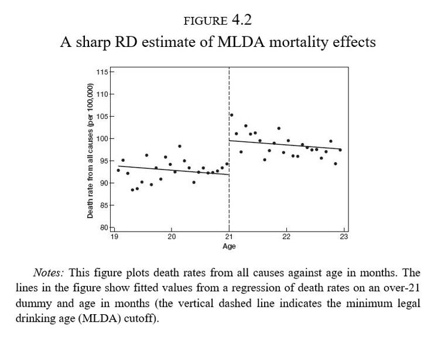
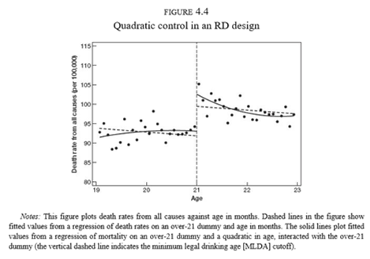
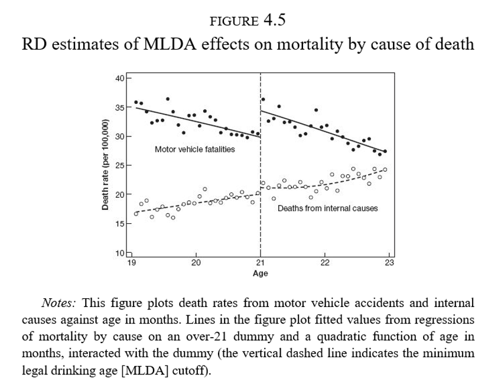
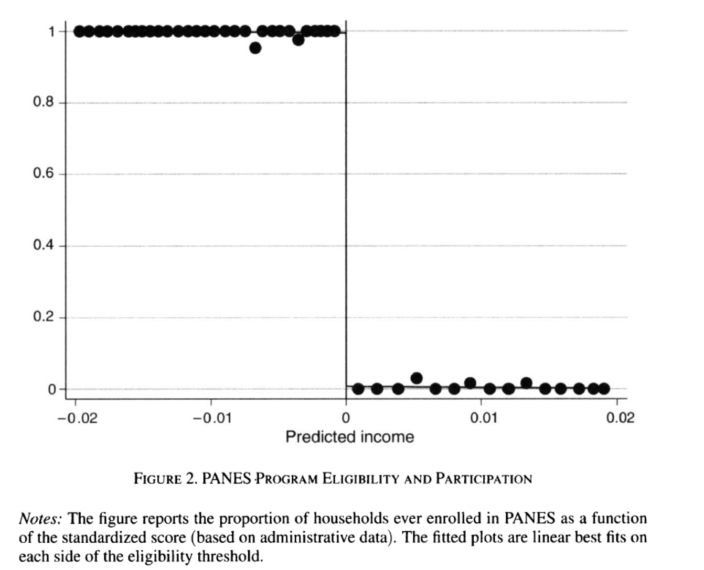
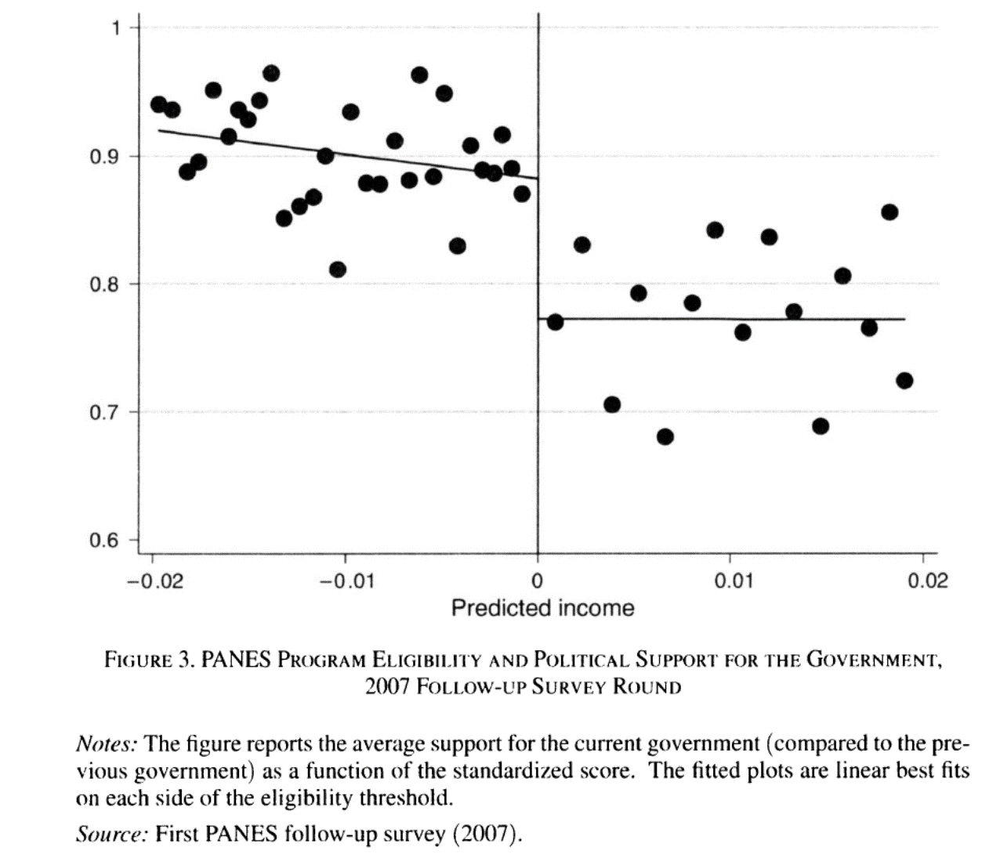
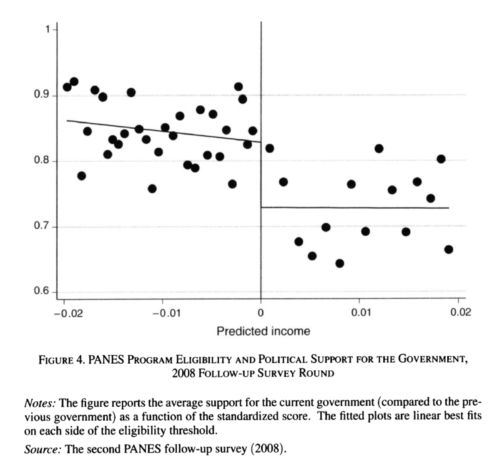
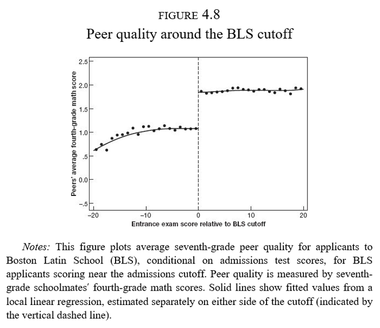

---
format:
  revealjs:
    theme: ["./theme-ic.scss"]
    width: 1600
    height: 900
    slide-number: c/t
    center: false
    scrollable: false
    title-slide: false
    logo: logo-CIDE.jpg
    footer: "Inferencia Causal · Diseños con discontinuidades"
    include-in-header:
      - _ic-header.html
      - fontawesome.html
---


```{r setup, include=FALSE}
knitr::opts_chunk$set(echo = FALSE, fig.path = "figures/")

library(tidyverse)
library(janitor)
library(sandwich)
#library(nnet)
library(readr)
library(clubSandwich)
library(modelsummary)
library(estimatr)
library(lubridate)
library(lfe)
library(kableExtra)


xfun::pkg_load2(c('base64enc', 'htmltools', 'mime'))
```


# Diseños con discontinuidades {.portada background-color="#163D34" data-state="nochrome"}

::: {.pa-eyebrow}
Inferencia Causal
:::

[Irvin Rojas]{.pa-name} <span class="pa-icons"><a href="https://github.com/rojasirvin" target="_blank" aria-label="GitHub"><i class="bi bi-github"></i></a> <a href="https://scholar.google.com/citations?hl=es&user=FUwdSTMAAAAJ&view_op=list_works&sortby=pubdate" target="_blank" aria-label="Google Scholar"><i class="bi bi-mortarboard-fill"></i></a> <a href="mailto:irvin.rojas@cide.edu" aria-label="Correo"><i class="bi bi-envelope-fill"></i></a></span>

::: {.pa-inst}
Centro de Investigación y Docencia Económicas<br>Maestría en Economía
:::
```{css, echo = FALSE}
.huge .remark-code { /*Change made here*/
  font-size: 200% !important;
}
.tiny .remark-code { /*Change made here*/
  font-size: 60% !important;
}
/* Láminas con código a la izquierda y gráfico a la derecha: código más grande
   que el del tema, con interlineado más compacto para que quepa */
.reveal .codigo-figura div.sourceCode pre code.sourceCode { font-size: 1.2em !important; line-height: 1.35; max-height: none !important; }
.reveal .codigo-figura div.sourceCode pre { max-height: none !important; }
```


# Diseños con discontinuidades {.divider background-color="#9B2247" data-state="nochrome"}

	 
## Motivación: edad legal para tomar en EU


:::: {.columns}

::: {.column width="50%"}
- En Estados Unidos la edad legal para tomar es de 21 años
  
- Claramente no podemos realizar un experimento para estudiar esta relación causal

- En DID vimos una aproximación al explotar la variación geográfica y temporal del cambio en las leyes de acceso al alcohol

- Otra manera de aproximar el problema es explotar la discontinuidad en el acceso legal al alcohol justo a los 21 años

:::

::: {.column width="50%"}
```{r}
#| echo: false
knitr::include_graphics("birthdays_funerals.png",
                        dpi = 10)
```
:::

::::

::: {.aside}
Fuente: Angrist & Pischke (2014), con datos de Carpenter & Dobkin (2009).
:::

 

## Motivación: edad legal para tomar en EU


:::: {.columns}

::: {.column width="50%"}

- Algo pasa en el cumpleaños 21

- ¿Podemos pensar que es el efecto fiesta?
 
- Hay una tendencia a la baja a ambos lados de la discontinuidad

- Sin embargo, hay un claro salto en la tasa de mortalidad a los 21 años
:::

::: {.column width="50%"}
```{r}
#| echo: false
#| out-width: "100%"

```
:::

::::

::: {.aside}
Fuente: Angrist & Pischke (2014), con datos de Carpenter & Dobkin (2009).
:::


# Discontinuidades nítidas {.divider background-color="#9B2247" data-state="nochrome"}

## Discontinuidades nítidas
 
- $D_a$ indica el estatus de tratamiento

$$
D_a =
\begin{cases}
1  & \text{si } a \geq 21 \\
0  & \text{si } a < 21
\end{cases}
$$

- $a$ es conocida como *running variable*, *score*, variable de selección, variable de asignación, etc.

- Llamamos *corte* o *umbral* al valor $a_0=21$

- El tratamiento es una función determinística de $a$

  - Si conocemos $a$ entonces conocemos $D_a$

- El tratamiento es discontinuo en $a_0$

  - No importa qué tanto nos acerquemos al corte, el estatus de tratamiento no cambia hasta cruzar $a_0$
 

## Discontinuidades nítidas y regresión
 
- Muchas cosas cambian con la edad

- Riesgo de enfermedades, muerte por otras causas

- Usamos regresión para aislar los efectos de la regla

$$
\bar{M}_a=\alpha+\rho D_a + \gamma a + \varepsilon_a
$$

- $\bar{M}_a$ es la tasa de mortalidad (por cada 100 mil habitantes) a la edad $a$, medida en meses

- $\rho$ captura el salto en la mortalidad a los 21 años

- $\hat{\rho}=7.66$ son muertes adicionales por cada 100 mil habitantes a los 21 años
	
 
## Diferencias respecto a otros diseños
 
- En los diseños experimentales generamos grupos estadísticamente similares en una serie de características $X$ y que difieren solo en el estatus de tratamiento

- En los métodos de regresión y de *matching*, controlamos por un vector $X$ y requerimos que haya soporte común, es decir, que haya individuos tratados y no tratados para cada valor de $X$

- En DID, para cada periodo de análisis post tratamiento, comparamos a los individuos tratados con algún grupo de comparación no tratado

- En los diseños con discontinuidades *no* hay valores de $a$ para los que observemos individuos en ambos estados del tratamiento

- De forma similar a los diseños experimentales con cumplimiento imperfecto, la interpretación de los efectos en los diseños con discontinuidades es la de un efecto local, en la vecindad de $a_0$
 
## No linealidad vs discontinuidad

:::: {.columns}

::: {.column width="50%"}
- En los paneles A y B hay un salto en $E[Y|a]$ en el corte, con una relación lineal y no lineal, respectivamente

- En el panel C, $E[Y|a]$ es continua pero muy pronunciada cerca de $a_0$, por lo que ajustar una recta a cada lado (líneas discontinuas) nos llevaría a inferir un salto donde no existe

- Al usar un diseño con discontinuidad debemos asegurarnos de que estamos identificando una discontinuidad y no una no linealidad

  - Modelar la no linealidad (enfoque *original*)

  - Concentrarnos solo en una ventana cercana a $a_0$ con métodos no paramétricos (enfoque más *moderno*)
:::

::: {.column width="50%"}
```{r}
#| label: no-linealidad-vs-discontinuidad
#| fig-width: 6.8
#| fig-height: 6.2
#| out-height: "670px"
#| fig-align: center
set.seed(2026)
n <- 100
a_sim <- sort(runif(n))
d_sim <- as.numeric(a_sim >= 0.5)

paneles <- c("(A) Discontinuidad lineal",
             "(B) Discontinuidad no lineal",
             "(C) No linealidad sin discontinuidad")

sim_nl <- tibble(
  a = rep(a_sim, 3),
  d = rep(d_sim, 3),
  panel = rep(paneles, each = n),
  ey = c(0.2 + 0.6 * a_sim + 0.25 * d_sim,
         0.6 - 0.5 * sin(2 * pi * a_sim) + 0.25 * d_sim,
         0.35 + 0.3 * a_sim + 0.5 * plogis((a_sim - 0.5) / 0.04))) |>
  mutate(y = ey + rnorm(3 * n, mean = 0, sd = 0.07),
         tramo = if_else(panel == paneles[3], 0, d))

sim_nl |>
  ggplot(aes(a, y)) +
  geom_point(size = 1, alpha = 0.6) +
  geom_line(aes(y = ey, group = tramo), linewidth = 1) +
  geom_smooth(data = filter(sim_nl, panel == paneles[3]),
              aes(group = d), method = "lm", formula = y ~ x,
              se = FALSE, linetype = "dashed", color = "#9B2247") +
  geom_vline(xintercept = 0.5, linetype = "dashed") +
  facet_wrap(~panel, ncol = 1) +
  labs(x = "Variable de asignación (a)", y = "Resultado (Y)") +
  theme_minimal(base_size = 15)
```
:::

::::

::: {.aside}
Fuente: elaboración propia con datos simulados, con base en la figura 6.1.1 de Angrist & Pischke (2009).
:::


## No linealidades
 
- Podemos usar polinomios de $a$

- Idealmente, las conclusiones no deberían cambiar de acuerdo al grado del polinomio usado

- La recomendación práctica es intentar varias especificaciones y no solo la que se ajuste más a nuestras expectativas de los resultados

- La gráfica de mortalidad por edad parece tener una leve curvatura a la derecha de $a_0$

- Podemos ajustar directamente un polinomio de la edad:

$$
\bar{M}_a=\alpha+\rho D_a + \gamma_1 a + \gamma_2 a^2 + \varepsilon_a
$$


## No linealidades

- O podemos especificar una pendiente diferente para $a$ antes y después de $a_0$:


$$
\bar{M}_a=\alpha+\rho D_a + \gamma(a-a_0) + \lambda[(a-a_0)D_a] + \varepsilon_a
$$

- Notemos que en este caso el efecto del tratamiento es:

$$
\rho+\lambda(a-a_0)
$$


- Es decir, un efecto que depende de la distancia con $a_0$

- Sin embargo, ¿qué tan válido es evaluar el efecto en, digamos, $a=30$? ¿O en $a=10$?

## No linealidades

- Podemos emplear una combinación de no linealidades y cambios en pendiente:

$$
\begin{aligned}
\bar{M}_a&=\alpha+\rho D_a + \gamma_1(a-a_0) +\gamma_2(a-a_0)^2+\lambda_1[(a-a_0)D_a]+ \lambda_2[(a-a_0)^2D_a] + \varepsilon_a
\end{aligned}
$$

- En esta especificación los términos lineal y cuadrático cambian en $a_0$

- Notemos que en este caso el efecto del tratamiento es:

$$
\rho+\lambda_1(a-a_0)+\lambda_2(a-a_0)^2
$$


- En los dos casos anteriores, regularmente se interpreta solo a $\rho$ como el efecto del tratamiento
 
  
## No linealidades


:::: {.columns}

::: {.column width="50%"}
- Con el polinomio cuadrático interactuado, $\hat{\rho}=9.55$

- Modelo más elaborado con mejor ajuste

- Es evidente gráficamente que hay un salto a los 21 años y una caída suave después

- ¿Qué tan robustos son los resultados?
:::

::: {.column width="50%"}
```{r}
#| echo: FALSE
#| fig-align: center
#| out-width: "100%"

```
:::

::::

::: {.aside}
Fuente: Angrist & Pischke (2014), con datos de Carpenter & Dobkin (2009).
:::


## Efectos estimados

```{r}
#| label: tabla-mlda

tabla_mlda <- tibble(
  variable = c("Todas las muertes",
               "Accidentes de vehículos de motor",
               "Suicidio",
               "Homicidio",
               "Otras causas externas",
               "Todas las causas internas",
               "Causas relacionadas con el alcohol",
               "Controles", "Tamaño de muestra"),
  m1 = c("7.66 (1.51)", "4.53 (0.72)", "1.79 (0.50)", "0.10 (0.45)",
         "0.84 (0.42)", "0.39 (0.54)", "0.44 (0.21)",
         "edad", "48"),
  m2 = c("9.55 (1.83)", "4.66 (1.09)", "1.81 (0.78)", "0.20 (0.50)",
         "1.80 (0.56)", "1.07 (0.80)", "0.80 (0.32)",
         "edad, edad², interactuadas", "48"),
  m3 = c("9.75 (2.06)", "4.76 (1.08)", "1.72 (0.73)", "0.16 (0.59)",
         "1.41 (0.59)", "1.69 (0.74)", "0.74 (0.33)",
         "edad", "24"),
  m4 = c("9.61 (2.29)", "5.89 (1.33)", "1.30 (1.14)", "-0.45 (0.93)",
         "1.63 (0.75)", "1.25 (1.01)", "1.03 (0.41)",
         "edad, edad², interactuadas", "24"))

tabla_mlda |>
  kbl(col.names = c("Variable dependiente", "(1)", "(2)", "(3)", "(4)"),
      align = "lcccc") |>
  kable_paper(c("hover", "condensed", "responsive"),
              full_width = FALSE, font_size = 26) |>
  add_header_above(c(" " = 1, "Edades 19-22" = 2, "Edades 20-21" = 2)) |>
  footnote(general = "Coeficientes de un indicador de edad mayor o igual a 21 años en regresiones de la tasa de mortalidad por mes de edad, según causa. Los controles de edad se interactúan con el indicador de mayor de 21 en las columnas (2) y (4). Errores estándar entre paréntesis. Fuente: adaptado de la tabla 4.1 de Angrist & Pischke (2014), con datos de Carpenter & Dobkin (2009).",
           general_title = "Nota: ",
           footnote_as_chunk = TRUE)
```


## Efectos estimados

```{r}
#| echo: FALSE
#| fig-align: center
#| out-width: "57%"

```

::: {.aside}
Fuente: Angrist & Pischke (2014), con datos de Carpenter & Dobkin (2009).
:::

# Ejemplo: transferencias gubernamentales y apoyo político {.divider background-color="#9B2247" data-state="nochrome"}


## Transferencias gubernamentales y apoyo político

- Manacorda, Miguel & Vigorito (2011), "Government Transfers and Political Support", *American Economic Journal: Applied Economics*

- ¿Los programas gubernamentales generan lealtades?

- Programa Nacional de Emergencia Social (PANES), focalizado con base en un índice de pobreza

- Existe una discontinuidad en el acceso al programa
 
## Contexto
 
- ¿Qué pasó en Uruguay?
 
- Crisis económica a inicios de los 2000
 
- En abril de 2005 el Frente Amplio toma el poder
 
- Expansión del gasto público contra la pobreza (0.41% del PIB)
 
- PANES
	 
  - Ingreso ciudadano: alrededor de US$70 mensuales
   
  - Otros componentes: alimenticio, empleo, salud, etc.
   
  - Alcanzó al 10% de los hogares y 14% de la población
		 

## Regla de asignación
 
- ¿Cómo se decidió quién recibiría el PANES?

- Focalizado a los más pobres

- Modelo probit de ingreso predicho

- El ingreso observado puede ser un indicador muy ruidoso

- Se asignó el programa solo a aquellos por debajo de un umbral de ingreso predicho


## Datos


:::: {.columns}

::: {.column width="50%"}
- Se recolectó información de los hogares alrededor de la discontinuidad (tratados y no tratados)
 
- Se realizaron dos rondas de seguimiento en 2006-07 y en 2008
 
- Variable de interés: apoyo político al gobierno en turno

- La figura muestra que la elegibilidad determina casi por completo la participación, es decir, tenemos un diseño nítido
:::

::: {.column width="50%"}
```{r}
#| echo: FALSE
#| fig-align: center
#| out-width: "100%"

```
:::

::::

::: {.aside}
Fuente: Manacorda, Miguel & Vigorito (2011).
:::

## ¿Cómo medir el apoyo político?
 
- Construcción de un índice del 0 al 1
 
- Justo debajo del umbral, los hogares elegibles tenían un apoyo político cercano a 0.90
 
- Justo arriba del umbral, los no elegibles mostraban un apoyo de 0.77
 
- Esto implica un incremento de 13 puntos porcentuales
 
## Evidencia gráfica en 2007

```{r}
#| echo: FALSE
#| fig-align: center
#| out-width: "53%"

```

::: {.aside}
Fuente: Manacorda, Miguel & Vigorito (2011).
:::

## Resultados de regresión

- $S_i$ es el score (ingreso predicho) del hogar $i$ y $E$ es el umbral de elegibilidad de PANES

- $N_i=S_i-E$ es el score normalizado; los hogares con $N_i<0$ son elegibles

$$
y_i=\beta_0+\beta_1 \mathcal{I}(N_i<0) + f_1(N_i) + \mathcal{I}(N_i<0)f_2(N_i)+u_i
$$

- $f_1$ y $f_2$ son polinomios del score normalizado

- $\beta_1$ captura el impacto del programa


## Efectos estimados

```{r}
#| label: tabla-panes

tabla_panes <- tibble(
  variable = c("Recibió PANES alguna vez, 2005-2007", "",
               "Apoyo al gobierno, 2007 (durante el programa)", "",
               "Apoyo al gobierno, 2008 (después del programa)", "",
               "Controles del score", "Otros controles"),
  media = c("0.004", "", "0.77", "", "0.73", "", "", ""),
  m1 = c("0.993***", "(0.002)", "0.129***", "(0.013)", "0.118***", "(0.030)", "Ninguno", "No"),
  m2 = c("0.987***", "(0.005)", "0.110***", "(0.026)", "0.100***", "(0.043)", "Lineal", "No"),
  m3 = c("0.995***", "(0.005)", "0.130***", "(0.040)", "0.093**", "(0.016)", "Cuadrático", "No"),
  m4 = c("0.993***", "(0.003)", "0.126***", "(0.014)", "0.119***", "(0.031)", "Ninguno", "Sí"),
  m5 = c("0.988***", "(0.005)", "0.103***", "(0.027)", "0.096***", "(0.045)", "Lineal", "Sí"),
  m6 = c("0.998***", "(0.005)", "0.125***", "(0.043)", "0.081*", "(0.045)", "Cuadrático", "Sí"),
  obs = c("2,232", "", "2,089", "", "1,948", "", "", ""))

tabla_panes |>
  kbl(col.names = c("Variable dependiente", "Media no elegibles",
                    "(1)", "(2)", "(3)", "(4)", "(5)", "(6)",
                    "Observaciones"),
      align = "lcccccccc") |>
  kable_paper(c("hover", "condensed", "responsive"),
              full_width = FALSE, font_size = 23) |>
  column_spec(1, width_min = "14em") |>
  add_header_above(c(" " = 2, "Coeficiente (error estándar)" = 6, " " = 1)) |>
  footnote(general = "Efecto de la elegibilidad a PANES (score por debajo del umbral) sobre la recepción del programa y el apoyo político. Las columnas (1) a (3) incluyen un polinomio de grado 0, 1 y 2 del score normalizado, interactuado con el indicador de elegibilidad; las columnas (4) a (6) agregan características previas al tratamiento. Errores estándar agrupados por score entre paréntesis. *** p<0.01, ** p<0.05, * p<0.1. Fuente: adaptado de la tabla 1 de Manacorda, Miguel & Vigorito (2011).",
           general_title = "Nota: ",
           footnote_as_chunk = TRUE)
```


## Evidencia gráfica en 2008

```{r}
#| echo: FALSE
#| fig-align: center
#| out-width: "48%"

```

::: {.aside}
Fuente: Manacorda, Miguel & Vigorito (2011).
:::


## Robustez

- Si el diseño es válido, la elegibilidad no debería predecir las características de los hogares antes del programa (2005)

```{r}
#| label: tabla-panes-balance

tabla_balance <- tibble(
  variable = c("Log del ingreso per cápita",
               "Años de educación promedio del hogar (16 años o más)",
               "Tamaño del hogar",
               "Edad promedio del hogar",
               "Quien responde es mujer",
               "Años de educación de quien responde",
               "Edad de quien responde",
               "No respuesta sobre apoyo político (2007)",
               "No respuesta sobre apoyo político (2008)",
               "Votó en las elecciones de 2004"),
  media = c("6.34", "4.05", "3.03", "31.68", "0.70",
            "6.43", "43.63", "0.41", "0.46", "0.92"),
  coef = c("-0.062", "0.135", "-0.350", "-1.195", "-0.025",
           "0.228", "-0.929", "0.037", "0.049", "0.013"),
  ee = c("(0.059)", "(0.198)", "(0.242)", "(2.159)", "(0.057)",
         "(0.307)", "(1.512)", "(0.044)", "(0.048)", "(0.023)"),
  obs = c("2,150", "2,162", "2,232", "2,232", "2,231",
          "2,206", "2,231", "2,372", "2,372", "2,200"))

tabla_balance |>
  kbl(col.names = c("Variable dependiente", "Media no elegibles",
                    "Coeficiente", "Error estándar", "Observaciones"),
      align = "lcccc") |>
  kable_paper(c("hover", "condensed", "responsive"),
              full_width = FALSE, font_size = 25) |>
  footnote(general = "Regresiones de características previas al programa en el indicador de elegibilidad, con la especificación de la columna (2) de la tabla anterior. Fuente: adaptado de la tabla 2 de Manacorda, Miguel & Vigorito (2011).",
           general_title = "Nota: ",
           footnote_as_chunk = TRUE)
```


# Estimación con discontinuidades nítidas {.divider background-color="#9B2247" data-state="nochrome"}

## Discontinuidades nítidas

- Generalizamos la notación del ejemplo del alcohol: $x_i$ es la variable de asignación, $c_0$ es el corte y $y_i$ es el resultado

- Motivamos el uso de una regresión con el siguiente modelo


$$
D_i =
\begin{cases}
1  & \text{si } x_i \geq c_0 \\
0  & \text{si } x_i < c_0
\end{cases}
$$

- Si asumimos efectos de tratamiento constantes

$$
\begin{aligned}
y_i^0&=\alpha + \beta x_i + \varepsilon_i \\
y_i^1&= y_i^0 + \delta
\end{aligned}
$$

## Discontinuidades nítidas

- Con nuestro modelo de resultados potenciales

$$
\begin{align*}
y_i &= y_i^0 + (y_i^1 - y_i^0)D_i \\
 &= \alpha + \beta x_i + \varepsilon_i + (\alpha + \beta x_i + \varepsilon_i + \delta - \alpha - \beta x_i - \varepsilon_i)D_i \\
 &= \alpha + \beta x_i + \delta D_i + \varepsilon_i
\end{align*}
$$

- Como solo usamos la información en la vecindad del corte de elegibilidad, definimos el efecto del tratamiento en el corte como

$$
\delta^{RD,N} = E(y_i^1 - y_i^0 | x_i=c_0)
$$

- Bajo el supuesto de continuidad, que formalizamos más adelante, este efecto se identifica con los límites laterales de lo que sí observamos

$$
\delta^{RD,N} = \lim_{x\downarrow c_0} E(y_i|x_i = x) - \lim_{x\uparrow c_0} E(y_i|x_i = x)
$$

## Discontinuidades nítidas

:::: {.columns}

::: {.column width="50%"}
- El efecto estimado es un *efecto local*, en el sentido de que nuestras conclusiones son válidas solo en la vecindad alrededor de $c_0$

- A diferencia de otros diseños, aquí no hay traslape

- Recurrimos a la *extrapolación*

- Las líneas discontinuas son los resultados potenciales que no observamos, pero extrapolamos usando los puntos que sí observamos
:::

::: {.column width="50%"}
```{r}
#| label: extrapolacion-nitida
#| fig-width: 6.8
#| fig-height: 6.2
#| out-height: "670px"
#| fig-align: center
set.seed(1711)

x <- runif(1000, -1, 1)
y <- 3 + 2*x + 5*(x>=0) + rnorm(1000, mean = 0, sd = 0.2)

data.sharp <- data.frame(y, x, c = 0)

data.sharp |>
  ggplot(aes(x, y)) +
  geom_point(size = 1, alpha = 0.6) +
  # Resultados potenciales observados
  annotate("segment", x = -1, xend = 0, y = 1, yend = 3, linewidth = 1) +
  annotate("segment", x = 0, xend = 1, y = 8, yend = 10, linewidth = 1) +
  # Resultados potenciales no observados (extrapolación)
  annotate("segment", x = -1, xend = 0, y = 6, yend = 8, linewidth = 1,
           linetype = "dashed", color = "#9B2247") +
  annotate("segment", x = 0, xend = 1, y = 3, yend = 5, linewidth = 1,
           linetype = "dashed", color = "#9B2247") +
  geom_vline(xintercept = 0, linetype = "dashed") +
  annotate("text", x = 0.5, y = 6.6, size = 4.5, color = "#9B2247",
           label = "Tratadas si no\nhubieran sido tratadas") +
  annotate("curve", x = 0.5, y = 5.9, xend = 0.6, yend = 4.4,
           curvature = -0.4, color = "#9B2247",
           arrow = arrow(length = unit(0.25, "cm"))) +
  annotate("text", x = -0.5, y = 4.4, size = 4.5, color = "#9B2247",
           label = "No tratadas si hubieran\nsido tratadas") +
  annotate("curve", x = -0.5, y = 5.1, xend = -0.4, yend = 7.0,
           curvature = -0.4, color = "#9B2247",
           arrow = arrow(length = unit(0.25, "cm"))) +
  labs(x = expression("Variable de asignación centrada" ~ (x[i] - c[0])),
       y = expression("Resultado" ~ (y[i]))) +
  theme_minimal(base_size = 15)
```
:::

::::

::: {.aside}
Fuente: elaboración propia con datos simulados.
:::

## Supuestos de identificación

**Supuesto 1. Continuidad**: $E(y_i^0|x_i)$ y $E(y_i^1|x_i)$ son funciones suaves y continuas de $x_i$ en el corte $c_0$

- Los resultados potenciales *no saltan* en el corte

- El único salto en $E(y_i|x_i)$ se debe al tratamiento

- Esto implica que no debe haber otras intervenciones o variables omitidas que salten en $c_0$

- En el ejemplo del acceso al alcohol, debemos descartar que haya otros factores (como enfermedades) que se disparen a los 21 años

**Supuesto 2. SUTVA**

## Estimación paramétrica

- Se acostumbra construir la versión *centrada* de la variable de asignación: $\tilde{x}_i=x_i-c_0$

- Para permitir no linealidades en $x_i$, podríamos especificar polinomios de alto grado

- Esta es una mala idea, como lo muestran Gelman & Imbens (2019), *"Why High-Order Polynomials Should Not Be Used in Regression Discontinuity Designs"*


## Estimación paramétrica

- A partir del modelo para $y_i$, donde $\alpha$ es la ordenada sin centrar:

$$
\begin{align}
y_i&=\alpha + \beta x_i + \delta D_i + \varepsilon_i \\
& = \alpha + \beta c_0 + \beta (x_i - c_0) + \delta D_i + \varepsilon_i \\
& = \alpha^* + \beta \tilde{x}_i + \delta D_i + \varepsilon_i
\end{align}
$$
con $\alpha^*=\alpha+\beta c_0$, la ordenada en el corte

- Recentrar solo cambia la ordenada al origen mientras que $\beta$ y $\delta$ no cambian

- En adelante, para simplificar, escribimos $\alpha$ para la ordenada en el corte


## Estimación paramétrica

- Permitimos pendientes distintas antes y después de $c_0$

$$
\begin{align}
E(y_i^0|x_i)&=\alpha + \beta_{01} \tilde{x}_i \\
E(y_i^1|x_i)&=\alpha + \delta + \beta_{11} \tilde{x}_i
\end{align}
$$

con $\alpha=E(y_i^0|x_i=c_0)$

- Usando la ecuación de resultados potenciales

$$
\begin{align}
E(y_i|x_i)=\alpha + \beta_{01} \tilde{x}_i + (\alpha + \delta + \beta_{11} \tilde{x}_i-\alpha - \beta_{01} \tilde{x}_i) D_i
\end{align}
$$

- Dando lugar a la regresión

$$
y_i = \alpha +  \beta_{01} \tilde{x}_i + \delta D_i + \beta_1^*\tilde{x}_i D_i+ \varepsilon_i
$$
donde $\beta_1^*=\beta_{11}-\beta_{01}$

## Estimación paramétrica

- Esto es, una regresión de $y_i$ en $D_i$, $\tilde{x}_i$ y la interacción $\tilde{x}_i D_i$

- Interpretamos $\delta$ como el salto en la función o el efecto causal


- Con un polinomio de segundo orden tendríamos

$$
y_i = \alpha +  \beta_{01} \tilde{x}_i + \beta_{02} \tilde{x}_i^2 + \delta D_i + \beta_1^*\tilde{x}_i D_i+ \beta_2^*\tilde{x}_i^2 D_i+ \varepsilon_i
$$
donde $\beta_{02}$ y $\beta_{12}$ son los coeficientes del término cuadrático antes y después de $c_0$, y $\beta_2^*=\beta_{12}-\beta_{02}$

## Estimación no paramétrica

- Muchos autores cuestionan la estimación paramétrica que hemos tratado hasta ahora pues el sesgo puede ser sustancial

- En muchas aplicaciones se prefiere usar una regresión lineal local (no paramétrica)

- Es una regresión restringida a una *ventana* alrededor del corte, con pesos que dependen de la distancia de cada observación a $c_0$

- Consiste en estimar

$$\hat{a}_{+}, \hat{b}_{+} = \arg \min_{a,b}\sum_{i=1}^n(y_i-a-b(x_i-c_0))^2K\left(\frac{x_i-c_0}{h}\right)1(x_i\geq c_0)$$

- Y lo mismo para $x_i<c_0$, de donde obtenemos $\hat{a}_{-}$, para estimar $\hat{\delta}=\hat{a}_{+}-\hat{a}_{-}$

- El parámetro $h$ indica el *ancho de banda*, que podemos escoger con criterios como minimizar el error cuadrático medio o validación cruzada


## Estimación no paramétrica


- En general, la regresión local se estima en cada valor $x$, pero en el diseño discontinuo solo nos interesa la predicción en $c_0$ por cada lado

- Los pesos vienen de una función kernel $K(u)$, con $u=(x_i-c_0)/h$

- Todos los kernels, salvo el gaussiano, dan peso cero fuera de $|u|\leq 1$

- En la práctica, `rdrobust` elige el $h$ óptimo y estima la regresión local, con kernel triangular por defecto

## Kernels en R {.codigo-figura}

```{r}
#| label: kernels
#| echo: true
#| output-location: column
#| fig-width: 5
#| fig-height: 4.2
#| out-width: "100%"
u <- seq(-1.5, 1.5, length.out = 601)
dentro <- as.numeric(abs(u) <= 1)

kernels <- tibble(
  u = u,
  Uniforme = 0.5 * dentro,
  Triangular = (1 - abs(u)) * dentro,
  Epanechnikov = 0.75 * (1 - u^2) * dentro,
  Gaussiano = dnorm(u)) |>
  pivot_longer(-u, names_to = "kernel", values_to = "K")

kernels |>
  ggplot(aes(u, K, color = kernel)) +
  geom_line(linewidth = 1.2) +
  labs(x = expression(u == (x[i] - c[0]) / h),
       y = "K(u)", color = "Kernel") +
  theme_minimal() +
  theme(legend.position = "bottom")
```

::: {.aside}
Fuente: elaboración propia.
:::

## Últimos consejos

- Hacer estudios placebo cuando sea posible: probar la especificación principal en variables que no deberían verse afectadas por el tratamiento

- Mostrar que no haya una discontinuidad en la densidad de la variable de asignación en el corte, lo que sugeriría manipulación

  - La prueba de densidad (McCrary, 2008) contrasta si la densidad de $x_i$ salta en $c_0$ (el paquete `rddensity` implementa la versión más reciente)

- Verificar que otras covariables sean continuas alrededor del corte


# Discontinuidades difusas {.divider background-color="#9B2247" data-state="nochrome"}


## Motivación: la ilusión de la élite
 
- Escuelas de élite, *exam schools*, altamente competitivas en Nueva York y Boston
 
- Bajas tasas de admisión
 
- ¿Cómo diferenciar el valor agregado de la escuela del hecho de que la acta selectividad hace que a estas escuelas asistan solo los alumnos más brillantes?
 
- ¡Ojalá pudiéramos asignar alumnos al azar!
 
- Los estudiantes en estas escuelas de élite comparten clases con estudiantes aventajados
 
 


## La regla de asignación

:::: {.columns}

::: {.column width = "50%"}

- Cada escuela tiene un *corte* de puntaje de admisión
 
- En la escuela más competitiva de Boston aquellos estudiantes debajo del corte nunca asisten a dicha escuela
 
- Los que están arriba del corte casi siempre acaban en la BLS
:::

::: {.column width = "50%"}

```{r}
#| echo: FALSE
#| fig-align: center
knitr::include_graphics("figures/RDfuzzy_enrollment_BLS.png",
                        dpi = 15)
```

:::

::::

::: {.aside}
Fuente: Angrist & Pischke (2014), con datos de Abdulkadiroğlu, Angrist & Pathak (2014).
:::


## La regla de asignación 

:::: {.columns}

::: {.column width = "50%"}

- Sin embargo, aquellos que no alcanzan el puntaje mínimo de la BLS acaban de cualquier forma en una escuela de élite

:::

::: {.column width = "50%"}

```{r}
#| echo: FALSE
#| fig-align: center
knitr::include_graphics("figures/RDfuzzy_enrollment_any.png",
                        dpi = 15)
```

:::

::::

::: {.aside}
Fuente: Angrist & Pischke (2014), con datos de Abdulkadiroğlu, Angrist & Pathak (2014).
:::


## La regla de asignación

:::: {.columns}

::: {.column width = "50%"}

- Hay una dimensión que genera una discontinuidad: efectos de pares o *peer effects*
 
- Es una de las preocupaciones más importantes de política educativa en casi cualquier país
 
- Tener buenos (malos) compañeros afecta los resultados del individuo $i$
 
- Quienes ingresan a la BLS (séptimo grado) tuvieron compañeros con mejor desempeño en matemáticas cuando iban en cuarto grado
:::

::: {.column width = "50%"}
```{r}
#| echo: FALSE
#| fig-align: center
knitr::include_graphics("figures/RDfuzzy_enrollment_peers.png",
                        dpi = 15)
```

:::

::::

::: {.aside}
Fuente: Angrist & Pischke (2014), con datos de Abdulkadiroğlu, Angrist & Pathak (2014).
:::


## Modelo de efectos de pares
 
- Un modelo de efectos de pares:
 
 
$$Y_i=\theta_0+\theta_1\bar{X}_{(i)}+\theta_2 X_i + u_i$$
 
 
- $Y_i$ es el resultado de un examen de matemáticas en el séptimo año del individuo $i$
 
- $X_i$ es el resultado de un examen de matemáticas en el cuarto año del individuo $i$
 
- $\bar{X}_{(i)}$ es el resultado promedio de un examen de matemáticas en el cuarto año de los compañeros de $i$ sin incluir $i$
 
- Otra notación en la literatura escribe esto como $\bar{X}_{(-i)}$
 
- Los resultados están estandarizados por lo que los coeficientes se interpretan en términos de desviaciones estándar: $\hat{\theta}_1=0.25\sigma$
 


## RD difuso + VI
 
- Problemas
 
  - Sabemos que en la discontinuidad, la calidad de los pares cambia drásticamente
   
  - Características de los hogares (habilidad de los padres)
   
  - Doble causalidad: $i$ afecta a $j$ pero $j$ afecta a $i$ a la vez
		 

::: {.fragment}

- Variables instrumentales:
 
   
  - Queremos conocer el efecto de la calidad de los pares en el desempeño de matemáticas
   
  - Usamos el corte mínimo para ser aceptado en BLS como instrumento de la calidad de los pares
		 
:::


## Forma reducida


:::: {.columns}

::: {.column width = "50%"}

- Si solo usamos el corte para ser aceptado en BLS:
	 
 
$$Y_i=\alpha_0+\rho D_i + \beta_0 R_i + \epsilon_i$$
 
 
- Se obtiene $\hat{\rho}=-0.02$, $s.e.=0.10$
 
- Este es un modelo de forma reducida (variable de interés en función de la posición respecto al corte)
 
- Es el efecto causal de estar antes o después del corte
:::

::: {.column width = "50%"}

```{r}
#| echo: FALSE
#| fig-align: center
knitr::include_graphics("figures/RDfuzzy_reducedform.png",
                        dpi = 15)
```
:::
::::

::: {.aside}
Fuente: Angrist & Pischke (2014), con datos de Abdulkadiroğlu, Angrist & Pathak (2014).
:::


## Modelo de VI
 
- Modelo estructural:
 
 
$$Y_i=\alpha_2+\lambda \bar{X}_{(i)} + \beta_2 R_i + \epsilon_{2i}$$
 
 
- Con una primera etapa
 
	 
$$\bar{X}_{(i)}=\alpha_1 + \phi D_i + \beta_1 R_i + \epsilon_{1i}$$
 
 
- En la primera etapa $\hat{\phi}=0.80\sigma$, como lo habíamos visto ya en la Figura 4.8
  
- En la segunda etapa $\hat{\lambda}=-0.023$, $(s.e.=0.13)$
 


## Modelo de VI

```{r}
#| echo: FALSE
#| fig-align: center
#| out-width: "52%"

```

::: {.aside}
Fuente: Angrist & Pischke (2014), con datos de Abdulkadiroğlu, Angrist & Pathak (2014).
:::


## La ilusión

- No hay tal ganancia por compartir clase con alumnos *brillantes*

- La gente sigue percibiendo que sus hijos ganan al ir a escuelas de élite

- Posiblemente los egresados de estas escuelas tengan mayores ingresos

- Las ganancias que se puedan obtener no son vía el efecto de pares o un mejor rendimiento cognitivo


# Estimación con discontinuidades difusas {.divider background-color="#9B2247" data-state="nochrome"}

## Discontinuidades difusas

- Tenemos un diseño difuso cuando hay un salto en la probabilidad de ser asignado al tratamiento

$$
\begin{align}
\lim_{x_i\rightarrow c_0} P(D_i=1|x_i=c_0) \neq \lim_{c_0 \leftarrow x_i}  P(D_i=1|x_i=c_0) \\
\end{align}
$$

- La probabilidad de recibir el tratamiento es discontinua en $c_0$

- El supuesto de identificación es igual que en el caso nítido, que los resultados potenciales son funciones continuas y suaves en $c_0$

- Recurrimos a variables instrumentales

- Ser asignado al tratamiento se vuelve un instrumento para recibir el tratamiento

$$
P(D_i=1|x_i) =
\begin{cases}
g_1(x_i)  & \mbox{si } x_i \geq c_0 \\
g_0(x_i)  & \mbox{si } x_i < c_0
\end{cases}
$$

## Discontinuidades difusas

- Tenemos entonces una primera etapa

$$
D_i = \gamma_0 + \gamma_1 x_i + \gamma_2 x_i^2 + \rho T_i + \varepsilon_i
$$

donde

$$
T_i =
\begin{cases}
1  & \mbox{si } x_i \geq c_0 \\
0  & \mbox{si } x_i < c_0
\end{cases}
$$

## Discontinuidades difusas

- La forma reducida es

$$
y_i = \beta_0 + \beta_1 x_i + \beta_2 x_i^2 + \delta T_i + u_i
$$

- Y la ecuación estructural es

$$
y_i = \pi_0 + \pi_1 x_i + \pi_2 x_i^2 + \lambda D_i + \nu_i
$$
- En términos de código, hacemos lo mismo que en los diseños nítidos


# Resumen {.divider background-color="#9B2247" data-state="nochrome"}


## Discontinuidades nítidas: resumen
 
- RD nítida se usa cuando el tratamiento es una función determinística de una variable $x$


$$
D_i =
\begin{cases}
1  & \mbox{if } x_i \geq x_0 \\
0  & \mbox{if } x_i < x_0
\end{cases}
$$


- $x_0$ es el *umbral* o *corte*

- $D_i$ es una función determinística de $x_i$ pues una vez que conocemos $x_i$ entonces conocemos $D_i$

- $D_i$ es una función discontinua en $x_i$ pues no importa que tanto nos acerquemos por la izquierda o por la derecha a $x_0$, el estado del tratamiento no cambia
	
## Discontinuidades nítidas: resumen
 
- A diferencia de los modelos de otros diseños, no hay valor de $x_i$ en el que observemos a individuos tratados y no tratados
 
- La interpretación del efecto estimado con diseños discontinuos es un efecto local en la vecindad de $x_0$, donde podemos tener confianza que los individuos tratados y no tratados son similares en todas las dimensiones excepto en su posición respecto a $x_0$
 
- Una especificación flexible permite no confundir una discontinuidad con una no linealidad
 
- En la práctica, suele variarse el orden del polinomio de $x_i$ hasta de orden 2 o 3 y se espera que los resultados no sean muy sensibles a especificaciones de este
 
- El método no paramétrico consiste en la estimación de $\rho$ en una vecindad de $x_0$ usando métodos locales no paramétricos


## RD difusa: resumen
 
- RD difusa explota discontinuidades en la probabilidad o valor esperado del tratamiento condicional en una variable

- El resultado es que la discontinuidad se convierte en una VI para el estado del tratamiento en vez de una variable que se prende y apaga

$$
P(D_i =1|x_i)=
\begin{cases}
g_1(x_i)  & \mbox{if } x_i \geq x_0 \\
g_0(x_i)  & \mbox{if } x_i < x_0
\end{cases}
$$

- Las funciones $g_0$ u $g_1$ difieren en $x_0$

- Supongamos que $g_1(x_0)>g_0(x_0)$, es decir, $x_i\geq x_0$ hace el tratamiento más probable


## RD difusa: resumen

- La relación entre el estado de tratamiento y $x_i$ puede ser escrita como:

$$E(D_i|x_i)=P(D_i=1|x_i)=g_0(x_i)+[g_1(x_i)-g_0(x_i)]T_i$$

con $T_i=\mathcal{I}(x_i\geq x_0)$

- Escribiendo las funciones $g_0$ y $g_1$ como polinomios flexibles de $x_i$

$$E(D_i|x_i)=\gamma_{00}+\gamma_{01}x_i+\gamma_{02}x_i+\ldots+\gamma_{0p}x_i^p +\pi T_i + \gamma_{1}^{*}x_i T_i+ \gamma_{2}^{*}x_i^2 T_i+\ldots+ \gamma_{p}^{*}x_i^p T_i$$


## RD difusa: resumen
 
- En la primera etapa podríamos usar $\{x_iTi, x_i^2 T_i,...,x_i^p T_i\}$ como instrumentos para $D_i$

- Una primera etapa con interacciones sugeriría emplear una segunda etapa también con interacciones

- La versión más simple solo usa $T_i$ como instrumento

- La primera etapa será

$$D_i=\gamma_0+\gamma_1 x_i + \gamma_2 x_i^2 + \ldots + \gamma_p x_i^p + \rho T_i + \xi_{i}$$


- La forma reducida o ITT de este modelo es:

$$y_i=\beta_0+\beta_1 x_i + \beta_2 x_i^2 + \ldots + \beta_p x_i^p + \delta\ T_i + u_{i}$$
- Mientras que la ecuación estructural


$$y_i=\pi_0+\pi_1 x_i + \pi_2 x_i^2 + \ldots + \pi_p x_i^p + \lambda\ D_i + u_{i}$$
se estima por MC2E usando $T_i$ como instrumento de $D_i$


# Diseños con discontinuidades {.final background-color="#9B2247" data-state="nochrome"}

::: {.f-eyebrow}
Inferencia Causal
:::

::: {.f-inst}
[Irvin Rojas](https://rojasirvin.github.io/)
:::

::: {.f-inst}
CIDE · Maestría en Economía
:::

<span class="f-icons"><a href="https://github.com/rojasirvin" target="_blank" aria-label="GitHub"><i class="bi bi-github"></i></a> <a href="https://scholar.google.com/citations?hl=es&user=FUwdSTMAAAAJ&view_op=list_works&sortby=pubdate" target="_blank" aria-label="Google Scholar"><i class="bi bi-mortarboard-fill"></i></a> <a href="mailto:irvin.rojas@cide.edu" aria-label="Correo"><i class="bi bi-envelope-fill"></i></a></span>

::: {.f-rule}
:::

::: {.f-copy}
© 2026 Irvin Rojas. Distribuido bajo licencia Creative Commons **CC BY-NC-SA 4.0**. Los materiales de terceros citados conservan sus propios derechos.
:::
