---
format:
  revealjs:
    theme: ["./theme-ic.scss"]
    width: 1600
    height: 900
    slide-number: c/t
    center: false
    scrollable: false
    title-slide: false
    logo: logo-CIDE.jpg
    footer: "Inferencia Causal · Control sintético"
    include-in-header:
      - _ic-header.html
      - fontawesome.html
---


```{r setup, include=FALSE}
knitr::opts_chunk$set(echo = FALSE, fig.path = "figures/")
```


# Control sintético {.portada background-color="#163D34" data-state="nochrome"}

::: {.pa-eyebrow}
Inferencia Causal
:::

[Irvin Rojas]{.pa-name} <span class="pa-icons"><a href="https://github.com/rojasirvin" target="_blank" aria-label="GitHub"><i class="bi bi-github"></i></a> <a href="https://scholar.google.com/citations?hl=es&user=FUwdSTMAAAAJ&view_op=list_works&sortby=pubdate" target="_blank" aria-label="Google Scholar"><i class="bi bi-mortarboard-fill"></i></a> <a href="mailto:irvin.rojas@cide.edu" aria-label="Correo"><i class="bi bi-envelope-fill"></i></a></span>

::: {.pa-inst}
Centro de Investigación y Docencia Económicas<br>Maestría en Economía
:::

## Los marieles

```{r, out.width="80%",fig.cap='Fuente: *The Miami News*, 29 de abril de 1980',fig.align='center'}

```


## Motivación
	 
:::: {.columns}

::: {.column width = "50%"}

- ¿Cuál es el efecto de la inmigración en los mercados laborales?

- Card (1990) empleó datos a nivel individual sobre salarios y empleo en el área metropolitana de Miami y los comparó con el promedio de otras cuatro ciudades con proporciones similares de hispanos y negros (Atlanta, Houston, Los Ángeles y Tampa)


:::

::: {.column width = "50%"}
```{r, out.width="50%",fig.cap='Fuente: Card (1990)',fig.align='center'}
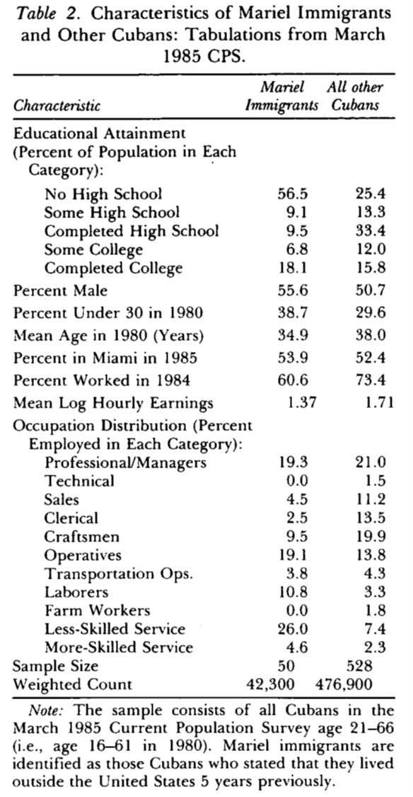
```

:::

::::


## Impactos en los ingresos

```{r, out.width="70%",fig.cap='Fuente: Card (1990)',fig.align='center'}
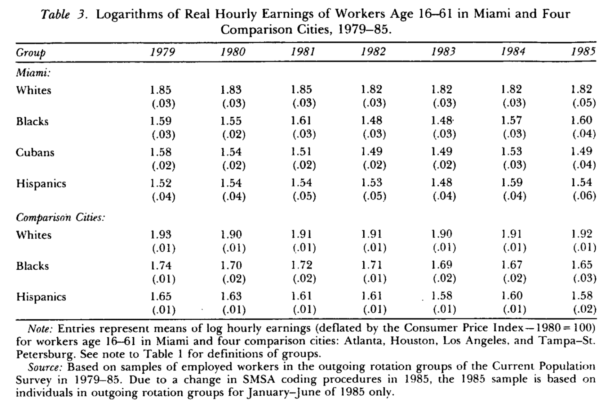
```


## Impactos en el empleo

```{r, out.width="70%",fig.cap='Fuente: Card (1990)',fig.align='center'}
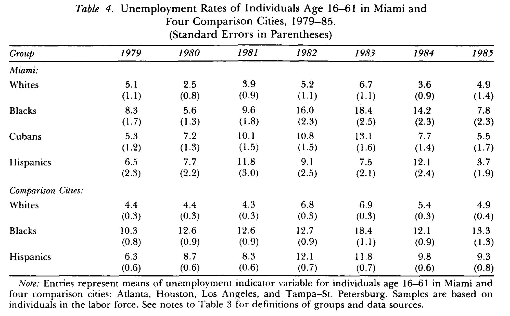
```

## Conclusión sobre los marieles
	 
- Al comparar las tendencias en empleo y salarios con las de este conjunto de ciudades Card concluye que la llegada de inmigrantes no tuvo ningún efecto negativo

- Tampoco encuentra evidencia de que la distribución de ingresos de los no cubanos se hubiera hecho más desigual

- Tampoco hubo efectos concentrados en los grupos menos educados

- Se concluye que Miami tuvo la capacidad para absorber el choque de oferta de trabajo sin efectos en el resto del empleo


## ¿Cómo escogemos las unidades de comparación?

- Los estudios de caso comparativos se usan cuando una política o programa se lleva a cabo a nivel agregado y afecta a unas pocas (a veces una) unidades


- En otras ciencias sociales los estudios de caso comparativos regularmente se realizan mediante un análisis detallado de las condiciones institucionales, políticas e históricas de la unidad tratada

- En inferencia causal, cuando empleamos DID, usamos un grupo de unidades de comparación
 
- ¿Cómo podemos saber qué tan buena es la unidad de comparación como contrafactual para reproducir lo que le hubiera pasado a la unidad tratada de no haber recibido el tratamiento?


## Extender DID sistemáticamente
	 
- El control sintético (CS) permite hacer estudios de caso comparativos de manera sistemática

- Con las características de las unidades no tratadas se construye una unidad sintética

- La unidad sintética representa la trayectoria que hubiera seguido la unidad tratada de no haber sido tratada

- Podemos estimar el efecto causal al comparar la trayectoria de la unidad sintética con la trayectoria que efectivamente siguió la unidad tratada

- Es un método relativamente reciente con varias extensiones y mejoras sucediendo en nuestros días 


## ¿Lo único que podemos hacer son estudios cualitativos?

```{r, out.width="75%", fig.cap='Fuente: fotograma de *Scarface* (De Palma, 1983)', fig.align='center'}

```


 

## Aplicaciones del CS

- CS ha sido empleado para estudiar el efecto de algunas políticas (o eventos):
 
  - El impacto del terrorismo en el País Vasco

  - El efecto de una legislación contra el tabaco en California

  - El efecto sobre el crecimiento de la reunificación de Alemania

  - El efecto del flujo masivo de inmigrantes a Miami
  
  

# El modelo {.divider background-color="#9B2247" data-state="nochrome"}


## El modelo
 
- Tenemos $J+1$ unidades: la unidad $1$ es la tratada y $\{2,\ldots,J+1\}$ son las no tratadas (el *donor pool*)

- $t=1,\ldots,T$ periodos, de los cuales $1,\ldots,T_0$ son pre-intervención

- La intervención afecta solo a la unidad $1$, en los periodos $T_0+1,\ldots,T$

- $Y_{it}(1)$ es el resultado potencial de la unidad $i$ en $t$ si recibe la intervención y $Y_{it}(0)$ es su resultado potencial sin la intervención

- Asumimos que la intervención no tiene efecto antes de implementarse: $Y_{1t}(0)=Y_{1t}(1) \quad \forall t\in\{1,\ldots,T_0\}$

- El efecto del tratamiento es:

$$\alpha_1=\left(\alpha_{1T_0+1},\ldots, \alpha_{1T}\right)$$

con $\alpha_{1t}=Y_{1t}(1)-Y_{1t}(0)$ para $t>T_0$


## El modelo
 
- Consideremos un modelo bastante general para la variable de interés (modelo de factores):
		 
$$Y_{it}(0)=\delta_t+\theta_t Z_i + \lambda_t\mu_i+\varepsilon_{it}$$

  - $Z_i$ son variables no afectadas por la intervención
  
  - $\theta_t$ es un vector de parámetros (que varía en el tiempo)
  
  - $\delta_t$ son factores comunes desconocidos (efectos temporales en un modelo de panel)
  
  - $\mu_i$ es un vector de cargas factoriales no observadas (*unknown loadings*)
  
  - $\lambda_t$ son factores comunes no observables


 
- DID ocurre cuando $\lambda_t=\lambda$
 


## El modelo
 
- Considere un vector de pesos $W=\left(w_2,\ldots,w_{J+1}\right)'$, con $w_j \geq 0 \quad \forall j\geq 2$

- Los pesos están normalizados, $w_2+\ldots+w_{J+1}=1$
 
- Cada valor de $W$ representa un potencial CS, es decir, un promedio ponderado de las unidades no tratadas
 
- Como los donantes nunca son tratados, $Y_{jt}=Y_{jt}(0)$ en todo $t$, y la variable de resultados para un CS (definido por $W$) es:


$$
\begin{aligned}
Y_{Wt}(0)&=\sum_{j=2}^{J+1} w_j Y_{jt} \\
	&=\delta_t+\theta_t \left(\sum_{j=2}^{J+1} w_j Z_j\right) + \lambda_t \left(\sum_{j=2}^{J+1} w_j \mu_j \right) + \left(\sum_{j=2}^{J+1} w_j\varepsilon_{jt} \right)
\end{aligned}
$$

- Hay una infinidad de CS, pues hay una infinidad de maneras de asignar los pesos a las unidades no tratadas


## El control sintético replica el contrafactual
 
- Suponga que existe un vector de pesos $W^*$ tal que el CS replica la unidad tratada antes de la intervención

- Esto es, el control sintético replica la variable de resultados pre-intervención y las características no afectadas por la intervención

$$
\begin{aligned}
&\sum_{j=2}^{J+1} w^*_j Y_{jt}=Y_{1t} \quad \forall t\in\{1,\ldots,T_0\} \\
&\sum_{j=2}^{J+1} w^*_j Z_j=Z_1
\end{aligned}
$$


- Abadie, Diamond y Hainmueller (2010) muestran que, si $W^*$ reproduce la trayectoria pre-intervención y las $Z$ de la unidad tratada, el sesgo de $\hat{\alpha}_{1t}$ está acotado por un término que se hace pequeño cuando el número de periodos pre-intervención $T_0$ es grande en relación con la escala de los choques transitorios $\varepsilon_{it}$

- La intuición es que con muchos periodos pre-intervención, ajustar bien la trayectoria solo es posible si el CS también reproduce los factores no observados $\mu_1$, y no por azar en los choques


## El estimador del control sintético

- Por tanto, el efecto del tratamiento puede estimarse como:

$$\hat{\alpha}_{1t}=Y_{1t}-\sum_{j=2}^{J+1} w^*_j Y_{jt}=Y_{1t}-Y_{W^*t}(0)$$
para $t\in \{T_0+1,\ldots,T\}$

- El problema es que, en la práctica, no sabemos si existe un $W^*$ que replique exactamente a la unidad tratada, ni cuál es


 
## Estimación
 
- Necesitamos datos de panel pre y post intervención para la variable dependiente
 
- Necesitamos algunos puntos pre-intervención para las variables $Z$
 
- Requerimos suficientes periodos pre-intervención para asegurarnos de que el CS replica bien a la unidad tratada antes de la intervención
 
- ¿Cómo escogemos los pesos $W$?
 


## Estimación

- Definamos $X_1=(Z_1',\tilde{Y}_1^{K_1},\ldots,\tilde{Y}_1^{K_M})'$ el vector que colecciona las características de la unidad tratada pre-intervención

- En el vector $X_1$ permitimos que haya $M$ combinaciones lineales de la variable de resultados pre-intervención

- Una combinación lineal de la variable de resultados pre-intervención es

$$\tilde{Y}_i^K=\sum_{s=1}^{T_0}k_sY_{is},\quad\quad K=(k_1,\ldots,k_{T_0})'$$

- Por ejemplo, podemos incluir el valor de la variable de resultados en algunos años pre-intervención o el promedio de todos los años pre-intervención


- Tenemos lo mismo, pero para las unidades no tratadas, en la matriz $X_0$

- Definimos $X_1-X_0W$ como una medida de discrepancia entre $X_1$ y $X_0W$


## Estimación de pesos

- Planteamos entonces una función objetivo para minimizar las discrepancias

$$\min_{W\in\mathcal{W}}\;(X_1-X_0W)'V(X_1-X_0W)$$
donde $\mathcal{W}$ es el conjunto de vectores con $w_j\geq0$ y $\sum_j w_j=1$, y $V$ es una matriz simétrica y positiva semidefinida (en la aplicación, diagonal y positiva definida) 

- $V$ es de dimensión $(k\times k)$, con $r$ siendo el número de convariables en $Z$

- La solución a este problema, $W^*(V)$ depende de $V$

- $V$ es una matriz de pesos que refleja la importancia relativa de las variables en $X_1$ y $X_0$

- Siguiendo a Abadie y Gardeazabal (2003), podemos realizar un proceso que minimice la distancia entre el valor observado de la variable de resultados y el contrafactual definido por $W^*(V)$


## Estimación de pesos

- Definamos $\mathcal{Y}_1$ como el vector de variables de resultados en la unidad tratada para los periodos pre-intervención y $\mathcal{Y}_0$ a la matriz de las mismas variables para los no tratados

- Entonces, podemos encontrar la $V$ óptima como

$$V^*=\arg\min_{V\in\mathcal{V}}(\mathcal{Y}_1-\mathcal{Y}_0W^*(V))'(\mathcal{Y}_1-\mathcal{Y}_0W^*(V))$$

- Y entonces, los pesos para el control sintético estarán dados por $W^*(V^*)$


## Supuestos fundamentales

- **No anticipación**: la intervención no afecta el resultado antes de $T_0+1$
  - Si hubo anticipación (por ejemplo, la ley se anunció antes), podemos redefinir $T_0$ como el último periodo en que el resultado no pudo haber reaccionado

- **No interferencia**: la intervención en la unidad $1$ no afecta los resultados de los donantes
  - Con *spillovers*, el CS deja de ser un contrafactual válido por lo que conviene excluir del *donor pool* a las unidades expuestas

- **No hay choques idiosincráticos en los donantes**: en el periodo post, los donantes no reciben intervenciones parecidas ni choques grandes propios
  - Podemos excluir las unidades que adoptaron programas o leyes similares a la estudiada

- **Modelo para el contrafactual**: $Y_{it}(0)$ sigue (aproximadamente) el modelo de factores, que es lineal en $Z_i$ y $\mu_i$


## Consideraciones prácticas para implementar CS

- **Envolvente convexa**: las características pre-intervención de la unidad tratada deben poder reproducirse con un promedio ponderado de los donantes
  - Si la unidad tiene valores extremos, ningún CS la reproduce
  - Siempre se puede medir y se debe reportar qué tan bueno es el ajuste

- **Sesgo de interpolación**: aun con buen ajuste, promediar unidades muy distintas puede sesgar si la relación no es lineal
  -  Podemos limitar el *donor pool* a unidades parecidas a la tratada

- **Suficientes periodos pre-intervención**: con $T_0$ pequeño, un buen ajuste puede deberse al ruido (sobreajuste) y no a reproducir $\mu_1$

- **Suficientes periodos post-intervención**: si el efecto tarda en aparecer, requerimos suficientes periodos para distinguir el efecto respecto a la volatilidad del resultado 


# Ejemplo clásico: la Proposición 99 en California {.divider background-color="#9B2247" data-state="nochrome"}


## La Proposición 99 en California
 
:::: {.columns}

::: {.column width = "50%"}

- En 1988 se pusieron en marcha una serie de medidas en el estado de California para tratar de reducir el consumo de tabaco
 
- Las medidas incluyeron nuevos impuestos, campañas publicitarias, establecimiento de espacios libres de humo, etc.
 
- Para conocer el impacto de la medida en el consumo per cápita, Abadie, Diamond y Hainmueller (2010) construyen un CS
 
- ¿Qué pasaría si comparamos California con el resto de los estados de EUA?
:::


::: {.column width = "50%"}
```{r, out.width="100%",fig.cap='Fuente: Abadie, Diamond y Hainmueller (2010)',fig.align='center'}
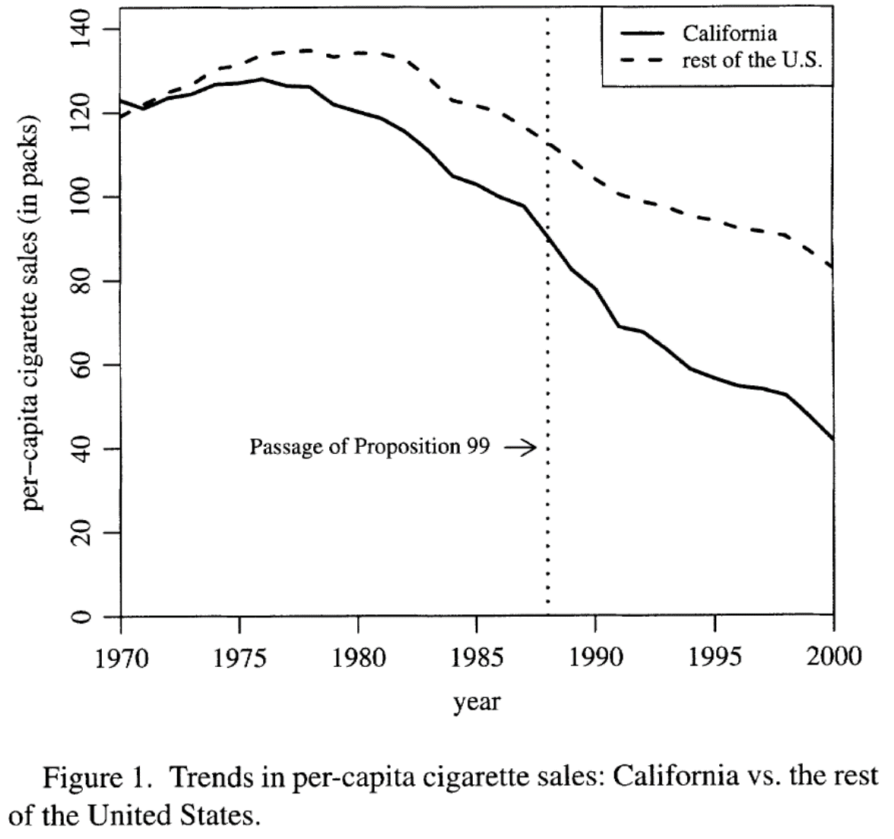
```

:::

::::


## California sintética
 
:::: {.columns}

::: {.column width = "50%"}
- Comparar a California con el resto de los estados no es lo más apropiado
 
- El consumo de tabaco ya venía cayendo en todo el país, pero en California la tendencia era más pronunciada
 
- La implementación del CS consiste en escoger a los estados no tratados de forma que puedan reproducir el comportamiento de California antes de la Proposición 99

:::

::: {.column width = "50%"}
```{r, out.width="100%",fig.cap='Fuente: Abadie, Diamond y Hainmueller (2010)',fig.align='center'}
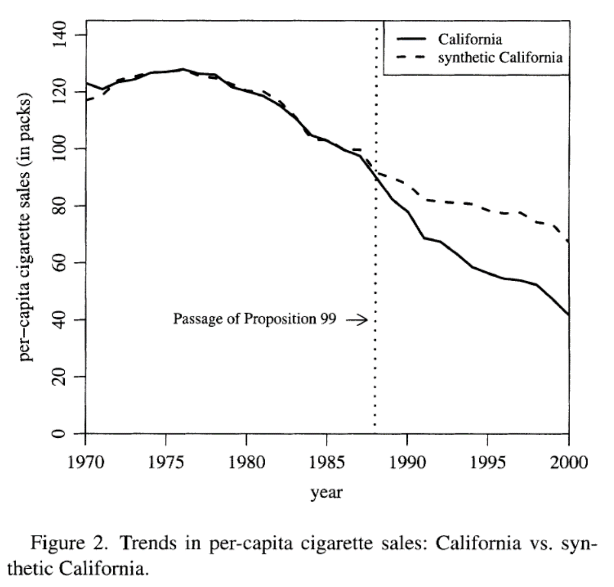
```

:::

::::


## El CS se parece más a California
:::: {.columns}

::: {.column width = "50%"}

- Al escoger los pesos apropiadamente el CS es más parecido a California que lo que era el promedio de todos los demás estados

:::


::: {.column width = "50%"}

```{r, out.width="100%",fig.cap='Fuente: Abadie, Diamond y Hainmueller (2010)',fig.align='center'}
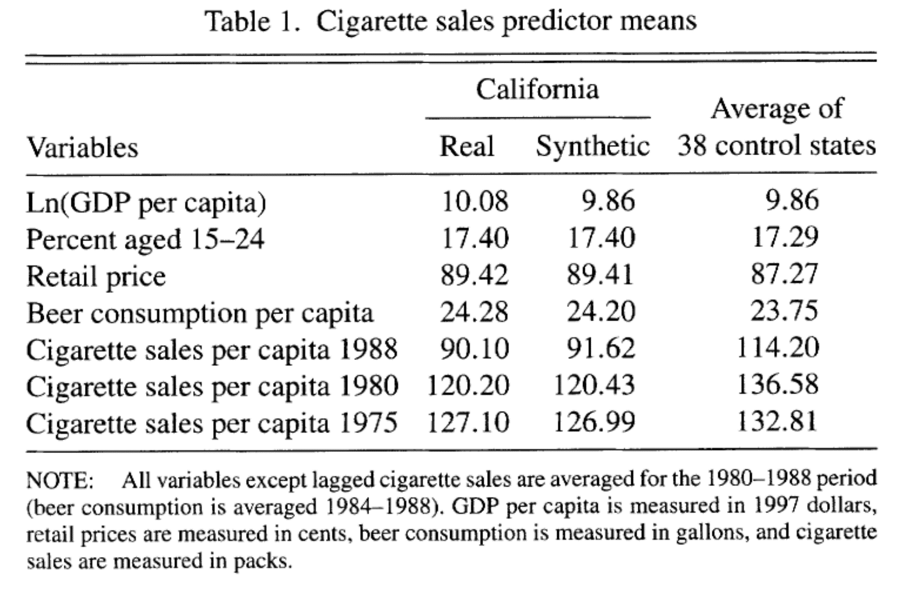
```

:::

::::

## Pesos estimados

- El control sintético se caracteriza por un vector de pesos

- Muchas unidades no contribuyen a la construcción del contrafactual

- Tenemos un método que nos permite asignar estos pesos de manera sistemática y dando más peso a los estados más parecidos a California

```{r, out.width="80%",fig.cap='Fuente: Abadie, Diamond y Hainmueller (2010)',fig.align='center'}
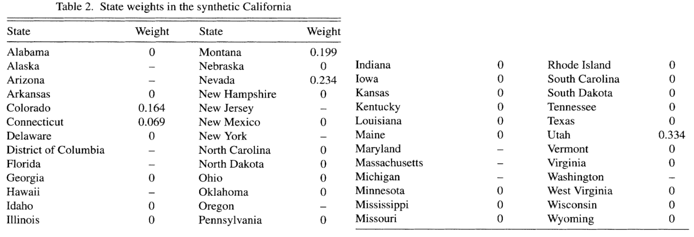
```


## Efecto del tratamiento
:::: {.columns}

::: {.column width = "50%"}

- El efecto del tratamiento está dado por la diferencia entre el consumo per cápita de cigarrillos en California y el del CS
 
- Esto es la distancia vertical entre las curvas
 
- Al graficar las diferencias obtenemos una gráfica más clara del efecto del tratamiento

:::

::: {.column width = "50%"}
```{r, out.width="100%",fig.cap='Fuente: Abadie, Diamond y Hainmueller (2010)',fig.align='center'}
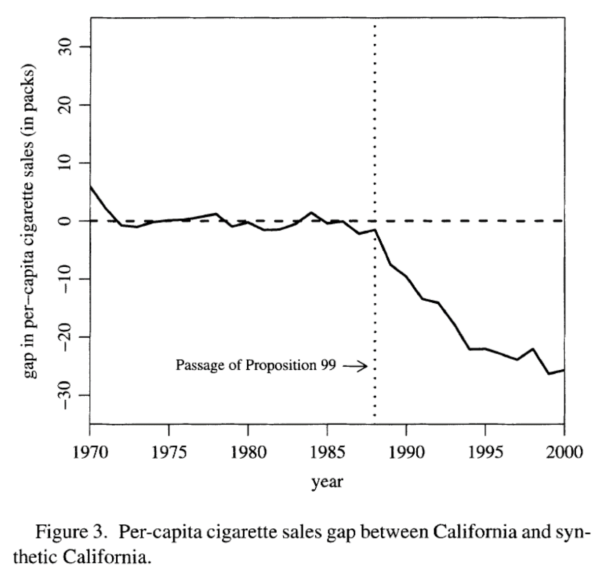
```

:::
::::


## Inferencia
 
- A diferencia de las técnicas basadas en regresión, aquí no tenemos errores estándar para hacer inferencia sobre si las diferencias son estadísticamente significativas
 
- Se propone hacer inferencia basada en placebos
 
- Para cada estado podemos estimar su CS
 
- Es una prueba placebo porque sabemos que para los demás estados no pasó una ley similar a la Proposición 99
 
- Para cada placebo obtenemos una gráfica del efecto del tratamiento como la anterior, aunque sabemos que este efecto debería ser cercano a cero
 


## Inferencia
:::: {.columns}

::: {.column width = "50%"}

- Analizamos qué tan común es ver efectos de la magnitud del encontrado con el CS de California

:::

::: {.column width = "50%"}
```{r, out.width="100%",fig.cap='Fuente: Abadie, Diamond y Hainmueller (2010)',fig.align='center'}
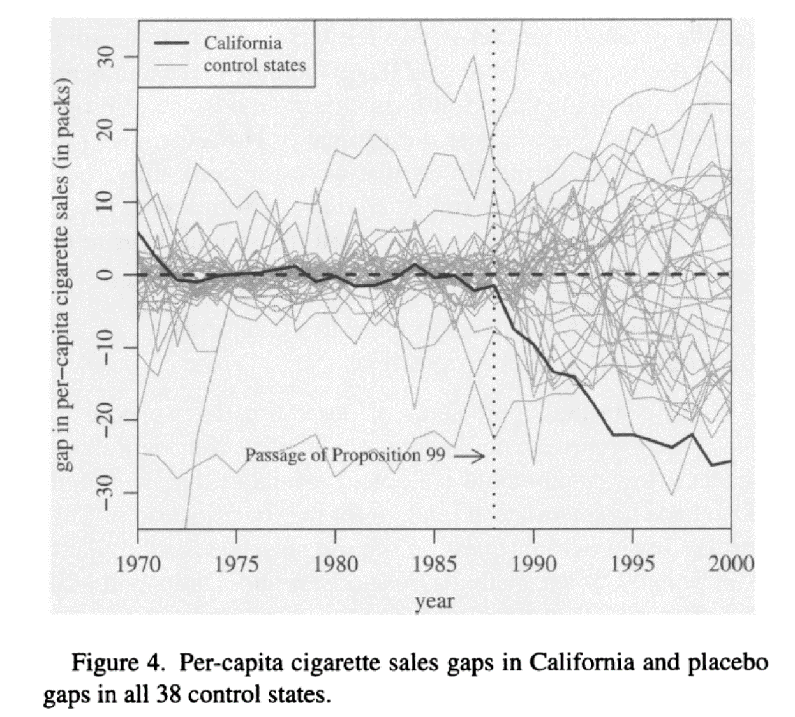
```

:::

::::


## Error de predicción cuadrado medio (MSPE)
:::: {.columns}

::: {.column width = "50%"}

- Medida del ajuste del CS estimado

- Promedio de las discrepancias cuadradas entre la unidad verdadera y su CS

$$r_{j}^{MSPE}=\frac{MSPE_{post}}{MSPE_{pre}}=\frac{\frac{1}{T-T_0}\sum_{t>T_0}\left(Y_{jt}-\hat{Y}_{jt}(0)\right)^2}{\frac{1}{T_0}\sum_{t\leq T_0}\left(Y_{jt}-\hat{Y}_{jt}(0)\right)^2}$$

- En esta aplicación $r_1^{MSPE}\approx130$

:::

::: {.column width = "50%"}

- Podemos ver la distribución de $r_j^{MSPE}$:

```{r, out.width="100%",fig.cap='Fuente: Abadie, Diamond y Hainmueller (2010)',fig.align='center'}
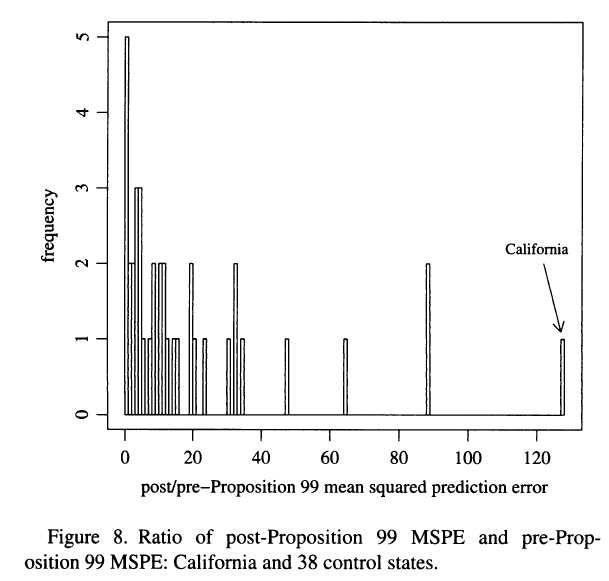
```

:::

::::


## Inferencia por permutación
:::: {.columns}

::: {.column width="50%"}

- Para cada unidad $j$, estimamos su CS y su $r_j^{MSPE}$

- Obtenemos un valor $p$ definido como la proporción de unidades con un ratio al menos tan grande como el de la unidad tratada

$$p=\frac{1}{J+1}\sum_{j=1}^{J+1}\mathbb{1}\left\{r_j^{MSPE}\geq r_1^{MSPE}\right\}$$

- California tiene el mayor ratio de las 39 unidades: $p=1/39\approx0.026$

:::

::: {.column width="50%"}

- Es la probabilidad de un efecto así de grande si la intervención se asignara al azar entre los estados

- **Placebos con mal ajuste** no son informativos, por lo que se sugiere eliminar los CS placebo con un MSPE grande

- **Placebos en el tiempo**: se impone la intervención antes de $T_0$ y no se espera encontrar ningún efecto

- **Dejar uno fuera**: se quita cada donante con peso positivo; el resultado no debe depender de uno solo

:::

::::
	 

# Otros estudios que usan control sintético {.divider background-color="#9B2247" data-state="nochrome"}


## La reunificación de Alemania
 
- En 1989 cae el muro de Berlín
 
- Alemania comienza una transición para convertirse en una sola nación
 
- ¿Cuál es el efecto de este evento político en la economía de Alemania Occidental?
 
- Abadie, Diamond y Hainmueller (2015) construyen una Alemania sintética a partir de pesos asignados a Austria, Japón, Holanda, Suiza y Estados Unidos

```{r, out.width="55%",fig.cap='Fuente: Abadie, Diamond y Hainmueller (2015)',fig.align='center'}
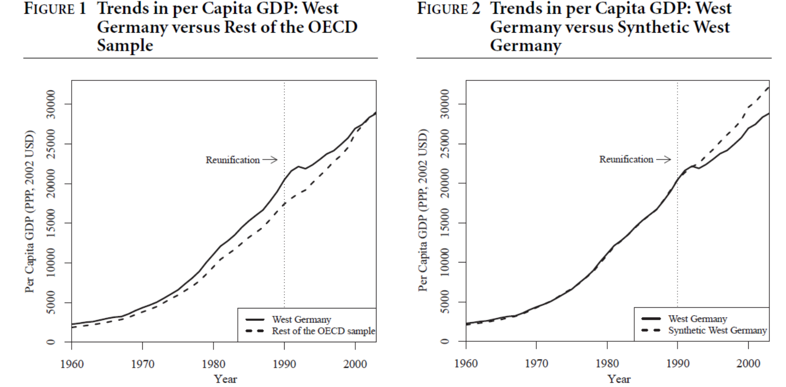
```


## El terrorismo en el País Vasco
:::: {.columns}

::: {.column width = "50%"}

- Desde finales de los 60 ETA comenzó una serie de ataques terroristas
 
- El propósito de ETA era promover la independencia del Estado vasco
 
- Usando características económicas de otras regiones de España se construye un CS
 
- Tras el inicio del terrorismo, el PIB per cápita del País Vasco cae alrededor de 10 puntos porcentuales respecto a su CS

:::

::: {.column width = "50%"}

```{r, out.width="100%",fig.cap='Fuente: Abadie y Gardeazabal (2003)',fig.align='center'}
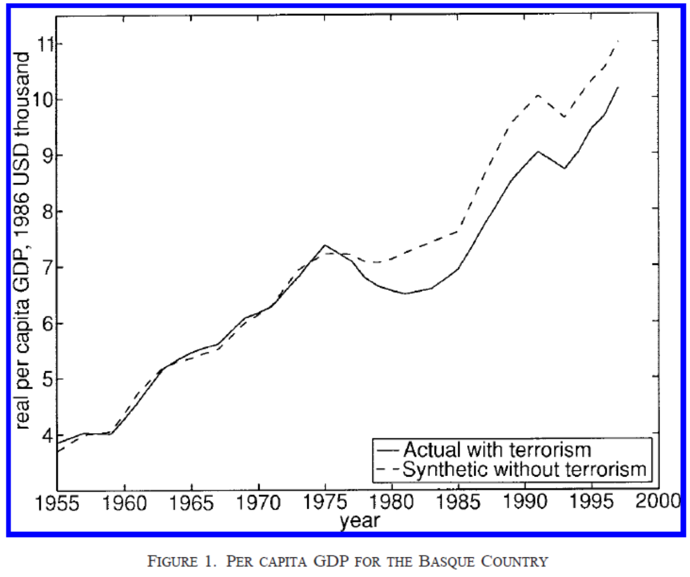
```

:::

::::


# Control sintético con más de una unidad tratada {.divider background-color="#9B2247" data-state="nochrome"}


## El valor de las conexiones en tiempos turbulentos
	 
- En medio de la crisis financiera de 2008 el entonces presidente electo Barack Obama nominó a Tim Geithner como Secretario del Tesoro
 
- Justo después de su nombramiento, los rendimientos de muchas empresas en las bolsas mostraron una repentina tendencia al alza
 
- Semanas después de haberse anunciado, se rumoró que un problema de impuestos podría impedirle a Geithner tomar el cargo, produciéndose el efecto contrario en el valor de las acciones
 
- Acemoglu et al. (2016) estudian si existe una relación entre las empresas *conectadas* con Geithner y los precios de las acciones
	 


## Control sintético con más de un tratado
	 
- Los autores identifican las empresas *conectadas* con Geithner
 
- De 603 empresas financieras en la muestra, los autores identifican 63 con algún tipo de conexión con Geithner
 
- Esto permite construir una unidad sintética para cada una de las unidades tratadas a partir del grupo de donantes
 
- La idea es repetir lo que hemos visto en los ejemplos anteriores pero tantas veces como unidades tratadas existan
	 


## Medida de rendimiento anormal acumulado
:::: {.columns}

::: {.column width = "50%"}
- Para cada tratado se calculan los rendimientos anormales como la diferencia entre los rendimientos verdaderos y los rendimientos de la unidad sintética
 
- Se promedian los rendimientos anormales

$$\hat{\phi}(\tau,k)=\frac{\sum_{i\in \text{tratados}} \frac{\sum^{k}_{t=0} (R_{it}-\hat{R}_{it})}{\hat{\sigma}_i}}{\sum_{i\in \text{tratados}} \frac{1}{\hat{\sigma}_i}}$$
	 
	
con $\hat{\sigma}_i=\sqrt{\frac{1}{T_0}\sum_{t=1}^{T_0}\left(R_{it}-\hat{R}_{it}\right)^2}$

- Se encuentran rendimientos anormales en los primeros 10 días de entre 6 y 12%

:::

::: {.column width = "50%"}

```{r, out.width="100%",fig.cap='Fuente: Acemoglu et al. (2016)',fig.align='center'}
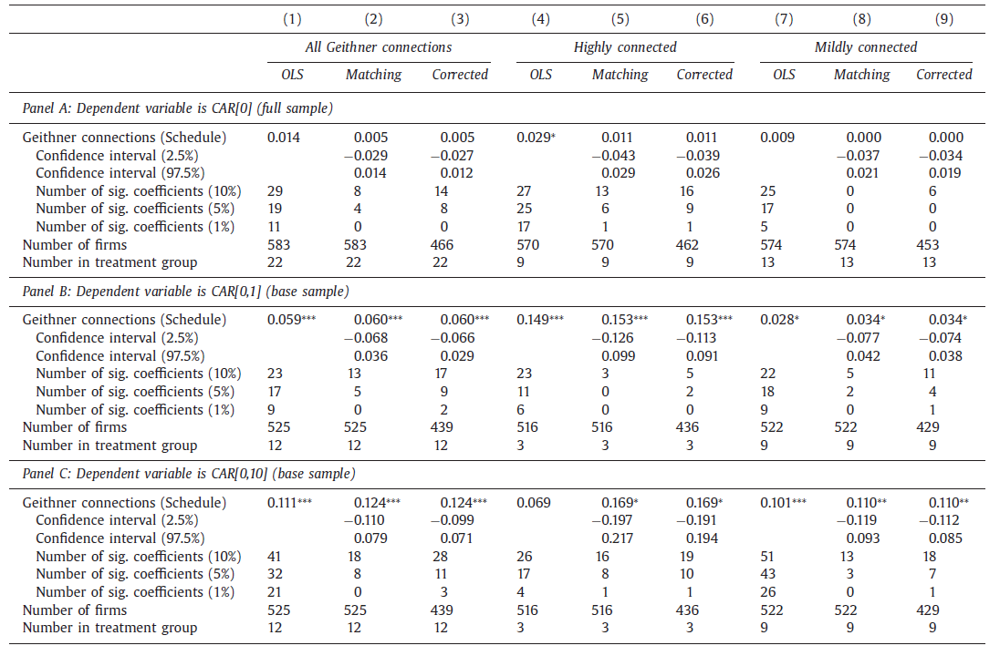
```

:::

::::

## Inferencia
	 
- Se obtienen 5 mil remuestreos de grupos de tratamiento placebo del mismo tamaño que el grupo tratado

- Se calculan los rendimientos anormales en cada muestra placebo

- El efecto estimado es significativo al 5% si no pertenece al intervalo que contiene los percentiles $[2.5, 97.5]$ de los efectos placebo


# Extensiones {.divider background-color="#9B2247" data-state="nochrome"}


## DID sintético

- Arkhangelsky et al. (2021) combinan las ideas de DID y del CS

- Se estiman pesos para las unidades de control, $\hat\omega_i$, como en el CS, y pesos para los periodos pre-intervención, $\hat\lambda_t$, que dan más importancia a los periodos parecidos a los posteriores

- El efecto se obtiene con una regresión de efectos fijos de dos vías ponderada:

$$\left(\hat{\tau},\hat{\mu},\hat{\alpha},\hat{\beta}\right)=\arg\min_{\tau,\mu,\alpha,\beta}\sum_{i=1}^{N}\sum_{t=1}^{T}\left(Y_{it}-\mu-\alpha_i-\beta_t-D_{it}\tau\right)^2\hat{\omega}_i\hat{\lambda}_t$$


- Con pesos uniformes es DID; sin efectos fijos de unidad ni pesos de tiempo, es (casi) el CS

- A diferencia del CS:
  - los efectos fijos $\alpha_i$ permiten que el CS difiera de la tratada en un nivel constante: basta reproducir la tendencia
  - admite varias unidades tratadas que empiezan el tratamiento al mismo tiempo


## Control sintético aumentado

- Si el ajuste pre-intervención no es bueno, el CS puede estar sesgado, y en la práctica el ajuste casi nunca es perfecto

- Ben-Michael, Feller y Rothstein (2021) corrigen el sesgo con un modelo de resultados $\hat{m}_t(\cdot)$, por ejemplo, una regresión *ridge* de los resultados post en los pre, estimada con los donantes:

$$\hat{Y}_{1t}^{aug}(0)=\sum_{j=2}^{J+1} \hat{w}_j Y_{jt}+\left(\hat{m}_t(X_1)-\sum_{j=2}^{J+1} \hat{w}_j\, \hat{m}_t(X_j)\right)$$

- El término entre paréntesis estima el sesgo debido al desbalance que deja el CS

- Es la misma lógica que la corrección de sesgo en *matching* y que los métodos doblemente robustos

- El costo: los pesos implícitos pueden ser negativos, es decir, hay algo de extrapolación, pero controlada por la penalización


## Control sintético penalizado

- Cuando hay muchos donantes (o muchas unidades tratadas, con datos desagregados), la solución del CS puede no ser única y puede promediar unidades muy distintas a la tratada

- Abadie y L'Hour (2021) agregan una penalización por la distancia entre la unidad tratada y cada donante que recibe peso:

$$\min_{W\in\mathcal{W}}\;\left\|X_1-\sum_{j=2}^{J+1}w_jX_j\right\|^2+\lambda\sum_{j=2}^{J+1}w_j\left\|X_1-X_j\right\|^2$$

- Con $\lambda\to0$ se obtiene el CS; con $\lambda\to\infty$, *matching* con el vecino más cercano

- Para $\lambda>0$ la solución es única y rala (pocos donantes con peso positivo), y se reduce el sesgo de interpolación

- $\lambda$ se escoge con validación cruzada, por ejemplo, con los periodos pre-intervención


## El papel de las covariables

- En la práctica, $X_1$ y $X_0$ mezclan covariables $Z$ y resultados pre-intervención, y los resultados pueden cambiar según qué predictores se incluyan

- Kaul et al. (2022): si se incluyen **todos** los resultados pre-intervención como predictores, las covariables reciben peso cero en $V^*$ y se vuelven irrelevantes
  - Hay que escoger: todos los rezagos del resultado, o algunos rezagos con covariables

- Botosaru y Ferman (2019): la cota del sesgo de ADH supone balance perfecto en covariables y en resultados pre
  - Sin balance en covariables aún se puede acotar el sesgo, pero con supuestos más fuertes y una cota más holgada
  - Un ajuste perfecto en los resultados pre **no** implica balance en las covariables, aunque estas sean relevantes: hay que revisarlo

- Recomendación: decidir la especificación antes de ver los resultados post y reportar la robustez a especificaciones alternativas


# Conclusión {.divider background-color="#9B2247" data-state="nochrome"}


## Los marieles nuevamente
:::: {.columns}

::: {.column width = "50%"}
- Usamos el estudio de Card (1990) sobre el impacto de los marieles en la economía de Miami

- Criticamos la selección del grupo de comparación

- Peri y Yasenov (2019) construyen un Miami sintético para estimar el efecto de los marieles

- Muestran que las conclusiones de Card en general se sostienen, aunque Borjas (2017) encuentra que, con otra muestra, sí se encuentran caídas salariales

:::

::: {.column width = "50%"}

```{r, out.width="100%",fig.cap='Fuente: Peri y Yasenov (2019)',fig.align='center'}
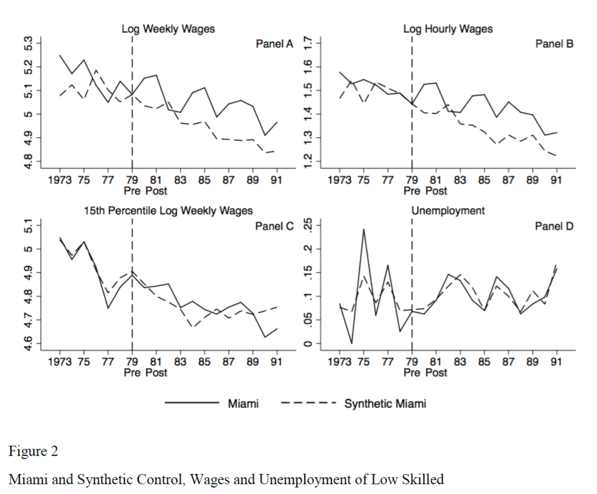
```

:::

::::


## Conclusión

- La construcción del CS se basa en lo que dicen los datos (*data driven*) para la selección de las unidades que son usadas y los pesos
 
- El investigador debe ser transparente al mostrar qué tan bueno es el CS que construye
 
- Para construir el CS no se usan los datos post-intervención por lo que, al menos en teoría, el investigador no debería seleccionar el CS guiado por las conclusiones que resultan


# Control sintético {.final background-color="#9B2247" data-state="nochrome"}

::: {.f-eyebrow}
Inferencia Causal
:::

::: {.f-inst}
[Irvin Rojas](https://rojasirvin.github.io/)
:::

::: {.f-inst}
CIDE · Maestría en Economía
:::

<span class="f-icons"><a href="https://github.com/rojasirvin" target="_blank" aria-label="GitHub"><i class="bi bi-github"></i></a> <a href="https://scholar.google.com/citations?hl=es&user=FUwdSTMAAAAJ&view_op=list_works&sortby=pubdate" target="_blank" aria-label="Google Scholar"><i class="bi bi-mortarboard-fill"></i></a> <a href="mailto:irvin.rojas@cide.edu" aria-label="Correo"><i class="bi bi-envelope-fill"></i></a></span>

::: {.f-rule}
:::

::: {.f-copy}
© 2026 Irvin Rojas. Distribuido bajo licencia Creative Commons **CC BY-NC-SA 4.0**. Los materiales de terceros citados conservan sus propios derechos.
:::
